# Reservas de Campos

[](https://github.com/rodrigo4sousa/SportsEstablishments/actions/workflows/ci.yml)


A web application for booking sports pitches and courts (futsal, 7-a-side football, padel, tennis) at clubs in Portugal. Players search clubs and book free slots; owners run their clubs, pitches, schedules and bookings; the platform admin sees only aggregate numbers. It is one Next.js app with three areas on top of an ASP.NET Core API and a PostgreSQL database. The user interface is in European Portuguese (pt-PT), and so are the product name and the UI strings quoted in the docs; the code, the commits and this README are in English.

> **Online demo:** <https://sports-establishments.vercel.app/>. It is a demo that may be taken offline at any time. The API runs on a free plan that sleeps when idle, so the first request can take about a minute. The demo accounts share a public password (see [Run locally](#run-locally)): never use it for a real account.

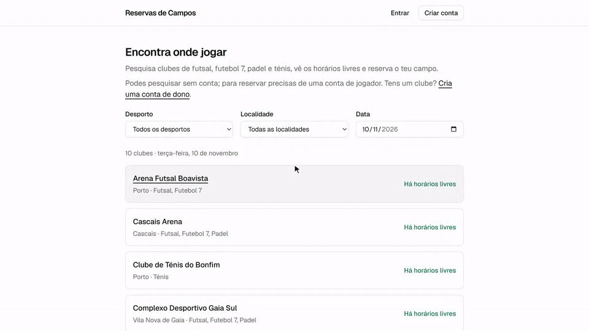

Recorded locally with the demo seed data.

## Screenshots

With the demo data. What each image shows and how they were made: [`docs/images`](docs/images/README.md).

| Club search | Club page | Weekly booking summary | My bookings |
|:---:|:---:|:---:|:---:|
| 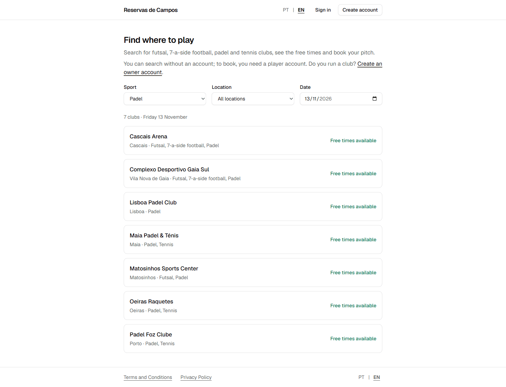 | 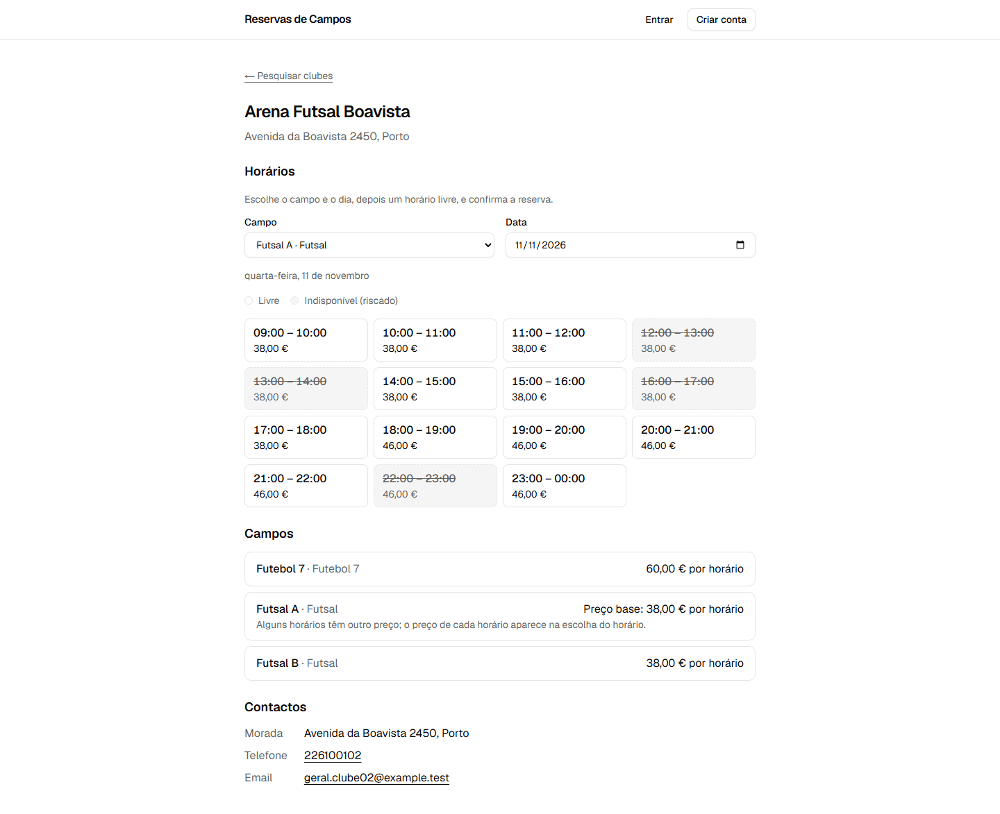 | 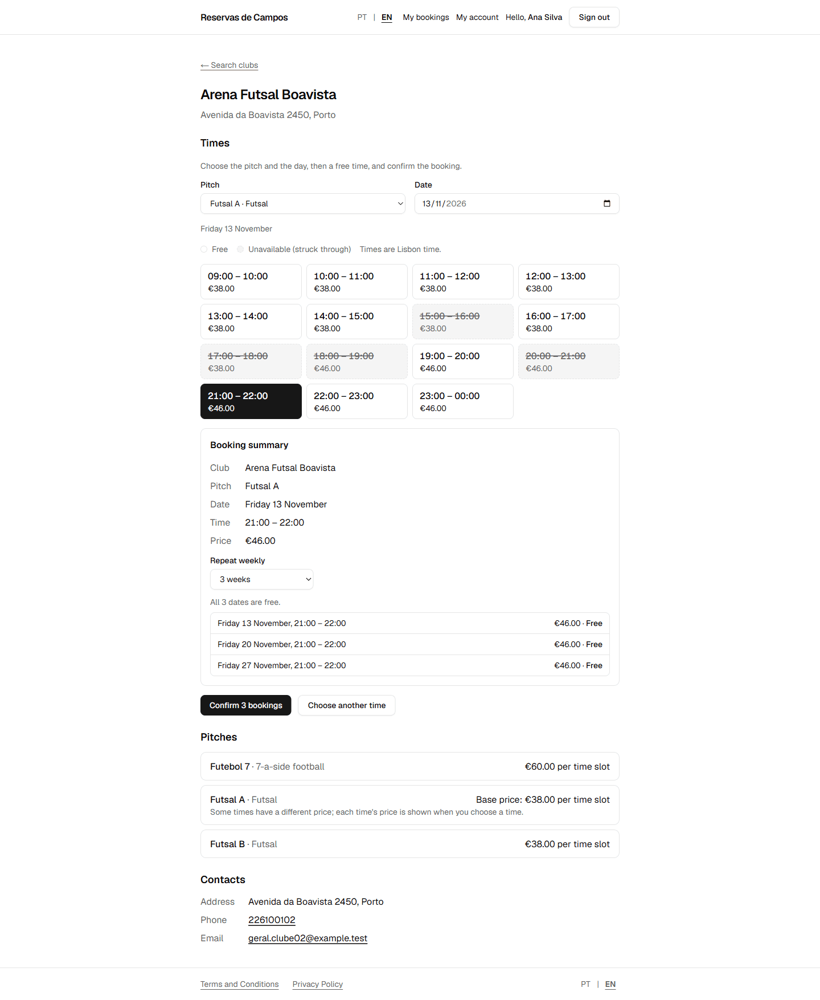 | 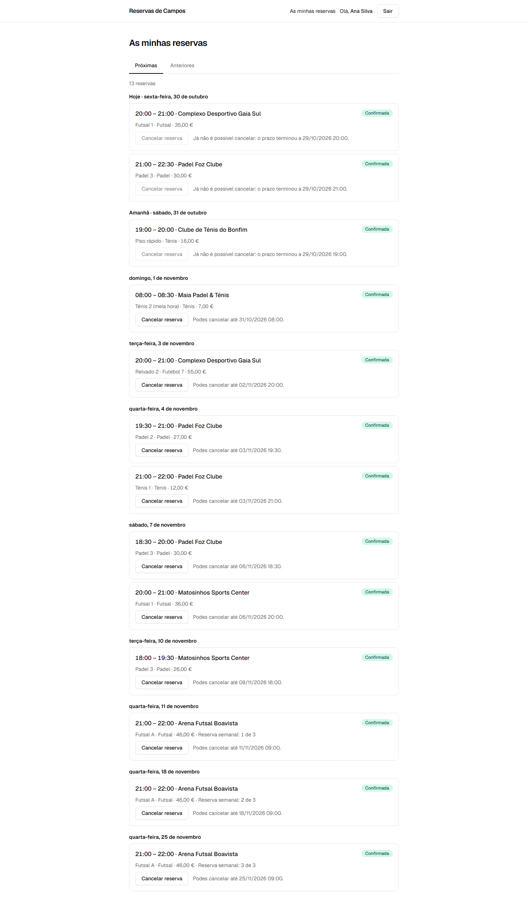 |

| Owner calendar | Club statistics | Admin dashboard | Admin: registrations and occupation |
|:---:|:---:|:---:|:---:|
| 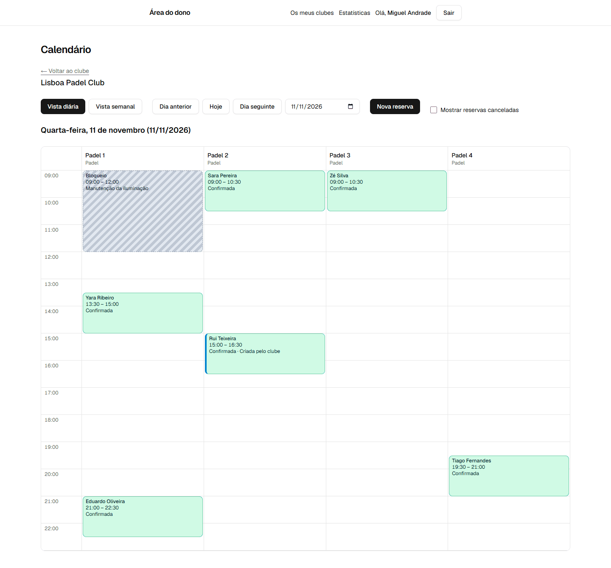 | 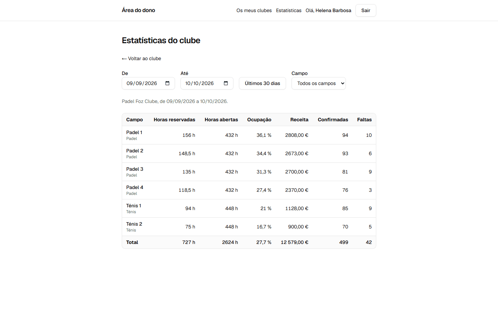 | 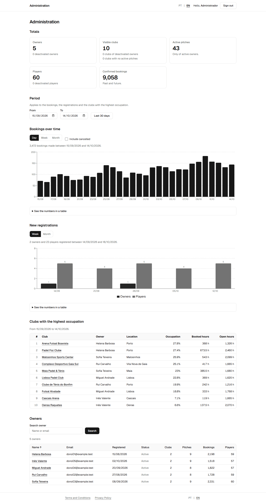 | 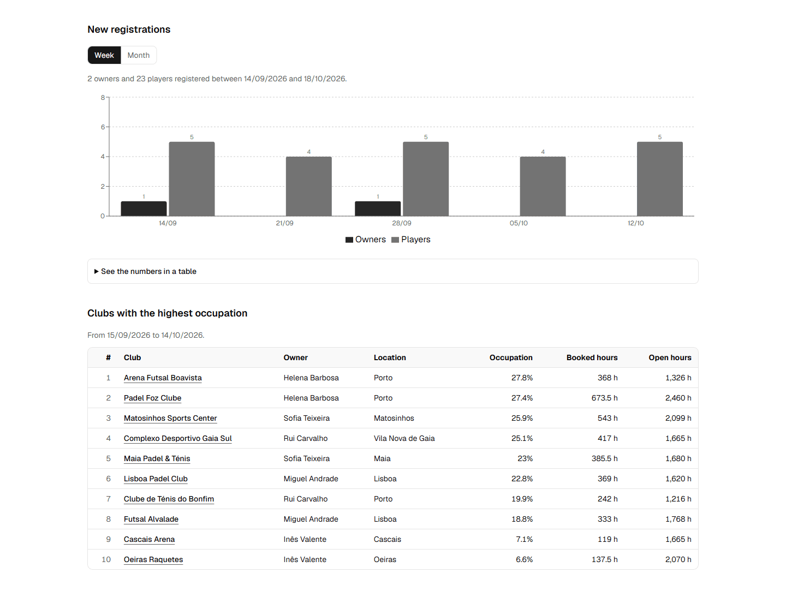 |

## Features

The stories and their acceptance criteria are in the [backlog](docs/backlog.md). It is a single marketplace: one player account works at every club of every owner.

**Player** (`/`)

- Search clubs by sport, locality and date, and see each pitch's free slots with their price (US16, US17). Without an account a visitor can only look; to book, they sign in and come back to the same choice.
- Sign-up, login and password recovery (US01, US03, US05).
- "A minha conta": download your own data as a JSON file and delete your account, with your password (US30). Future bookings are cancelled, personal data is removed and past bookings stay for the clubs without identifying you.
- Book a slot from today up to 30 days ahead, at the price of that moment (US18), and repeat the booking weekly for 2 to 4 weeks (US20).
- See upcoming and past bookings and cancel within the club's cancellation window (US19).
- Emails: confirmation and cancellation, a reminder before the booking, and a summary of a series (US21, US22).

**Owner** (`/manage`)

- Sign-up; clubs, pitches, weekly opening hours, slot length, blocks and price bands (US02, US06 to US10).
- A daily and weekly calendar, cancellation with a reason, bookings for customers without an account, and no-show marking (US11 to US13, US15).
- Occupation and revenue per club and pitch (US14), and an email for each new booking (US23).

**Admin** (`/admin`)

- The account is created only from configuration at startup, never through an endpoint (US04).
- Totals, bookings and registrations over time, the clubs with the highest occupation and the list of owners (US24 to US28). The admin never sees a player's name, email or phone.
- Deactivate and reactivate owners, with a reason and an append-only history (US29).

## Tech stack

Next.js 16.4 (App Router), React 19.3, TypeScript 5.9, Tailwind CSS 4.3 and shadcn/ui, TanStack Query, React Hook Form and Zod; ASP.NET Core 10 with controllers, EF Core 10 and Npgsql, ASP.NET Core Identity, FluentValidation and MailKit; PostgreSQL 18. The API types used by the front end are generated from the OpenAPI document. Tests use xUnit v3, Shouldly, Testcontainers, Vitest and MSW. Docker Compose, GitHub Actions and PlantUML. Exact versions are in [`frontend/package.json`](frontend/package.json), [`backend/Directory.Packages.props`](backend/Directory.Packages.props), [`global.json`](global.json) and [`docker-compose.yml`](docker-compose.yml); the reasons for the choices are in the [Stack document](docs/stack.md).

## Architecture

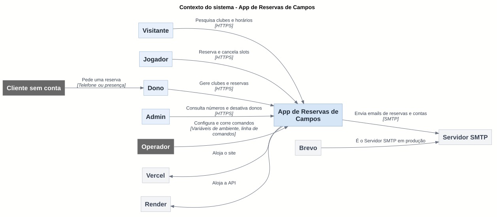

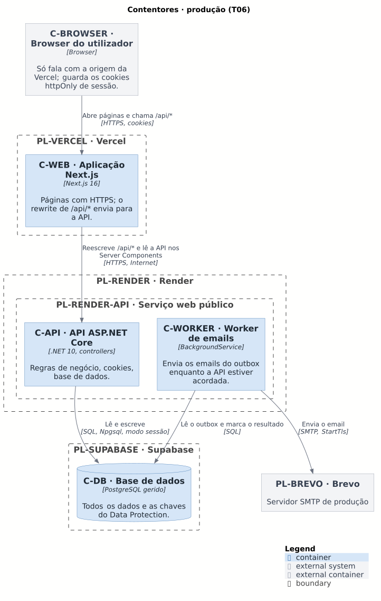

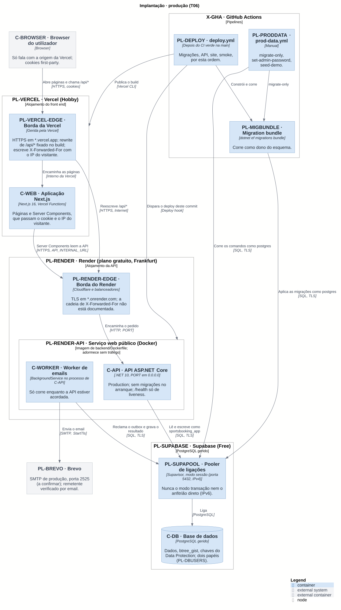

Context, containers in production and deployment in production. The diagram labels are in Portuguese. All the views (C4 and 4+1), the element inventory and the decisions are in [`docs/architecture`](docs/architecture/README.md).

The main decisions:

- **Clean Architecture** in the back end, in four projects with dependencies pointing only inwards (Api → Infrastructure → Application → Domain). The Application layer uses `IAppDbContext`; there is no generic repository. See the [logical view](docs/architecture/4plus1/logical.md).
- **No double bookings, enforced by the database.** A PostgreSQL exclusion constraint (`bookings_no_overlap`) prevents two confirmed bookings of the same pitch from overlapping, and its violation becomes a 409. Blocking and booking first take a lock on the pitch row. A test sends 20 simultaneous requests for the same slot. [ADR 0003](docs/architecture/adr/0003-booking-exclusion-constraint.md).
- **Emails through an outbox.** The message is written in the same transaction as the booking or the cancellation, and a worker inside the API sends it later, with `SKIP LOCKED` and retries. [ADR 0004](docs/architecture/adr/0004-outbox-for-emails.md).
- **Session in httpOnly cookies, on one origin.** Next.js rewrites `/api/*` to the API, so the browser knows a single origin, the cookies are first-party and there is no CORS. A 15-minute JWT and a rotating refresh token, out of reach of the page's JavaScript. [ADR 0002](docs/architecture/adr/0002-session-in-httponly-cookies.md).
- **Slots are computed, not stored**, in blocks of real elapsed time, correct on clock-change days. [ADR 0007](docs/architecture/adr/0007-calculated-slots.md).

## Deployment

In production since 2026-11-09: the site on Vercel, the API and the email worker in one Render service, PostgreSQL on Supabase, email through Brevo and the pipelines on GitHub Actions. The decision is in [ADR 0009](docs/architecture/adr/0009-deployment-target.md) and the manual steps in the [runbook](docs/deployment/runbook.md); the settings are in [environment-variables.md](docs/deployment/environment-variables.md). The deploy runs after CI is green on `main`, and only if the `DEPLOY_ENABLED` variable is `true`.

Everything runs on free plans, and that has costs: the API sleeps when idle, and the worker only sends emails while it is awake; the Supabase free plan has no automatic backups; without a domain of its own, the `*.vercel.app` and `*.onrender.com` addresses are used; and the per-IP limits are best-effort, because the API is public. The data is demo data.

## Testing

Counted on 2026-11-09:

- **Back end:** 1410 tests, all passing (`dotnet test backend/SportsBooking.slnx`): 553 unit and 857 integration. The integration tests run against a real PostgreSQL 18 with Testcontainers; they need Docker, and without it they all fail. None uses the in-memory EF Core provider.
- **Front end:** 1171 tests passing (`npm test`, in `frontend/`): Vitest, Testing Library and MSW.
- **End-to-end:** 4 Playwright tests (Chromium) in `e2e/`, run against the docker compose stack with the demo data in their own workflow ([`e2e.yml`](.github/workflows/e2e.yml)); see [Running the E2E tests](#running-the-e2e-tests). Other UI changes are checked by hand in the browser.

```bash
dotnet build backend/SportsBooking.slnx     # warnings are errors; regenerates the OpenAPI document
dotnet test backend/SportsBooking.slnx
cd frontend && npm ci && npm run lint && npm run typecheck && npm test && npm run build
npm run gen:api                              # in frontend/, after a back end build
```

[CI](.github/workflows/ci.yml) runs three jobs on every push and pull request: the back end (build, tests, OpenAPI up to date, no EF model change without a migration, vulnerable packages), the front end (lint, types, tests, build, API types up to date, `npm audit` of production dependencies) and the diagrams (renders them and fails if an SVG changed). `main` has no branch protection: the CI result is checked by hand before every merge.

### Running the E2E tests

Four Playwright tests (Chromium only) check the main flows through the real stack: a player books and cancels, two players want the same slot (the second gets the conflict), an owner sees the booking in the calendar while an unknown club answers 404, and a new user exports their data, deletes the account and can no longer sign in. They need Docker, Node.js 22, and ports 3000 and 5080 free (stop `docker compose up` first; the E2E stack is its own compose project, `sportsbooking-e2e`, with its own database volume, and never touches a development stack).

```bash
cd e2e
npm ci
npx playwright install chromium     # first time; on Linux add --with-deps
npm run e2e                         # builds the stack, seeds the demo data, runs the tests, removes the stack
```

Or step by step, to run the tests again against the same stack: `npm run stack:up`, then `npm test` (or `npm run test:headed`, `npm run report` for the HTML report), then `npm run stack:down`. The tests use the public demo accounts (and one throwaway account per run), book the first free slot from day 20 ahead on and cancel what they book, so they can run repeatedly on the same database; they refuse to run against any address that is not `localhost`. The workflow [`e2e.yml`](.github/workflows/e2e.yml) does the same on every pull request and push to `main`, separately from CI (the deploy does not wait for it), and uploads the report, traces and videos when it fails. Decision: [ADR 0010](docs/architecture/adr/0010-playwright-end-to-end-tests.md).

## Run locally

You need Docker with Compose v2.

```bash
cp .env.example .env          # optional: local values; this is where the admin is set
docker compose up --build
```

| Service | URL |
| --- | --- |
| Web app | http://localhost:3000 |
| API | http://localhost:5080 (`/health`) |
| Swagger (Development only) | http://localhost:5080/swagger |
| Mailpit (development inbox) | http://localhost:8025 |
| PostgreSQL | `localhost:5432` (user, password and database `sportsbooking`) |

In Development the API applies the migrations at startup. The data lives in the database volume; `docker compose down -v` deletes it.

**Demo data.** With the stack running, on an empty database:

```bash
docker compose run --rm api seed-demo
```

It creates 5 owners, 60 players, 10 clubs, 43 pitches, 5 blocks and more than 10 000 bookings (10 612 on 2026-11-09), around Porto and Lisboa, without sending any email, and it refuses if an owner or a player already exists. The addresses are `dono01@example.test` to `dono05@example.test` and `jogador01@example.test` to `jogador60@example.test`, and **every account has the same password, `demo-password-1`, which is public and only meant for development**.

**Admin account.** Set `ADMIN_SEED_EMAIL` and `ADMIN_SEED_PASSWORD` (8 or more characters) in `.env`: the API creates the admin at startup, if there is none yet. With neither set it starts without an admin and logs a warning; with only one set it refuses to start. The seed never changes an admin that already exists, never creates a second one, and never promotes a player or an owner account.

**Changing the admin password.** The `set-admin-password` command changes it, ends all the admin's sessions and exits without starting the server. The new password only comes from the `ADMIN_NEW_PASSWORD` environment variable, never from the command line, and is never printed or logged. It exits with 0 if it changed and with 1 if it refused and changed nothing.

```bash
read -rs ADMIN_NEW_PASSWORD && export ADMIN_NEW_PASSWORD
docker compose run --rm -e ADMIN_NEW_PASSWORD api set-admin-password
unset ADMIN_NEW_PASSWORD
```

The production settings (JWT key, allowed origins, SMTP, database roles) are in [environment-variables.md](docs/deployment/environment-variables.md); the API refuses to start if a required one is missing.

## Documentation

The detailed documentation under `docs/` is written in English. The application itself (UI text and API error messages) is still in Portuguese (pt-PT), so documents quote on-screen text in Portuguese followed by its English meaning.

- [Backlog](docs/backlog.md): stories, acceptance criteria, estimates and business rules.
- [Stack and practices](docs/stack.md): the stack, the back end architecture, authentication, the front end, data, validation and errors, tests and security.
- [UX audit](docs/ux-audit.md).
- [Architecture](docs/architecture/README.md): C4 and 4+1 views, inventory, [decision records (ADR)](docs/architecture/adr/README.md).
- Deployment: [runbook](docs/deployment/runbook.md), [environment variables](docs/deployment/environment-variables.md) and [database roles](docs/deployment/supabase-roles.sql).
- [Screenshots](docs/images/README.md).
- [Demo GIF](docs/demo/README.md): how to record it again.
- Legal pages (in Portuguese): [`/terms`][terms-page] and [`/privacy`][privacy-page].

[terms-page]: frontend/src/app/(legal)/terms/page.tsx
[privacy-page]: frontend/src/app/(legal)/privacy/page.tsx
- [AGENTS.md](AGENTS.md): the architecture and convention rules for whoever changes the code, including the commands.

## License and credits

Released under the [MIT License](LICENSE), Copyright (c) 2026 Rodrigo Sousa. The site icon is an original drawing made for this project, under the same licence ([how it is generated](scripts/README.md)). The Liberation Sans fonts used to render the diagrams keep their own license (SIL Open Font License 1.1, in [`docs/architecture/fonts`](docs/architecture/fonts/LICENSE)). To report a vulnerability, see [SECURITY.md](SECURITY.md). The names of clubs, people and demo addresses are invented (`example.test`).
