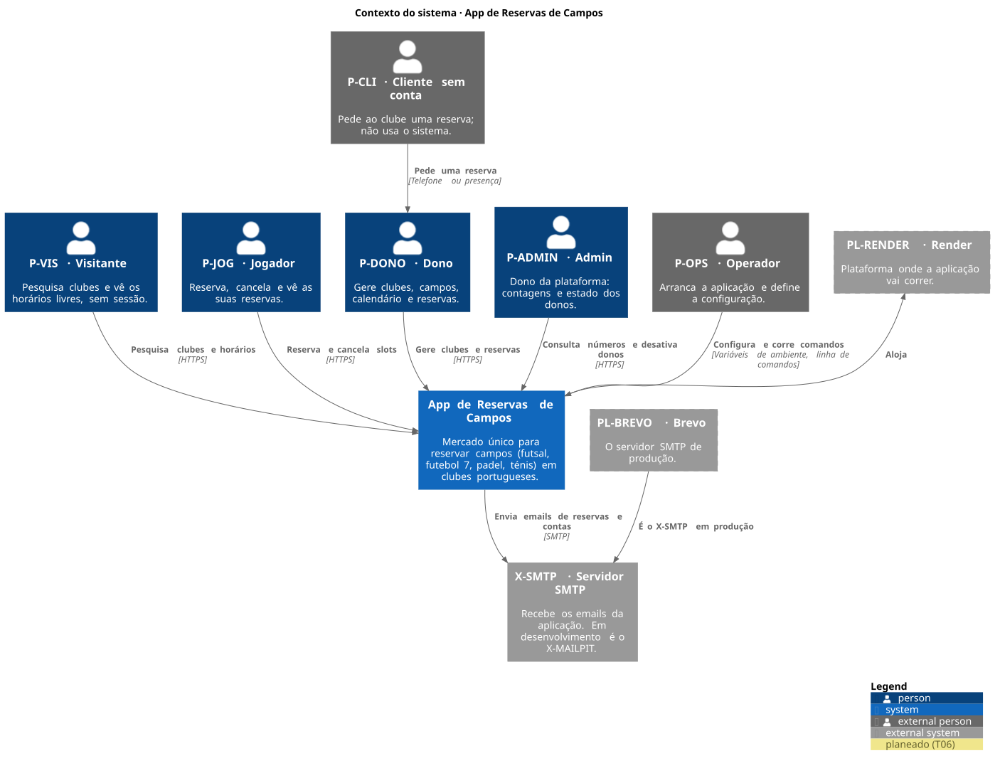

# 01 · Contexto do sistema

<!-- C4 nível 1 · vista 4+1: cenários (contexto de uso). Ver README.md. -->

## Diagrama

Fonte: [01-context.puml](diagrams/01-context.puml). Os contornos tracejados são o que está planeado (T06); o resto existe hoje.

## Âmbito

A App de Reservas de Campos é um **mercado único**: um só sistema onde jogadores reservam campos (futsal, futebol 7, padel, ténis) em clubes portugueses. Um jogador tem uma conta que serve em todos os clubes de todos os donos; não há sites nem domínios por dono. O mesmo sistema tem três áreas (jogador, dono, admin) sobre a mesma API. Não há pagamentos: a reserva guarda o preço do momento.

Fora do âmbito: pagamentos, aplicações móveis, integração com outros sistemas de reservas, reservas depois da meia-noite (limitação conhecida do MVP) e qualquer forma de o admin ver dados pessoais dos jogadores.

## Pessoas

| Id | Papel | O que faz com o sistema |
| --- | --- | --- |
| P-VIS | Visitante | Pesquisa clubes e vê horários livres; para reservar vai ao login. |
| P-JOG | Jogador | Reserva (um slot ou uma série semanal), vê e cancela as suas reservas, recebe emails. |
| P-DONO | Dono | Gere clubes, campos, horários, bloqueios, preços e o calendário; reserva para clientes; marca faltas. |
| P-ADMIN | Admin | Vê contagens e gráficos e desativa ou reativa donos. Só existe por seed. |
| P-CLI | Cliente sem conta | Não usa o sistema: pede ao clube, e o dono reserva em nome dele. Não recebe email. |
| P-OPS | Operador | Arranca a aplicação, define a configuração e corre `seed-demo` e `set-admin-password`. |

## Sistemas externos

| Id | Sistema | Ligação |
| --- | --- | --- |
| X-SMTP | Servidor SMTP | A aplicação envia por SMTP os emails de reservas e de contas. Em desenvolvimento é o X-MAILPIT (nada sai para fora); em produção será o PL-BREVO. |
| PL-BREVO | Brevo | O servidor SMTP de produção (planeado). |
| PL-RENDER | Render | A plataforma onde a aplicação vai correr (planeado). É só uma caixa: o que contém está em [02-containers.md](02-containers.md). |

O CI (X-GHA) e o repositório (X-GH) não fazem parte do uso do sistema e não aparecem aqui; estão na vista de implantação.

## Notas

- O Render (planeado (T06)) aparece como sistema externo para marcar que o alojamento é uma escolha de implantação e não do sistema. Nenhuma regra de negócio depende dele.
- O envio de email nunca bloqueia uma reserva: a aplicação grava o email num outbox e envia-o depois (ver [04-process-view.md](04-process-view.md)).
