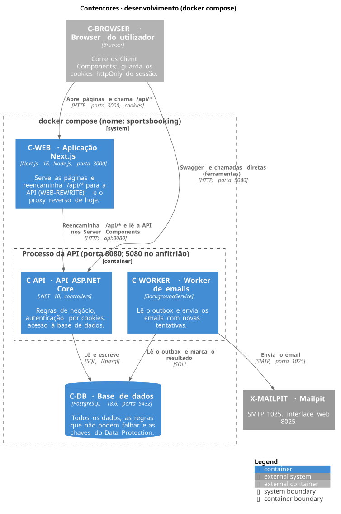
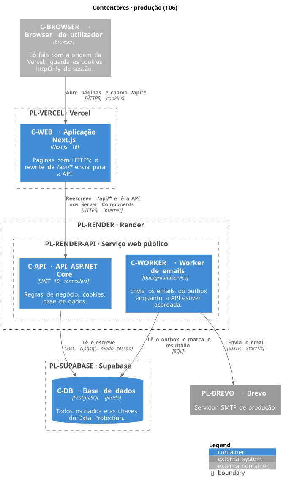

# 02 · Contentores

<!-- C4 nível 2 · vista 4+1: de processo. Ver README.md. -->

Dois diagramas: o que corre hoje em desenvolvimento e o que está planeado para produção. Em ambos o browser vê **uma só origem**, o que mantém os cookies de sessão first-party e dispensa CORS.

## Diagrama

### Desenvolvimento (docker compose)

Fonte: [02-containers-dev.puml](diagrams/02-containers-dev.puml).

### Produção, planeado (T06)

Fonte: [02-containers-prod.puml](diagrams/02-containers-prod.puml). **Planeado (T06): ainda não há código nem deploy.** Os contornos tracejados são o que se prevê.

## Contentores

| Id | Tecnologia | Responsabilidade | Dono de |
| --- | --- | --- | --- |
| C-BROWSER | Browser | Corre os Client Components e guarda os cookies httpOnly `access_token` e `refresh_token`. Fala só com C-WEB (em desenvolvimento, também com a API na 5080, para o Swagger). | Os cookies de sessão. |
| C-WEB | Next.js 16 (App Router, imagem `standalone`), porta 3000 | Serve as áreas do jogador, do dono e do admin. Os Server Components chamam a API pelo URL interno, a passar o cookie do utilizador; os Client Components chamam `/api/*` na mesma origem. Reencaminha `/api/*` para a API (WEB-REWRITE). | Nenhum dado: não acede à base de dados. |
| C-API | .NET 10, ASP.NET Core, porta 8080 (5080 no anfitrião, só em desenvolvimento) | Única dona das regras de negócio, da autenticação (JWT e refresh em cookies), da autorização por perfil e por dono, dos erros ProblemDetails e do rate limiting. Verifica o `Origin` dos pedidos que alteram dados. | Todas as regras e todo o acesso a C-DB. |
| C-WORKER | `BackgroundService` no processo da API | Lê o outbox, compõe e envia os emails com novas tentativas; usa `SKIP LOCKED`, por isso pode correr em várias instâncias. | O envio dos emails (o outbox em si está em C-DB). |
| C-DB | PostgreSQL 18.6 (desenvolvimento); PostgreSQL gerido (produção, planeado (T06)) | Guarda os dados, impõe as regras que não podem falhar (sem reservas confirmadas sobrepostas, histórico de donos só de acrescentar) e guarda as chaves do Data Protection. | Os dados e o esquema. |

C-CLI (`seed-demo` e `set-admin-password`) é o mesmo executável da API sem arrancar o servidor, por isso não tem caixa própria nestes diagramas.

## Comunicação entre contentores

**Desenvolvimento**

- C-BROWSER → C-WEB: HTTP na porta 3000, com cookies. É a entrada normal.
- C-WEB → C-API: o Next.js reencaminha `/api/*` para `http://api:8080`, e os Server Components leem a API no mesmo endereço (`API_INTERNAL_URL`). O endereço é argumento de build (os rewrites ficam fixados no build) e variável de ambiente em execução.
- C-BROWSER → C-API: a API também está publicada na porta 5080 (Swagger em `/swagger`), e `http://localhost:5080` é uma das origens aceites em Development. É uma entrada direta para ferramentas, fora do caminho normal.
- C-API e C-WORKER → C-DB: SQL com Npgsql, `Host=postgres;Port=5432`.
- C-WORKER → X-MAILPIT: SMTP na porta 1025, sem TLS; a interface web está na 8025.

**Produção, planeado (T06)**

- C-BROWSER → C-WEB: HTTPS. O serviço web público do Render (PL-RENDER-WEB) é a **única entrada pública**.
- C-WEB → C-API: HTTP pela rede interna do Render, para o URL interno do serviço privado (`API_INTERNAL_URL`). O serviço da API (PL-RENDER-API) **não tem URL público**: não há outra forma de lhe chegar a partir da internet.
- C-API e C-WORKER → C-DB (PL-SUPABASE): SQL.
- C-WORKER → PL-BREVO: SMTP na porta 587 com StartTls.
- Cookies: são httpOnly e Secure; o `refresh_token` tem `Path=/api/auth`. Como o browser só conhece o domínio de C-WEB, são first-party. A API verifica que o `Origin` é o do site (`Security__AllowedOrigins__0`).

## Notas

- **Hoje o proxy reverso é o Next.js, não o Caddy.** Em desenvolvimento e no compose é C-WEB que reencaminha `/api/*`. O desenho antigo de produção (Caddy numa máquina virtual, em `docs/stack.md`) não é o plano atual: no plano do Render, o Next.js continua a ser o proxy e o Caddy não aparece (ver a nota no fim do [inventário](00-inventory.md)).
- **O IP do cliente.** A API só confia em `X-Forwarded-For` de proxies configurados (`ForwardedHeaders:KnownProxies`), e nunca do contentor Next.js, porque o rewrite passa à frente um `X-Forwarded-For` enviado pelo browser. Com o Next.js como único proxy, a API só vê o endereço de C-WEB como IP do cliente e todos os utilizadores partilham o mesmo limite. Como resolver isto no Render fica para a T06; este diagrama não afirma nenhuma solução.
- O worker corre no processo da API: em produção (planeado (T06)) a API também envia emails e tem de ter pelo menos uma instância sempre a correr.
- As migrações e o seed do admin correm no arranque da API em desenvolvimento. Como se aplicam em produção (utilizador da base de dados, migration bundle) é da T06.
