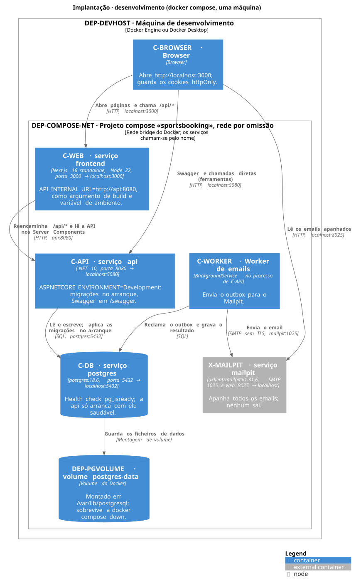
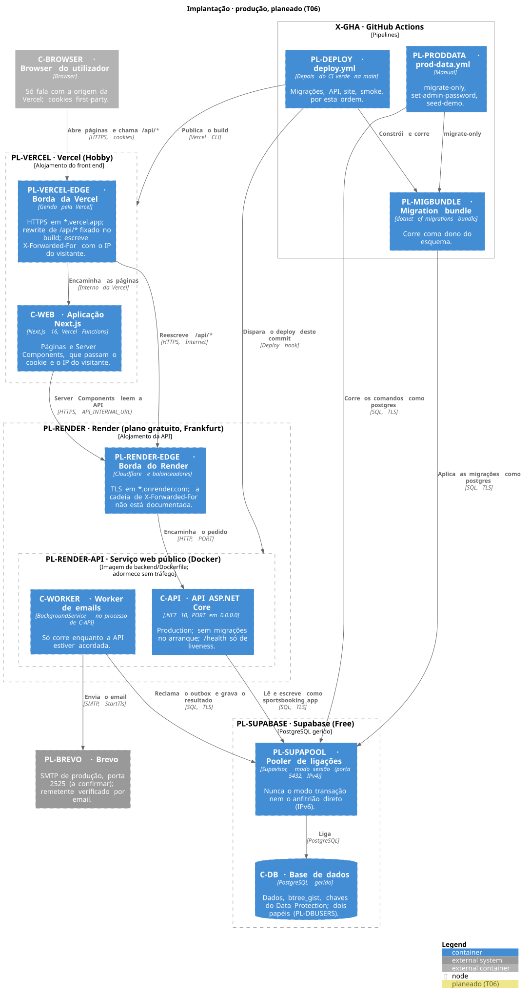

# 06 · Vista física

<!-- Diagramas de implantação do C4 · vista 4+1: física. Ver README.md. -->

Onde corre cada contentor, como se chega a ele, em que se confia e que configuração muda o comportamento. Dois níveis: os **diagramas de implantação** (desenvolvimento, que existe, e produção, que está **planeada para a T06** e ainda não foi implantada) e a **rede e confiança** (o que é público, TLS, origem, IP do cliente, base de dados, segredos). Os ids estão no [inventário](00-inventory.md); os nós `DEP-` e os novos `PL-` foram acrescentados com esta vista.

O que se diz do desenvolvimento foi conferido em 2026-10-30, no commit `452be5a`, com `docker-compose.yml`, `.env.example`, `backend/Dockerfile`, `frontend/Dockerfile`, `frontend/next.config.ts`, `frontend/src/proxy.ts`, `Api/Program.cs`, os `appsettings*.json` e as classes de opções. **A produção ainda não foi implantada:** os workflows e a configuração existem, mas não houve nenhum deploy real. O que se diz dos fornecedores (Vercel, Render, Supabase, Brevo) vem da documentação deles, lida em 2026-11-09. A decisão está na [ADR 0009](adr/0009-alvo-de-implantacao.md).

## 1. Desenvolvimento (docker compose)

Fonte: [06-physical-dev.puml](diagrams/06-physical-dev.puml).

Uma máquina (DEP-DEVHOST) com Docker. `docker compose up --build` cria o projeto `sportsbooking` com a rede por omissão do compose (DEP-COMPOSE-NET), onde os serviços se chamam pelo nome (`api`, `postgres`, `mailpit`).

| Serviço | Elemento | Imagem ou build | Portas (anfitrião → contentor) | Volumes | Arranca depois de | Ambiente (do `docker-compose.yml`) |
| --- | --- | --- | --- | --- | --- | --- |
| `postgres` | C-DB | `postgres:18.6` | `5432 → 5432` | `postgres-data` (DEP-PGVOLUME) em `/var/lib/postgresql` | — | `POSTGRES_DB`, `POSTGRES_USER`, `POSTGRES_PASSWORD` (do `.env`, por omissão `sportsbooking`). Health check `pg_isready` a cada 5 s. |
| `mailpit` | X-MAILPIT | `axllent/mailpit:v1.31.6` | `8025 → 8025` (web), `1025 → 1025` (SMTP) | — | — | — |
| `api` | C-API, C-WORKER | build de `./backend` (`backend/Dockerfile`: SDK 10.0 → `aspnet:10.0`, utilizador `$APP_UID`, `EXPOSE 8080`) | `5080 → 8080` | — | `postgres` saudável, `mailpit` arrancado | `ASPNETCORE_ENVIRONMENT=Development`; `ConnectionStrings__Default` (`Host=postgres;Port=5432;…;GSS Encryption Mode=Disable`); `AdminSeed__Email`/`AdminSeed__Password` (de `ADMIN_SEED_*` no `.env`, vazios por omissão); `Email__Host=mailpit`, `Email__Port=1025`, `Email__Security=None`. |
| `frontend` | C-WEB | build de `./frontend` (`frontend/Dockerfile`: `node:22-alpine`, `output: "standalone"`, utilizador `node`) com o argumento de build `API_INTERNAL_URL` | `3000 → 3000` | — | `api` (arrancado, não saudável) | `API_INTERNAL_URL=http://api:8080`, definido uma vez (`x-api-internal-url`) e usado como argumento de build e como variável de ambiente. |

O que vem do `appsettings.Development.json` (porque o ambiente é Development) e não do compose: `Jwt:SigningKey` (chave só de desenvolvimento), `Email:FromAddress`, `PublicSite:BaseUrl=http://localhost:3000` e `Security:AllowedOrigins` (`http://localhost:3000` e `http://localhost:5080`).

**Consequências do ambiente Development:**

- A API aplica as migrações no arranque (`Program.cs`), corre o seed do admin e mostra o Swagger em `/swagger` (só em Development).
- O browser fala com `http://localhost:3000`; os cookies são `Secure` mas os browsers aceitam-nos em `localhost` sem HTTPS (comentário em `Api/Auth/AuthCookies.cs`).
- A API tem uma segunda entrada, `localhost:5080`, para ferramentas ([Notas de arquitetura](README.md#notas-de-arquitetura), 1). O PostgreSQL também está publicado em `localhost:5432`, para correr a API fora do Docker (`dotnet run`, com a ligação do `appsettings.Development.json`) e para clientes SQL.
- Os dados ficam no volume `postgres-data`: sobrevivem a `docker compose down` e só se apagam com `docker compose down -v`.
- Os comandos de linha (C-CLI) correm como `docker compose run --rm api seed-demo` (ou `set-admin-password`, com `ADMIN_NEW_PASSWORD`): um contentor de curta duração na mesma rede.

## 2. Integração contínua

O CI (X-GHA, `.github/workflows/ci.yml`) não implanta nada. Os runners `ubuntu-latest` constroem e testam; os testes de integração arrancam um `postgres:18.6` próprio com Testcontainers, e o job `diagrams` arranca a imagem do PlantUML. Detalhe em [05 · Vista de desenvolvimento](05-development-view.md#4-pipeline-de-build-e-qualidade). Na T06 o CI passa também a fazer parte do deploy (secção 5).

## 3. Produção, planeado (T06)

Fonte: [06-physical-prod.puml](diagrams/06-physical-prod.puml). **Planeado (T06): os workflows e a configuração existem, mas ainda não houve nenhum deploy real.** Os contornos tracejados são o que se prevê. Os passos manuais estão no [runbook](../deployment/runbook.md).

| Nó ou serviço | Elemento | Corre | Público? | Nota |
| --- | --- | --- | --- | --- |
| Vercel (Hobby) | PL-VERCEL, PL-VERCEL-EDGE | C-WEB | Sim, em `https://<projeto>.vercel.app` | **A origem que o browser conhece.** O rewrite de `/api/*` fica fixado no build. |
| Render (gratuito) | PL-RENDER, PL-RENDER-EDGE, PL-RENDER-API | C-API com C-WORKER, imagem de `backend/Dockerfile` | **Sim**, em `https://<serviço>.onrender.com` | Adormece ao fim de 15 minutos sem tráfego. Deploy automático desligado. |
| Supabase (gratuito) | PL-SUPABASE, PL-SUPAPOOL, C-DB | PostgreSQL gerido e o pooler | Sim (endpoint na Internet, com palavra-passe e TLS) | Sempre pelo pooler em modo sessão (secção 4.6). |
| Brevo | PL-BREVO | SMTP | — (fornecedor) | Porta 2525 (a confirmar); remetente verificado por email. |
| GitHub Actions | X-GHA, PL-DEPLOY, PL-PRODDATA, PL-MIGBUNDLE | `deploy.yml`, `prod-data.yml` | — | Secção 4.8. |

## 4. Rede e confiança

### 4.1 O que é público e o que não é

| O quê | Hoje (compose) | Produção planeada |
| --- | --- | --- |
| Páginas e `/api/*` | `localhost:3000` (C-WEB) | `https://<projeto>.vercel.app` (PL-VERCEL) |
| A API diretamente | `localhost:5080` (Swagger) | **Sim**, em `https://<serviço>.onrender.com`. O Swagger só existe em Development. Um `POST` sem o `Origin` do site recebe 403 |
| O PostgreSQL | `localhost:5432` | Endpoint do Supabase na Internet, protegido por palavra-passe e TLS |
| O SMTP | Mailpit em `localhost:1025`/`8025` | Brevo (fornecedor externo) |

### 4.2 TLS

- **Browser → Vercel:** HTTPS. Os cookies já são `Secure` (`AuthCookies`). O HSTS liga-se com `ENABLE_HSTS=true` nas variáveis da Vercel: os cabeçalhos ficam escritos no build.
- **Vercel → Render:** HTTPS pela Internet (o build falha na Vercel se `API_INTERNAL_URL` não for `https`).
- **Borda do Render → C-API:** HTTP. A documentação do Render diz que o balanceador termina o TLS. A API não faz `UseHttpsRedirection`, o que está certo atrás de um proxy, e lê o esquema de `X-Forwarded-Proto`.
- **C-API → Supabase:** TLS, com `SSL Mode=Require` (encripta sem verificar o servidor, como a documentação do Supabase descreve).
- **C-WORKER → Brevo:** `Email__Security=StartTls`, a confirmar na porta 2525 (`StartTls` recusa o envio se o servidor não suportar TLS).

### 4.3 Uma só origem: cookies first-party, sem CORS, `Origin`

O browser só conhece a origem da Vercel: as páginas e `/api/*` vêm desse endereço, e o rewrite envia `/api/*` para a API. Por isso:

- Os cookies `access_token` (`Path=/`, `SameSite=Lax`) e `refresh_token` (`Path=/api/auth`, `SameSite=Strict`), ambos httpOnly e Secure, são **first-party**.
- **Não há CORS** e a API não o configura.
- A **verificação do `Origin`** (CC-ORIGIN) aceita só `Security__AllowedOrigins__0`, o endereço da Vercel sem barra final. Sem pelo menos uma origem a API não arranca. Os previews da Vercel têm outro endereço e recebem 403.
- Quem chama a API a partir do servidor (Server Components) só faz `GET`, que não precisa de `Origin`.

### 4.4 O IP do cliente

**Provisório.** O rate limiting (CC-RATE) conta por IP do cliente. A API só lê `X-Forwarded-For` e `X-Forwarded-Proto` se houver um proxy configurado. Em produção usa `ForwardedHeaders__TrustAnyProxy=true`, porque os proxies do Render não têm endereços que se possam listar, com um `ForwardedHeaders__ForwardLimit` explícito.

- **Rewrite:** a documentação da Vercel diz que, num rewrite externo, envia à origem `x-forwarded-for` com o IP público do visitante, e que reescreve o que o browser envia.
- **Server Components:** levam o IP do visitante (`visitorIpHeader`, `lib/server/visitor-ip.ts`).
- **A cadeia no Render não está documentada:** quantas entradas chegam à API e por que ordem. O valor certo de `ForwardLimit` encontra-se no primeiro deploy, com a linha `Too many requests from client …` do log ([procedimento](../deployment/environment-variables.md)).
- **A API é pública**, por isso quem lhe ligar diretamente pode forjar o cabeçalho: os limites por IP são só de melhor esforço, e a proteção real contra adivinhar palavras-passe é o bloqueio de conta do Identity.

### 4.5 Os rewrites são fixados no build

`next.config.ts` lê `API_INTERNAL_URL` quando o Next.js **constrói** a aplicação; os Server Components leem a mesma variável **em execução**. Na Vercel é uma só variável, disponível nos dois momentos, e mudar o endereço da API obriga a um novo deploy. O build falha na Vercel se ela faltar. Detalhe em [`environment-variables.md`](../deployment/environment-variables.md).

### 4.6 Base de dados: papéis, ligação e Supabase

**Dois papéis (PL-DBUSERS, critério da T06), criados por [`supabase-roles.sql`](../deployment/supabase-roles.sql):**

| Papel | Usado por | Pode | Não pode |
| --- | --- | --- | --- |
| `postgres` (dono do esquema) | PL-MIGBUNDLE e C-CLI, a partir do GitHub Actions | DDL: tabelas, índices, a `bookings_no_overlap`, o trigger DB-AUDITTRG e a extensão `btree_gist` (DB-GIST) | — |
| `sportsbooking_app` | C-API e C-WORKER, no Render | `SELECT`, `INSERT`, `UPDATE`, `DELETE` nas tabelas; usar as sequências; `USAGE` no esquema | DDL, `TRUNCATE`, criar extensões |

`ALTER DEFAULT PRIVILEGES FOR ROLE postgres` cobre as tabelas e sequências criadas por migrações futuras. Testado com o `postgres:18.6` do compose: reservas, a `bookings_no_overlap` (409 `slot_taken`), o outbox, as chaves do Data Protection, os refresh tokens, o Identity e o trigger funcionam com o papel da aplicação, que não consegue fazer DDL. As migrações e o `seed-demo` também correram em `postgres:17`.

**Ligação pelo pooler do Supabase.** As transações da API dependem de estado de sessão: `PitchLock` mantém `SELECT … FOR UPDATE` até ao `COMMIT`, o worker mantém `FOR UPDATE SKIP LOCKED` e o Npgsql prepara comandos. A documentação do Supabase (2026-11-09) diz que o pooler partilhado é IPv4, que o modo sessão usa a porta 5432 e suporta prepared statements, que o modo transação usa a 6543 e não os suporta, e que a ligação direta é IPv6, ou IPv4 com um add-on pago. O utilizador é `<papel>.<project-ref>`. Escolha: **modo sessão na porta 5432**. No plano gratuito o pool tem 15 ligações, por isso o Render usa `Maximum Pool Size=5`.

**API de dados do Supabase.** A documentação diz que objetos novos em `public` podem receber privilégios de `anon`, `authenticated` e `service_role`, conforme o projeto. As tabelas da aplicação não têm row level security e incluem `users`. O script retira esses privilégios, também para as tabelas futuras.

**Versão.** O desenvolvimento e os testes usam PostgreSQL 18.6; as páginas lidas não dizem que versão o Supabase dá aos projetos novos.

### 4.7 Segredos e variáveis de ambiente por serviço

A lista completa, por sítio, está em [`environment-variables.md`](../deployment/environment-variables.md). `ValidateOnStart`: uma definição obrigatória em falta ou inválida impede a API de arrancar, e a mensagem nunca mostra o valor. A ligação do dono do esquema só existe nos segredos do GitHub, nunca no Render.

### 4.8 Onde correm as migrações e os comandos

**`deploy.yml` (PL-DEPLOY)** corre depois do CI verde na `main`, no commit exato do CI, e só com a variável `DEPLOY_ENABLED` a `true`:

1. **migrate:** constrói o migration bundle (PL-MIGBUNDLE) e aplica-o como `postgres`.
2. **deploy-api:** chama o deploy hook do Render com esse commit (PL-DEPLOYHOOK) e espera até 6 minutos por um 200 em `/health`.
3. **deploy-web:** `vercel pull`, `vercel build --prod` e `vercel deploy --prebuilt --prod`, a partir da raiz do repositório.
4. **smoke:** só leituras, no site e em `/health`.

O esquema novo fica ativo antes da API nova: **cada migração tem de funcionar com a versão anterior da API** (acrescentar antes de remover). O `/health` não diz que versão está a correr, e durante um build o Render continua a servir a instância anterior: um 200 confirma que a API responde, não que este commit já esteja ativo.

**`prod-data.yml` (PL-PRODDATA)**, manual, corre `migrate-only`, `set-admin-password` ou `seed-demo`, como `postgres`. O grupo de concorrência é o do deploy.

### 4.9 Chaves do Data Protection e cópias de segurança

- As chaves que protegem os tokens de recuperação (CC-DATAPROT) vivem na tabela `data_protection_keys` (DB-DPKEYS). Por isso um reinício ou um novo deploy continuam a aceitar as ligações já enviadas, e nada precisa de disco persistente no Render.
- O código não configura cifra das chaves em repouso: **quem tem uma cópia da base de dados tem as chaves**.
- **Cópias (PL-BACKUP).** Não há: os dados são de demonstração, e a documentação do Supabase não inclui cópias automáticas no plano gratuito.

## 5. Riscos e pontos em aberto para a T06

Os riscos aceites estão na [ADR 0009](adr/0009-alvo-de-implantacao.md). «Verificado aqui» = confirmado no repositório ou num teste local em 2026-11-09. «A confirmar» = só se vê no primeiro deploy real.

| # | Ponto | Estado | O que verificar |
| --- | --- | --- | --- |
| 1 | **`ForwardLimit`** | A confirmar | O procedimento de [`environment-variables.md`](../deployment/environment-variables.md) |
| 2 | **`Origin` e `Set-Cookie` no rewrite da Vercel** | Verificado aqui com `next start`; a documentação da Vercel não fala deles | Login e um pedido que altere dados no site real |
| 3 | **Cache da Vercel nos rewrites** | A documentação diz que respeita o `Cache-Control` da origem; a API não o envia nas respostas JSON | Que nenhuma resposta fica em cache |
| 4 | **Porta 2525 e STARTTLS no Brevo** | A documentação lista a porta 2525, sem falar de STARTTLS nem do servidor | Um email real |
| 5 | **Pooler do Supabase com o EF Core** | Documentação lida; testado só contra PostgreSQL local | Uma reserva e o worker contra o Supabase |
| 6 | **`btree_gist` no Supabase** | A página de extensões não a nomeia | A consulta do runbook, antes da primeira migração |
| 7 | **`vercel deploy --prebuilt` real** | `vercel build` testado localmente com a CLI fixada; o deploy precisa de credenciais | A primeira execução de `deploy.yml` |
| 8 | **Contexto de build no Render** | A documentação diz que o caminho do Dockerfile é relativo ao Root Directory | O primeiro build no Render |
| 9 | **Health check HTTP no plano gratuito** | A documentação não diz | Se a opção existe |

## 6. Notas

- **Ficheiro.** Esta vista substitui o `06-deployment.md` previsto (que estava vazio); a correspondência no [README](README.md) foi atualizada.
- **Ids novos** (no [inventário](00-inventory.md)): `DEP-DEVHOST`, `DEP-COMPOSE-NET`, `DEP-PGVOLUME` (prefixo novo `DEP-`, nós e infraestrutura de implantação que existem hoje), `PL-DNS`, `PL-RENDER-EDGE`, `PL-RENDER-NET`, `PL-SUPAPOOL`, `PL-DEPENDABOT`, `PL-SECHEADERS`.
- **O que esta vista substitui da Stack:** ver a [ADR 0009](adr/0009-alvo-de-implantacao.md). A Stack não foi alterada.
- **Alvo revisto (2026-11-09).** A primeira versão desta vista descrevia o Next.js e uma API privada no Render. O alvo passou a ser Vercel e Render gratuito com a API pública (ADR 0009): os ids `PL-RENDER-WEB`, `PL-RENDER-NET` e `PL-DNS` ficam no inventário como «não adotado».
- **Desvios encontrados entre documentos e código** (corrigidos):
  - O comentário de `TrustedProxyOptions` dizia que a produção confia só no Caddy. **Corrigido**: descreve o que a T06 fez (secção 4.4).
  - O `AGENTS.md` dizia «Caddy in prod» para a mesma origem e para o IP do cliente. **Corrigido** (planeado, nenhum proxy de confiança hoje). O `README.md` também dizia «Production: trust only Caddy»; **corrigido** ao reescrevê-lo (pull request #29).
  - `getPublicClub` chamava um endpoint com limite por IP a partir do servidor, sem o IP do cliente. **Corrigido** na T06 (`visitorIpHeader`).
  - O comentário de `MigrateDatabaseAsync` e o de `Program.cs` diziam que a produção usa um migration bundle, que não existia. **Corrigido**: o bundle é construído e aplicado pelos workflows da T06.
  - O diagrama [02-containers-dev.svg](diagrams/02-containers-dev.svg) mostrava o rótulo da seta C-WEB → C-API partido, porque `http://` no argumento de tecnologia de um `Rel` é lido como itálico pelo PlantUML. **Corrigido** (a tecnologia é agora «HTTP, api:8080»); nos diagramas da vista física o esquema também foi tirado desses rótulos.
