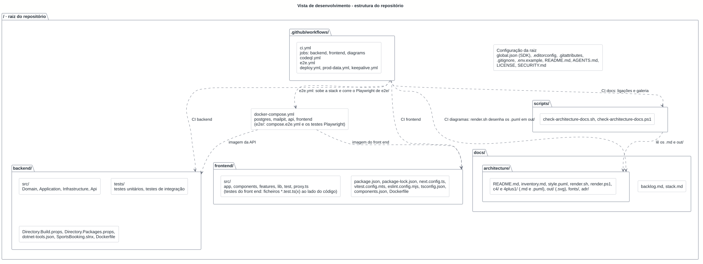
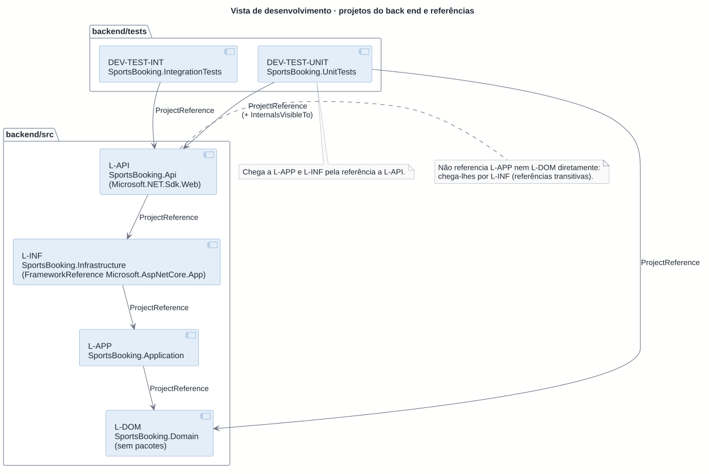
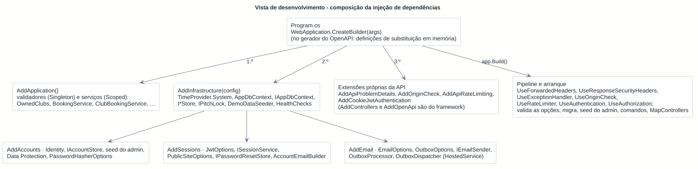
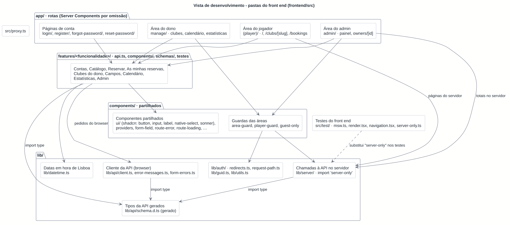
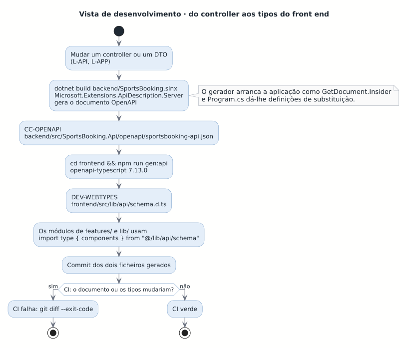
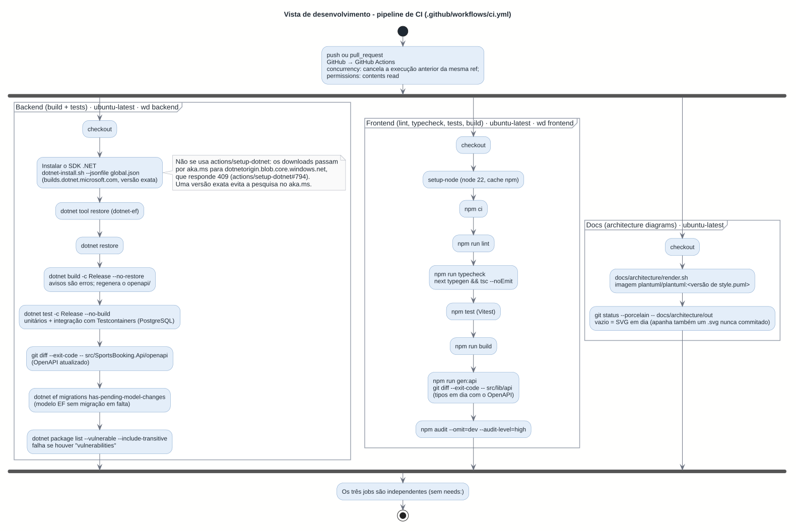
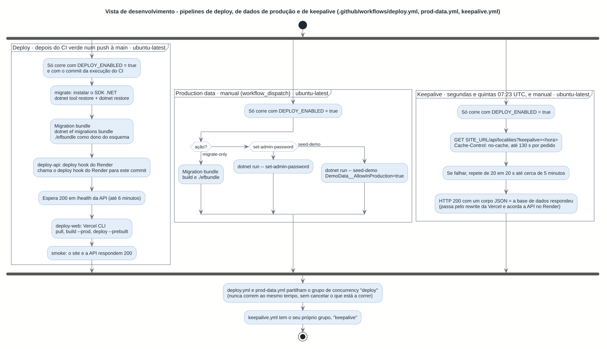

# Vista de desenvolvimento

<!-- Vista 4+1: de desenvolvimento (implementação). Sem equivalente direto no C4. Ver README.md. -->

Como o código está organizado para quem o escreve: as pastas do repositório, os projetos do back end e as suas referências, as pastas do front end, o que o CI verifica, como se testa e como se acrescenta uma funcionalidade. Tudo foi conferido com os ficheiros do repositório (`.csproj`, `Directory.Packages.props`, `package.json`, `ci.yml`) em 2026-10-29, no commit `f4057ca`; os ids estão no [inventário](../inventory.md) (secção 9 para os `DEV-`).

## 1. Estrutura do repositório

Fonte: [development-repo.puml](development-repo.puml).

| Pasta ou ficheiro | Id | O que tem |
| --- | --- | --- |
| `backend/` | DEV-BACKEND | A solução .NET (`SportsBooking.slnx`), `Directory.Build.props`, `Directory.Packages.props`, `dotnet-tools.json` e o `Dockerfile` da API. |
| `backend/src/` | L-DOM, L-APP, L-INF, L-API | Os quatro projetos da aplicação (secção 2). |
| `backend/tests/` | DEV-TEST-UNIT, DEV-TEST-INT | Os dois projetos de teste. |
| `frontend/` | DEV-FRONTEND | A aplicação Next.js, a configuração (`next.config.ts`, `vitest.config.mts`, `eslint.config.mjs`, `tsconfig.json`, `components.json`) e o `Dockerfile`. |
| `frontend/src/` | WEB-* | `app/`, `components/`, `features/`, `lib/`, `test/` e `proxy.ts` (secção 3). |
| `docs/` | DEV-DOCS | `backlog.md` e `stack.md` (fontes de verdade, em pt-PT) e a arquitetura. |
| `docs/architecture/` | DEV-ARCHDOCS | Estes documentos, `adr/` (o índice e as ADRs escritas), `c4/` e `4plus1/` com os `.puml`, `out/` com os `.svg`, `style.puml` (o estilo comum) e `render.sh` e `render.ps1`. |
| `scripts/` | DEV-SCRIPTS | `check-architecture-docs.sh` e `check-architecture-docs.ps1`. |
| `.github/workflows/` | DEV-WORKFLOWS | `ci.yml`, o único workflow. |
| `docker-compose.yml`, `.env.example` | DEV-COMPOSE | A stack local: `postgres` (imagem `postgres:18.6`), `mailpit` (`axllent/mailpit:v1.31.6`), `api` (construída de `backend/`) e `frontend` (construída de `frontend/`). |
| `global.json`, `.editorconfig`, `.gitattributes`, `.gitignore`, `README.md`, `AGENTS.md` | DEV-ROOTCFG | Na raiz. `global.json` fixa o SDK 10.0.400 (`rollForward: latestFeature`) e escolhe o executor `Microsoft.Testing.Platform`. `.editorconfig` impõe UTF-8, `lf`, 2 espaços (4 em `.cs`) e namespaces com âmbito de ficheiro. `.gitattributes` fixa `eol=lf`. |

Workflows de implantação da T06: `.github/workflows/deploy.yml` e `prod-data.yml`, que usam `.github/actions/install-dotnet`. Ver a [vista física](physical.md#48-onde-correm-as-migrações-e-os-comandos). Não há `Caddyfile` (ver as [Notas](#7-notas-e-diferenças-encontradas)).

## 2. Back end

### Projetos e referências

Fonte: [development-backend.puml](development-backend.puml).

As referências são as dos `.csproj`. Todos os projetos herdam de `Directory.Build.props`: `net10.0`, `Nullable`, `ImplicitUsings`, `TreatWarningsAsErrors`, `EnforceCodeStyleInBuild`, `AnalysisLevel` `latest-recommended` e `ManagePackageVersionsCentrally` (as versões ficam todas em `Directory.Packages.props`).

| Projeto | Id | Referencia | Pacotes principais (versão) |
| --- | --- | --- | --- |
| `SportsBooking.Domain` | L-DOM | nada | nenhum |
| `SportsBooking.Application` | L-APP | Domain | `FluentValidation` 12.2.0, `Microsoft.EntityFrameworkCore` 10.0.13, `Microsoft.Extensions.DependencyInjection.Abstractions` 10.0.13 |
| `SportsBooking.Infrastructure` | L-INF | Application | `Npgsql.EntityFrameworkCore.PostgreSQL` 10.0.3, `EFCore.NamingConventions` 10.0.1, `Microsoft.AspNetCore.Identity.EntityFrameworkCore` 10.0.13, `Microsoft.AspNetCore.DataProtection.EntityFrameworkCore` 10.0.13, `Microsoft.IdentityModel.JsonWebTokens` 8.19.2, `MailKit` 4.18.2, `Microsoft.Extensions.Diagnostics.HealthChecks.EntityFrameworkCore` 10.0.13, `Microsoft.EntityFrameworkCore.Design` 10.0.13 (privado); `FrameworkReference Microsoft.AspNetCore.App` |
| `SportsBooking.Api` | L-API | Infrastructure | `Microsoft.AspNetCore.Authentication.JwtBearer` 10.0.13, `Microsoft.AspNetCore.OpenApi` 10.0.13, `Microsoft.Extensions.ApiDescription.Server` 10.0.13 (gera o documento no build), `Swashbuckle.AspNetCore.SwaggerUI` 10.3.1, `Microsoft.EntityFrameworkCore.Design` 10.0.13 (privado) |
| `SportsBooking.UnitTests` | DEV-TEST-UNIT | Domain, Api | `xunit.v3` 4.0.2, `Shouldly` 4.3.0, `Microsoft.Extensions.TimeProvider.Testing` 10.11.0 |
| `SportsBooking.IntegrationTests` | DEV-TEST-INT | Api | `xunit.v3` 4.0.2, `Shouldly` 4.3.0, `Microsoft.AspNetCore.Mvc.Testing` 10.0.13, `Testcontainers.PostgreSql` 4.16.0, `Microsoft.Extensions.Diagnostics.Testing` 10.11.0, `Microsoft.Extensions.TimeProvider.Testing` 10.11.0 |

A ferramenta local `dotnet-ef` 10.0.13 está em `dotnet-tools.json` (`dotnet tool restore`). Dois pontos que o diagrama mostra e que importam:

- **A regra de dependência é verificada pelo compilador.** `Api` só referencia `Infrastructure`, que referencia `Application`, que referencia `Domain`; o `Domain` não tem referências nem pacotes. Uma classe da Application não consegue usar o Npgsql porque o pacote não está no seu projeto (tem só o `Microsoft.EntityFrameworkCore`, para o `IAppDbContext`).
- **A Api acede à Application e ao Domain só por referência transitiva** (via Infrastructure). Os testes unitários referenciam Domain e Api, e por esta chegam a Application e Infrastructure; a Api dá-lhes `InternalsVisibleTo`.

### Como a injeção de dependências é composta

Fonte: [development-di.puml](development-di.puml).

`Program.cs` só compõe. Regista primeiro `AddApplication()` (validadores como Singleton e serviços como Scoped), depois `AddInfrastructure(configuration)`, que chama internamente `AddAccounts`, `AddSessions` e `AddEmail`, e por fim o que é da própria Api: `AddControllers`, `AddApiProblemDetails`, `AddOriginCheck`, `AddApiRateLimiting`, `AddCookieJwtAuthentication` e `AddOpenApi`. Cada camada regista-se a si mesma; o `DbContext` e quem o usa são Scoped, e o `OutboxDispatcher` (`BackgroundService`) cria um scope por passagem. Depois de `Build()`, `Program.cs` monta o pipeline (ver [04](process.md)) e, **se não for o gerador do OpenAPI**, valida as opções (`IStartupValidator`), aplica as migrações (em Development, ou com `Database:ApplyMigrationsOnStartup`), faz o seed do admin e trata os comandos `seed-demo` e `set-admin-password` (que saem sem arrancar o servidor, C-CLI).

O gerador do OpenAPI arranca a aplicação como `GetDocument.Insider`, sem base de dados nem configuração real: por isso `Program.cs` lhe dá definições de substituição em memória (`ConnectionStrings:Default`, `Security:AllowedOrigins:0`, `Jwt:SigningKey`, `Email:*`, `Outbox:Enabled`, `PublicSite:BaseUrl`) e salta as migrações e o seed. Uma definição obrigatória nova precisa de um valor de substituição aí.

## 3. Front end

Fonte: [development-frontend.puml](development-frontend.puml).

| Pasta | Ids | O que tem |
| --- | --- | --- |
| `src/app/` | WEB-AREA-PLAYER, WEB-AREA-MANAGE, WEB-AREA-ADMIN, WEB-AREA-ACCOUNT | As rotas: `(player)/` (`/`, `/clubs/[slug]`, `/bookings`), `manage/`, `admin/`, `login/`, `register/` (e `register/owner`), `forgot-password/`, `reset-password/`. São Server Components por omissão; cada área tem `layout.tsx`, `error.tsx` e `loading.tsx`. |
| `src/features/<nome>/` | WEB-F-* | Uma pasta por funcionalidade (`admin`, `auth`, `booking`, `calendar`, `catalog`, `clubs`, `my-bookings`, `pitches`, `statistics`) com `api.ts`, `components/`, `schemas/` onde há formulários, e os testes ao lado. |
| `src/components/` | WEB-GUARDS, WEB-UI | Peças partilhadas: guardas (`area-guard`, `player-guard`, `guest-only`), `providers`, `form-field`, cabeçalhos e erros de rota; `ui/` tem os cinco componentes shadcn em uso (`button`, `input`, `label`, `native-select`, `sonner`). |
| `src/lib/` | WEB-API-CLIENT, WEB-SERVER, WEB-DATETIME, DEV-WEBTYPES | `api/` (cliente, mensagens de erro por `code`, `form-errors`, `schema.d.ts` gerado), `server/` (só no servidor), `auth/` (decisões de redirecionamento), `datetime.ts`, `guid.ts`, `utils.ts`. |
| `src/proxy.ts` | WEB-PROXY | Em `/manage/*`, `/admin/*` e `/bookings`, escreve o caminho no cabeçalho `x-pathname`. |
| `src/test/` | DEV-TEST-WEB | `msw.ts`, `render.tsx`, `navigation.tsx` e `server-only.ts` (apoio dos testes). |

O alias `@/*` aponta para `src/*` (`tsconfig.json` e `vitest.config.mts`). Há 49 ficheiros com `"use client"` (sem contar testes): o resto é código de servidor ou partilhado.

### Tipos gerados da API

Fonte: [development-api-types.puml](development-api-types.puml).

O documento OpenAPI (CC-OPENAPI) é escrito em cada build da Api (`OpenApiGenerateDocumentsOnBuild` por omissão; o `Dockerfile` desliga-o com `-p:OpenApiGenerateDocumentsOnBuild=false`) para `backend/src/SportsBooking.Api/openapi/sportsbooking-api.json`. `npm run gen:api` (`openapi-typescript` 7.13.0) transforma-o em `frontend/src/lib/api/schema.d.ts` (DEV-WEBTYPES), que os módulos importam com `import type { components } from "@/lib/api/schema"` (as `features/*/api.ts` e `types.ts`, `lib/api/client.ts` e `lib/server/*`). Os dois ficheiros vão para o repositório e o CI falha se algum estiver desatualizado (secção 4). Nenhum tipo de resposta da API é escrito à mão.

### A fronteira `server-only`

Os quatro ficheiros de `src/lib/server/` (`session.ts`, `public-club.ts`, `admin-stats.ts`, `api-url.ts`) começam por `import "server-only"`: o Next.js falha o build se algum entrar num bundle de browser. Essa pasta lê os cookies do utilizador (`session.ts`, `admin-stats.ts`) e o `API_INTERNAL_URL` (o endereço interno da API, que o browser nunca vê), por isso só é importada por código de servidor: `components/area-guard.tsx`, `player-guard.tsx`, `guest-only.tsx`, `app/(player)/clubs/[slug]/page.tsx` e `app/admin/page.tsx`. O pacote `server-only` não está no `package.json`: é o Next.js que fornece o módulo no build; nos testes, `vitest.config.mts` troca-o por `src/test/server-only.ts`, para os módulos carregarem como módulos normais. O browser usa só `lib/api/client.ts` (WEB-API-CLIENT), que fala com `/api/*` na mesma origem.

### Pacotes principais (versões exatas de `package.json`)

| Pacote | Versão | Para quê |
| --- | --- | --- |
| `next` | 16.4.2 | Framework (App Router, `cacheComponents`, `proxy.ts`, `output: "standalone"`) |
| `react`, `react-dom` | 19.3.0 | Interface |
| `typescript` | 5.9.3 | `strict` |
| `@tanstack/react-query` | 5.104.1 | Dados da API |
| `react-hook-form`, `@hookform/resolvers`, `zod` | 7.89.0, 5.9.1, 4.6.7 | Formulários e validação de UX |
| `tailwindcss`, `@tailwindcss/turbopack` | 4.3.3 | Estilos |
| `radix-ui`, `class-variance-authority`, `cn`, `lucide-react`, `tw-animate-css`, `shadcn` | 1.8.1, 0.7.1, 0.5.0, 1.61.0, 1.4.0, 4.22.1 | Componentes (shadcn/ui) |
| `recharts` | 3.10.1 | Gráficos do admin |
| `sonner`, `next-themes` | 2.0.8, 0.4.6 | Avisos e tema |
| `openapi-typescript` | 7.13.0 | Tipos da API |
| `vitest`, `jsdom`, `@testing-library/react`, `@testing-library/dom`, `@testing-library/jest-dom`, `@testing-library/user-event`, `msw` | 5.0.5, 29.1.1, 16.3.3, 10.4.2, 7.0.1, 14.6.8, 3.0.2 | Testes |
| `eslint`, `eslint-config-next` | 9.39.5, 16.4.2 | Lint |

Node 22 (`engines`, CI e imagens Docker). Os scripts: `dev`, `build`, `start`, `lint`, `typecheck` (`next typegen && tsc --noEmit`), `test` (`vitest run`), `test:watch` e `gen:api`.

## 4. Pipeline de build e qualidade

### CI (`ci.yml`)

Fonte: [development-ci.puml](development-ci.puml). O deploy e os dados de produção estão na [secção seguinte](#deploy-e-dados-de-produção-deployyml-e-prod-datayml).

`ci.yml` corre em cada `push` e `pull_request` (X-GHA), com `permissions: contents: read` e `concurrency` por ref que cancela a execução anterior. Os três jobs não dependem uns dos outros.

| Job | Id | Passos, por ordem | O que apanha |
| --- | --- | --- | --- |
| `backend` | DEV-CI-BACKEND | `checkout` → instalar o SDK .NET → `dotnet tool restore` → `dotnet restore` → `dotnet build -c Release --no-restore` → `dotnet test -c Release --no-build` → `git diff --exit-code -- src/SportsBooking.Api/openapi` → `dotnet ef migrations has-pending-model-changes` → `dotnet package list --vulnerable --include-transitive` | Avisos (são erros), testes, OpenAPI desatualizado, alteração do modelo EF sem migração, pacotes NuGet vulneráveis (diretos e transitivos). |
| `frontend` | DEV-CI-FRONTEND | `checkout` → `setup-node` (22, cache npm) → `npm ci` → `npm run lint` → `npm run typecheck` → `npm test` → `npm run build` → `npm run gen:api` + `git diff --exit-code -- src/lib/api` → `npm audit --omit=dev --audit-level=high` | Lint, tipos, testes, build, tipos da API desatualizados, vulnerabilidades altas nas dependências de produção. |
| `diagrams` | DEV-CI-DIAGRAMS | `checkout` → `docs/architecture/render.sh` → `git status --porcelain -- docs/architecture/out` tem de ser vazio → `scripts/check-architecture-docs.sh` | Um `.svg` que não corresponde ao `.puml`, ou nunca commitado; uma ligação relativa que não chega a um ficheiro. |

**Porque é que o SDK .NET não vem de `actions/setup-dotnet`.** Os downloads dessa action passam por `aka.ms` até `dotnetorigin.blob.core.windows.net`, que responde 409 (`PublicAccessNotPermitted`; [actions/setup-dotnet#794](https://github.com/actions/setup-dotnet/issues/794)). O passo descarrega `dotnet-install.sh` de `builds.dotnet.microsoft.com` e instala a versão exata de `global.json` (`--jsonfile global.json`, `--azure-feed https://builds.dotnet.microsoft.com/dotnet`); uma versão exata dispensa a pesquisa no `aka.ms`. Quando o problema for resolvido pode voltar-se à action (confirmar que o registo da instalação já não menciona `dotnetorigin`).

**Os testes de integração precisam de Docker**, que os runners `ubuntu-latest` têm; localmente, sem Docker, todos falham a ligar (parece haver centenas de falhas). **Não há testes end-to-end no CI.** A `main` **não tem proteção de branch** no GitHub (verificado em 2026-10-30: a API responde «Branch not protected»), por isso nada obriga o CI a estar verde: confirma-se à mão, antes de cada merge, que os três jobs passaram.

### Deploy e dados de produção (`deploy.yml` e `prod-data.yml`)

Fonte: [development-deploy.puml](development-deploy.puml).

`deploy.yml` (PL-DEPLOY) corre depois de o CI acabar com sucesso num `push` à `main`, só com a variável `DEPLOY_ENABLED` a `true`, e tem quatro jobs em fila: `migrate` (PL-MIGBUNDLE, como dono do esquema), `deploy-api` (PL-DEPLOYHOOK, e espera 200 em `/health`), `deploy-web` (CLI da Vercel) e `smoke`. `prod-data.yml` (PL-PRODDATA) é manual e corre `migrate-only`, `set-admin-password` ou `seed-demo` contra a base de produção. Os dois partilham o grupo de `concurrency` `deploy`, sem cancelar o que está a correr. Os passos manuais e os segredos estão no [runbook](../../deployment/runbook.md) e em [environment-variables.md](../../deployment/environment-variables.md); a decisão, na [ADR 0009](../adr/0009-alvo-de-implantacao.md).

**Em local.** O que o CI faz repete-se com `dotnet build backend/SportsBooking.slnx`, `dotnet test backend/SportsBooking.slnx` e, em `frontend/`, `npm run lint`, `npm run typecheck`, `npm test`, `npm run build`, `npm run gen:api`; os diagramas com `docs/architecture/render.sh` (ou `.ps1`), que só precisa de Docker.

## 5. Estratégia de testes

Duas camadas automáticas no back end, uma no front end, e verificação manual no browser. **Não há testes end-to-end (Playwright ou outros) no repositório nem no CI.** A prática, antes de fazer merge de uma história com interface, é percorrer à mão (ou com scripts de browser temporários, que não se guardam) os fluxos críticos com a stack completa (`docker compose`, dados de demonstração e Mailpit), e conferir os emails e os logs.

| Camada | Id | Ferramentas | O que cobre | O que não cobre |
| --- | --- | --- | --- | --- |
| Unitários do back end | DEV-TEST-UNIT | xUnit v3, Shouldly, `FakeTimeProvider` | Regras do domínio e das políticas (slots e mudanças de hora, janela de cancelamento, palavras-passe), validadores, serviços sem base de dados, composição de emails, peças de segurança da Api (acesso por `InternalsVisibleTo`) | Qualquer coisa que dependa de SQL, constraints ou transações. |
| Integração do back end | DEV-TEST-INT | xUnit v3, `WebApplicationFactory<Program>`, Testcontainers PostgreSQL (`postgres:18.6`), Shouldly | Endpoints completos da autenticação à base de dados: autorização por perfil e por dono, `bookings_no_overlap` e pedidos simultâneos, códigos de erro, outbox e worker, arranque e seed, limites de pedidos | A interface. O provider em memória do EF Core nunca se usa. |
| Componentes do front end | DEV-TEST-WEB | Vitest 5.0.5 (jsdom), Testing Library, MSW 3.0.2 | Comportamento da UI com a API simulada: erros por campo, mensagens por `code`, URL como estado, layout do calendário, funções puras (`datetime`, `redirects`, `selection`) | A API real, o browser real, os cookies httpOnly. |
| Verificação manual | — | Browser, `docker compose`, Mailpit | Fluxos críticos de ponta a ponta antes do merge. | Não se repete automaticamente. |

**Contagens** (2026-10-30, `f4057ca` com o pull request de endurecimento pré-deploy da T06, `Release`, verificadas ao correr os testes):

| Conjunto | Casos executados | Métodos de teste | Notas |
| --- | --- | --- | --- |
| Unitários do back end | 549 | 291 em 39 classes | `dotnet test --project backend/tests/SportsBooking.UnitTests`; os `[Theory]` contam uma vez por linha de dados. |
| Integração do back end | 831 | 593 em 49 classes | Cerca de 2 min 40 s, com Docker. |
| Front end | 995 | — | 64 ficheiros de teste; cerca de 100 s. |

Os «métodos» vêm de `dotnet <SportsBooking.*Tests.dll> -list methods`; os «casos» do resumo do `dotnet test` e do `vitest run`.

### Como são os testes de integração

- **Um PostgreSQL por execução, uma base por teste que precisa.** `ApiFactory` (`AssemblyFixture`, ambiente `Testing`) arranca um contentor `postgres:18.6` e aplica as migrações no arranque (`Database:ApplyMigrationsOnStartup=true`, como em Development). Os testes partilham essa base e dão a cada teste localidades ou nomes únicos; os que dependem do arranque ou de totais usam `factory.CreateIsolatedApp(nome, definições)`, com base própria e logs capturados.
- **Dados com `TestVenues`** (donos, clubes, campos, bloqueios, reservas) pelo modelo do domínio, e sessões com `CreateSignedInAsync`, sem o custo do PBKDF2.
- **Origem, rede e relógio.** A origem do site é `https://localhost` (para os cookies `Secure`); o `TestClientAddress` fixa o IP de ligação; limites de pedidos muito altos no anfitrião partilhado (testados em apps isoladas); `FakeTimeProvider` (ou `SettableTimeProvider`) onde a hora conta, sabendo que o token de acesso é validado contra o relógio do sistema. O outbox fica desligado (`Outbox:Enabled=false`) e os testes do worker correm o processador à mão com `FakeEmailSender`; `MailpitTests` usa um Mailpit real.
- **Limites das pools de ligações.** Cada anfitrião de teste tem a sua própria pool do Npgsql, e o PostgreSQL tem um limite de ligações para a suite inteira. Sem cuidado, algumas dezenas de anfitrões (alguns já descartados, com ligações ociosas) esgotavam as ligações e faziam falhar testes sem relação. Por isso: o contentor arranca com `max_connections=400` (a omissão é 100); as apps isoladas usam `Maximum Pool Size=8;Minimum Pool Size=0;Connection Idle Lifetime=15`; `AdminTestApp` usa `Maximum Pool Size=4` e um semáforo que deixa no máximo 4 anfitriões ao mesmo tempo; `PasswordResetTests` e `BookingNotificationTests` usam 6; o teste de 20 pedidos à espera do trinco do campo (`RecurringBookingTests`) usa 8, para não tirar vinte ligações ao servidor. Os testes que criam a sua própria pool chamam `NpgsqlConnection.ClearPool` ao terminar.

## 6. Convenções

**Git.** A regra é que a `main` só recebe pull requests com o CI verde, com **squash merge**; não está imposta por proteção de branch, e o CI verde confirma-se à mão antes de cada merge. Uma branch por história (`feat/US18-short-name`, `chore/T01-...` para as técnicas, `docs/...`, `ci/...`), a sair da `main`. Os commits seguem Conventional Commits com o id da história: `feat(US18): ...`, `test(T03): ...`, `fix(US19): ...`, `docs(architecture): ...`. Cada bug ganha primeiro um teste que o reproduz, e só depois a correção. A história de `main` tem um commit por história (squash); os primeiros cinco pull requests (#1 a #5) ficaram com commits de merge.

**Código e texto.** Código, identificadores, commits e branches em inglês; texto da interface e mensagens de erro da API em pt-PT. Os documentos de arquitetura estão em pt-PT, com os nomes do código em inglês.

**ADRs.** As decisões importantes ficam em `docs/architecture/adr/` (`NNNN-titulo-curto.md`; uma ADR aceite não se reescreve, é substituída por outra). O [índice](../adr/README.md) tem o estado de cada uma; as ADRs 0001 a 0008 estão aceites e a 0009 (alvo de implantação) está proposta.

**Migrações.** Gera-se com `dotnet ef migrations add <Nome> --project src/SportsBooking.Infrastructure --startup-project src/SportsBooking.Api --output-dir Persistence/Migrations`, a partir de `backend/`. Nunca se edita uma migração já aplicada; acrescenta-se outra (há 21). A pasta está marcada como `generated_code`. SQL à mão (a `bookings_no_overlap`, índices parciais) entra na própria migração.

**Definição de pronto.** Uma história só está pronta quando cada critério de aceitação está coberto por testes (unitário, integração e/ou componente) e o CI está verde.

### Como se acrescenta uma funcionalidade

A ordem segue as dependências: cada passo assenta no anterior. Os commits de squash de uma história (por exemplo `eb94b07`, US20) tocam em todos estes sítios.

| # | Passo | Onde | Verificação |
| --- | --- | --- | --- |
| 1 | Regra no `docs/backlog.md` (critérios) e, se for decisão técnica, em `docs/stack.md` | DEV-DOCS | — |
| 2 | **Entidade e migração**: método com intenção na entidade (setters privados), configuração EF, `dotnet ef migrations add` | L-DOM, L-INF (`Persistence/Migrations/`) | `has-pending-model-changes` vazio |
| 3 | **Serviço** com `Result<T>`, validador FluentValidation e códigos de erro estáveis; a interface (`I*Store`) na Application e a implementação na Infrastructure; registo em `AddApplication()` / `AddInfrastructure()` | L-APP, L-INF | testes unitários |
| 4 | **Endpoint**: controller fino sob a política do perfil (nas rotas do dono, `api/manage/clubs/{clubId}/…` e `OwnedClubs`) | L-API | — |
| 5 | **Testes**: unitários para a regra, integração para o endpoint (autorização, erros, concorrência); rotas novas nas listas dos testes de acesso (`OwnerAreaAccessTests`, `AdminAreaAccessTests`) | DEV-TEST-UNIT, DEV-TEST-INT | `dotnet test` |
| 6 | **OpenAPI e tipos**: `dotnet build` regenera o documento; `npm run gen:api` regenera `schema.d.ts`; commit dos dois | CC-OPENAPI, DEV-WEBTYPES | `git diff` vazio no CI |
| 7 | **Front end**: `api.ts` da funcionalidade, componentes, esquema Zod que espelha os limites da API, mensagens por `code` em `error-messages.ts`, estado no endereço, testes de componentes com MSW | WEB-F-*, WEB-API-CLIENT | `lint`, `typecheck`, `test`, `build`; verificação manual no browser |
| 8 | **Documentação**: critérios do backlog, `AGENTS.md` se a regra muda o mapa do código, e, se mexe num elemento do inventário, o inventário e os diagramas (e `docs/architecture/render.sh`) | DEV-DOCS, DEV-ARCHDOCS | job `diagrams` |

## 7. Notas e diferenças encontradas

Diferenças entre o código e outros documentos, só registadas aqui (esta parte não altera código, testes nem os outros documentos):

1. `docs/stack.md` (secção «Repositório, Git, CI e deploy») mostra um `Caddyfile` na árvore do repositório, que não existe: a [ADR 0009](../adr/0009-alvo-de-implantacao.md) substitui essa parte. A mesma secção promete ADRs «em `docs/`»: estão em `docs/architecture/adr/` (0001 a 0009).
2. O `README.md` da raiz foi reescrito (pull request #29) e já descreve os três jobs de CI, incluindo `diagrams`, e a estrutura atual do repositório; esta nota fica só como registo.
3. `frontend/Dockerfile` copia `/app/public`, que não existe no repositório; o próprio `Dockerfile` cria a pasta vazia (`mkdir -p public`) e explica-o num comentário. Não é erro.
4. A `main` não tem proteção de branch no GitHub; o `README.md`, o `docs/stack.md` e o `AGENTS.md` dizem-no como é, e o CI verde confirma-se à mão antes de cada merge.
