# Logical view

<!-- C4 levels 3 (components) and 4 (code) · 4+1 view: logical. See README.md. -->

From the most general to the most detailed: the back end layers, the API and front end components, the domain model, the states that bookings, outbox messages and owners go through, and finally the code of two central pieces. All the names of classes, methods and tables were checked against the code; the ids are in the [inventory](../inventory.md).

## 1. Layers

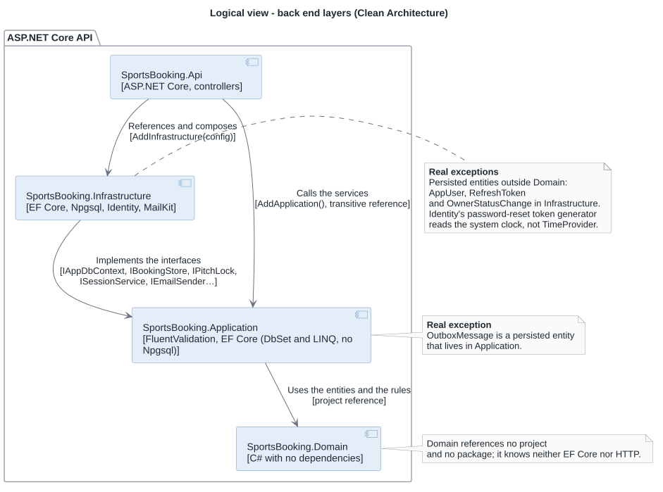

Source: [logical-layers.puml](logical-layers.puml).

| Name | Technology | Responsibility |
| --- | --- | --- |
| SportsBooking.Api | ASP.NET Core, controllers | Thin controllers, cookies and JWT, policies by profile, ProblemDetails, Origin check, rate limiting. Program.cs only composes. |
| SportsBooking.Infrastructure | EF Core, Npgsql, Identity, MailKit | AppDbContext, migrations, stores (I\*Store), PitchLock, sessions, Identity, SMTP sending, the outbox worker, commands. |
| SportsBooking.Application | FluentValidation, EF Core (DbSet and LINQ, no Npgsql) | Services per use case, validation, Result/ServiceError, IAppDbContext and the interfaces that Infrastructure implements. |
| SportsBooking.Domain | C# with no dependencies | Entities with private setters and intention-revealing methods; rules for hours, slots and accounts. |

**Dependency rule.** Dependencies point inward only: L-API → L-INF → L-APP → L-DOM. That is what the project references say: `SportsBooking.Api` references only Infrastructure (and reaches Application through it), Infrastructure references Application, Application references Domain, and Domain references nothing (not even packages). Each layer registers itself (`AddApplication()`, `AddInfrastructure(config)`); `Program.cs` only composes.

| Id | Project | What lives there |
| --- | --- | --- |
| L-API | `SportsBooking.Api` | Thin controllers, `AuthCookies` and JwtBearer reading the cookie, policies by profile, `ServiceErrorResults` (`Result` → ProblemDetails), `GlobalExceptionHandler`, the `Origin` check, rate limiting, `Program.cs` (startup, migrations, admin seed, commands). |
| L-APP | `SportsBooking.Application` | One service per use case (`BookingService`, `ClubBookingService`, …), FluentValidation validators, `Result<T>`/`ServiceError`, `IAppDbContext` and the interfaces that Infrastructure implements (`IAccountStore`, `ISessionService`, `IBookingStore`, `IPitchLock`, `IEmailSender`, …), the shared pieces (`OwnedClubs`, `VisibleClubs`, `PitchDayCalendar`, `BookingSlotCheck`) and email composition. |
| L-INF | `SportsBooking.Infrastructure` | `AppDbContext` and migrations, EF configurations, the stores (their own SQL: 23P01, `SKIP LOCKED`, conditional updates), `PitchLock`, Identity (`AppUser`, `AccountStore`), sessions (`SessionService`, `RefreshToken`), `SmtpEmailSender`, the outbox worker, the `seed-demo` and `set-admin-password` commands. |
| L-DOM | `SportsBooking.Domain` | Entities (`Club`, `Pitch`, `Block`, `Booking`, …), time values and rules (`ClubTime`, `SlotGenerator`, `OpeningHours`, `TimeSlot`, `BookingWindow`), account rules (`Profiles`, `PasswordPolicy`, …). |

**What upholds the rule.**

- **Thin controllers.** A controller receives the request, calls a service and turns the `Result` into a response with `this.Problem(error)`; it has no rules.
- **Entities protect the invariants.** Private setters, private constructors and intention-revealing methods: `booking.CancelByPlayer(window, now)`, `booking.CancelByClub(reason, now)`, `pitch.ChangeSchedule(duration, week, now)`, `pitch.TryAddPriceBand(details, now, out band)`. Whoever asks for a change gets the result (`CancellationOutcome`, `NoShowOutcome`, `PriceBandOutcome`) and the state only changes on success.
- **Expected failures are results.** Services return `Result<T>` with a `ServiceError` (stable `code`, `ErrorKind` → HTTP status); exceptions are only programming errors or unexpected failures, which `GlobalExceptionHandler` turns into 500.
- **`IAppDbContext`, no generic repository.** Application uses EF Core's `DbSet`s and LINQ directly (the `DbContext` is the unit of work). What depends on PostgreSQL stays behind a small interface implemented in Infrastructure (`IBookingStore`, `IPitchStore`, `IClubStore`, `IOwnerStatusStore`, `IOccupationStore`, …).
- **Injected time.** All current time comes from `TimeProvider` (CC-TIME).

**Real exceptions** (see the [architecture notes](../README.md#known-limitations)):

- Persisted entities outside Domain: the account (`AppUser`, D-USER, from Identity), the refresh token (`RefreshToken`, D-REFRESH) and an owner's status change (`OwnerStatusChange`, D-STATUSCHG) live in Infrastructure; the outbox message (`OutboxMessage`, D-OUTBOX) lives in Application. In Domain the account exists only as rules (`Dom/Accounts`).
- Identity's password-reset token generator (`DataProtectorTokenProvider`, registered by `AddDefaultTokenProviders`) reads the system clock, not `TimeProvider`; the tests fabricate old tokens in Identity's format.

## 2. API components (C4 level 3)

### Overview by feature

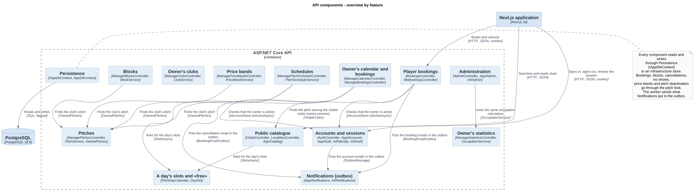

Source: [03-components-api-overview.puml](../c4/03-components-api-overview.puml).

Each component brings together the controller, the services and what Infrastructure gives it (paths in the inventory). The startup and command-line components (API-ADMINSEED, API-DEMO, API-ADMINPW) are not here: they run before the server starts (C-CLI) and appear in the accounts diagram. The cross-cutting pieces in front of all the controllers (CC-ORIGIN, CC-RATE, CC-COOKIES, CC-AUTHZ, CC-PROBLEM) are also left out so as not to repeat an arrow per component.

The connections between features that matter:

- **Booking goes through four shared pieces**: CC-AUTHZ (owner only), CC-LOCK, CC-SLOTCHECK and API-NOTIF. The detail is in the next diagram.
- **A single calculation of free slots** (CC-DAYCAL) for the owner's preview (API-SCHED) and for the public catalogue (API-CATALOG).
- **A single occupation calculation** (`OccupationService`, in API-STATS), also used by the admin's top 10.
- **API-PITCHES is the door to the owner's pitches** (`OwnedPitches`), used by schedules, blocks, price bands and the owner's bookings.

### Bookings: single, weekly series and the owner's

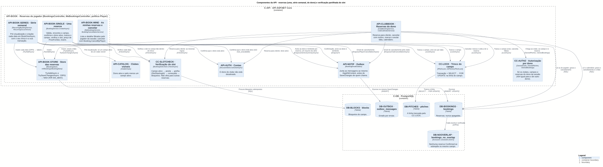

Source: [03-components-api-bookings.puml](../c4/03-components-api-bookings.puml).

- A single booking (API-BOOK-SINGLE), each date of a series (API-BOOK-SERIES, in `BookOneAsync`) and the booking for a customer (API-CLUBBOOK) follow the same sequence: lock the pitch (CC-LOCK), read the pitch again inside the lock, `BookingSlotCheck.CheckAsync` (CC-SLOTCHECK), price from `Pitch.PriceForSlot`, and insert through `IBookingStore.TryAddAsync`. Overlap with another booking is left to `bookings_no_overlap` (DB-NOOVERLAP): 23P01 → 409 `slot_taken` (or the reason `taken` in a series).
- The emails (API-NOTIF) go into the same `IAppDbContext` before the caller's `SaveChanges`, so they are written, or undone, with the booking. The series has its own summary, saved after the dates, in a separate transaction.
- Cancelling (player or owner) and marking or undoing a no-show also run under CC-LOCK and read the booking again inside it. Undoing a no-show saves through `TrySaveChangesAsync`, because the constraint may refuse.
- A series preview reads the pitch through the visible clubs (`VisibleClubs`, API-CATALOG); creation, like a single booking, only checks that the pitch exists and that the owner is active.

### Accounts, sessions and password recovery

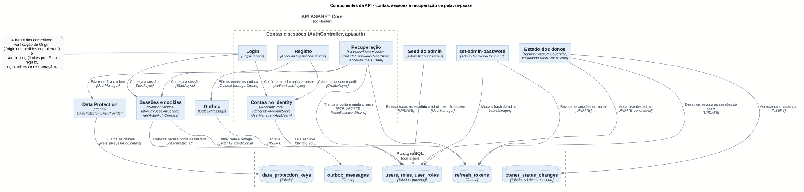

Source: [03-components-api-accounts.puml](../c4/03-components-api-accounts.puml).

- Registration and login end in `ISessionService.StartAsync` (CC-COOKIES): an access JWT with `sub` and `role` and a refresh token stored only as a SHA-256; `AuthController` writes the two cookies with `AuthCookies`.
- Refresh (CC-COOKIES) refuses a deactivated account and consumes the token with a conditional update; an already used token revokes all the account's sessions.
- Recovery (API-AUTH-RESET) only puts the account id in the outbox; the token is made by the worker, with Identity and the Data Protection keys (CC-DATAPROT, stored in DB-DPKEYS). Confirming changes the hash, revokes the sessions and puts the `password_changed` notice in the outbox, in one transaction.
- Deactivating an owner (API-ADMIN) and `set-admin-password` (API-ADMINPW) also revoke refresh tokens. Only the seed (API-ADMINSEED) gives the Admin profile.

### Notifications: outbox and worker

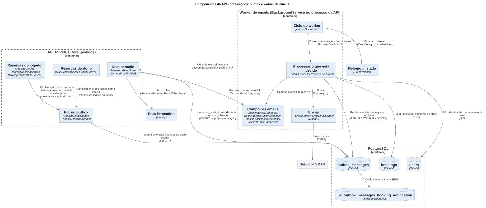

Source: [03-components-api-notifications.puml](../c4/03-components-api-notifications.puml).

- On the request side, only the `outbox_messages` table is written, in the change's transaction. The DB-OUTBOXUQ index guarantees at most one reminder and one owner notice per booking.
- The worker (C-WORKER) is a `BackgroundService` in the API process: `OutboxDispatcher` runs `OutboxProcessor.ProcessDueAsync` in a scope per pass; this claims the due messages with `FOR UPDATE SKIP LOCKED`, reads the booking and the recipient **at send time**, composes (the recipient's language, pt-PT or English since T09; Lisbon time) and sends through `IEmailSender`. The message states are in section 5.

## 3. Front end components (C4 level 3)

### Routes, guards and paths to the API

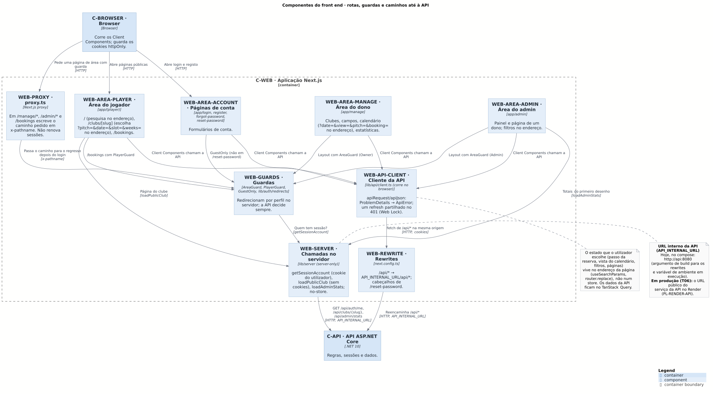

Source: [03-components-web.puml](../c4/03-components-web.puml).

There are two paths to the API:

- **In the browser**, the features' Client Components call `/api/*` on the same origin, only through WEB-API-CLIENT (`apiRequest`/`apiJson`); Next.js forwards to the API (WEB-REWRITE). The httpOnly cookies go with the request; on a 401 there is a single shared refresh (Web Lock between tabs) and a retry.
- **On the server**, WEB-SERVER (`lib/server`, `server-only`) calls the API directly at the **internal URL** (`API_INTERNAL_URL`, `lib/server/api-url.ts`), with `no-store`: `getSessionAccount` passes the user's cookie to `GET /api/auth/me`, `loadPublicClub` passes no cookies, `loadAdminStats` passes the admin's. The server never renews a session. Today, in compose, that URL is `http://api:8080`. In production (T06) it is the public URL of the API service on Render (PL-RENDER-API), set in `API_INTERNAL_URL`.

WEB-PROXY (`proxy.ts`) writes the requested path to `x-pathname` in the guarded areas (`/manage/*`, `/admin/*`, `/bookings`); the guards (WEB-GUARDS) use it to send to `/login?next=…`. It also answers 404 to an impossible id and to a public club the API does not have, because a page that has already started sending cannot change the HTTP status. The guards are a convenience: whoever decides access is always the API.

**State is in the address, not in a store.** The booking step (`?pitch=&date=&slot=&weeks=`, `features/booking/selection.ts`), the calendar view (`?date=&view=&pitch=&booking=&cancelled=`, `features/calendar/calendar-url.ts`), the search filters, the pages and the admin and statistics filters live in the page address (`useSearchParams`, `router.replace`). That is what lets a visitor return to the same choice after login and share links. API data stays in TanStack Query; there is no Zustand.

### Areas and features

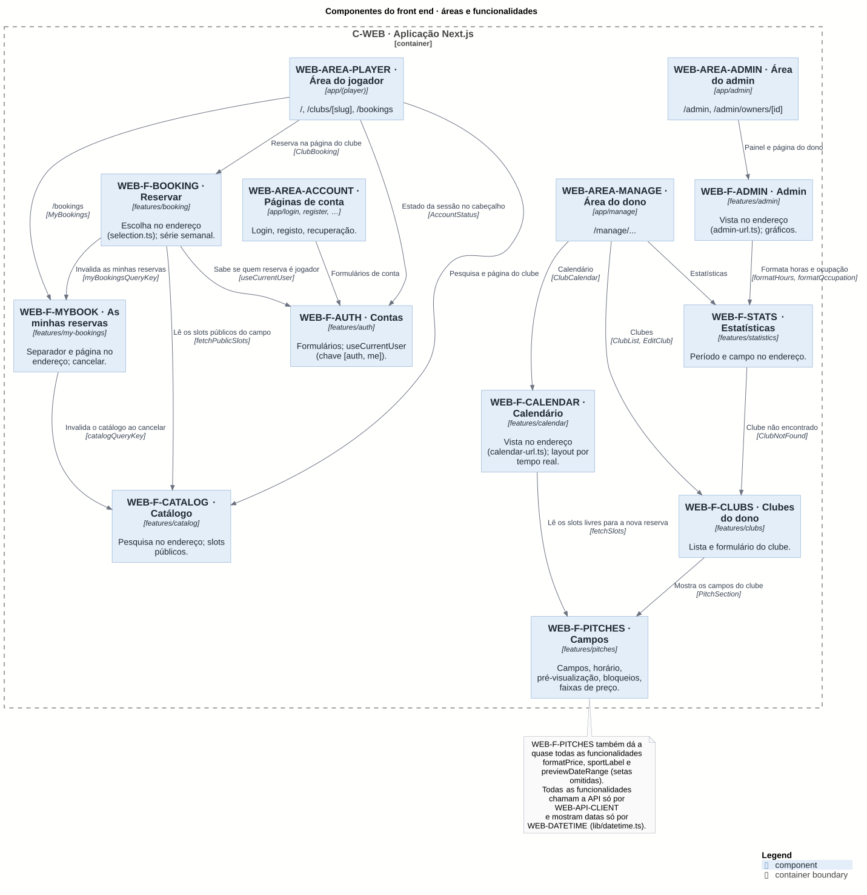

Source: [03-components-web-features.puml](../c4/03-components-web-features.puml).

The arrows between features are the real imports that count for something (a component, a read, a cache invalidation). WEB-F-PITCHES also gives almost all the other features formatting functions (`formatPrice`, `sportLabel`, `previewDateRange`); those arrows were left out.

## 4. Domain model

Two diagrams, so as not to go past about 15 elements: the bookings one and the one for accounts and entities of other layers. Each class's package is the layer where it lives.

### Clubs, pitches, blocks and bookings

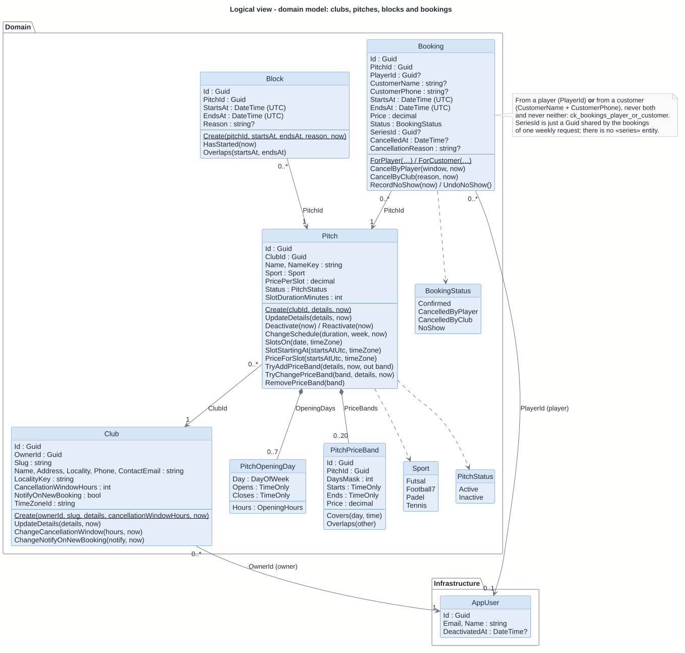

Source: [logical-domain-booking.puml](logical-domain-booking.puml).

### Accounts, sessions, owner history and outbox

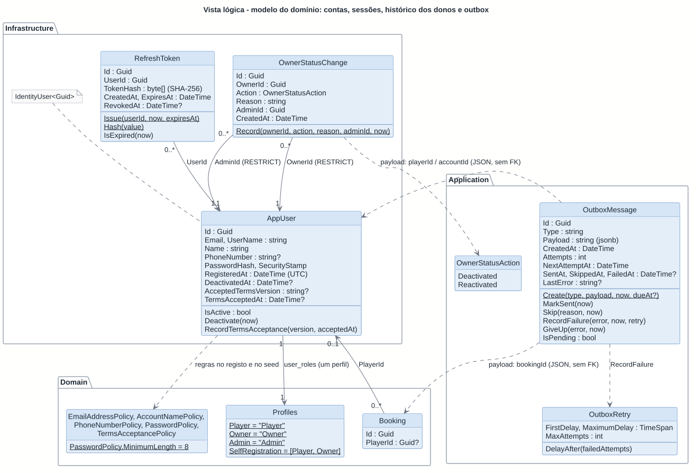

Source: [logical-domain-accounts.puml](logical-domain-accounts.puml).

### Main invariants and where they are guaranteed

| Element | Invariant | Guaranteed by |
| --- | --- | --- |
| D-CLUB | A single owner, forever (`OwnerId` only at creation). | `Club.Create`; `RESTRICT` FK to `users`. |
| D-CLUB | Unique `Slug`, generated from the name at creation, never changed. | `Club.UpdateDetails` does not touch it; `ix_clubs_slug` (unique). |
| D-CLUB | Cancellation window from 1 to 168 h; read at the moment of cancelling, never copied into the booking. | `ClubRules.IsValidCancellationWindow`; `ck_clubs_cancellation_window_hours`. |
| D-PITCH | Never deleted (active/inactive); name unique in the club, case-insensitive. | `Deactivate`/`Reactivate`; `NameKey` + `ix_pitches_club_id_name_key`. |
| D-PITCH | Price > 0, ≤ 500, two decimal places; slot of 30, 60 or 90 min. | `PitchRules.IsValidPrice`, `SlotDuration.IsSupported`; `ck_pitches_*`. |
| D-PITCH | Slots only come from `SlotsOn` → `SlotGenerator`; a slot's price only comes from `PriceForSlot`. | Code (a single function of each). |
| D-OPENDAY | At most one interval per day; hours in 30-minute steps; closing `00:00` = midnight, never later. | `Pitch.ChangeSchedule`, `OpeningHours.Create`; `ck_pitch_opening_hours_*`. |
| D-PRICEBAND | At least one day; no overlap on the same pitch (touching is allowed); at most 20. | `Pitch.TryAddPriceBand`/`TryChangePriceBand`, `PitchPriceBand.Apply`; `ck_pitch_price_bands_*`. |
| D-BLOCK | `[StartsAt, EndsAt)` in UTC, end after start; no overlap with another block or with confirmed bookings. | `Block.Create`; `BlockService` under CC-LOCK; `ck_blocks_ends_after_starts`. |
| D-BOOKING | From a player **or** from a customer, never both and never neither. | `Booking.ForPlayer`/`ForCustomer`; `ck_bookings_player_or_customer`. |
| D-BOOKING | No confirmed booking overlaps another on the same pitch. | `bookings_no_overlap` (DB-NOOVERLAP), for `Confirmed` only. |
| D-BOOKING | Never deleted; changes state only through the methods in section 5; stores the price at the time. | `Booking`; `ck_bookings_status`, `ck_bookings_price`. |
| D-USER | One email = one account = one profile; unique normalized email. | `AccountStore.CreateAsync` (account and profile in one transaction); `ix_users_normalized_email`. |
| D-REFRESH | Only the SHA-256 is stored; each token is used once; absolute lifetime. | `RefreshToken.Issue`; conditional update in `SessionService.RefreshAsync`. |
| D-STATUSCHG | Append-only. | No update/delete in the code; trigger `owner_status_changes_append_only` (DB-AUDITTRG). |
| D-OUTBOX | No addresses in the payload; at most one outcome. | `BookingEmailOutbox`, `PasswordResetStore`; `ck_outbox_messages_one_outcome`. |

## 5. State machines

The transitions were taken from the entities' methods and the services that call them.

### Booking

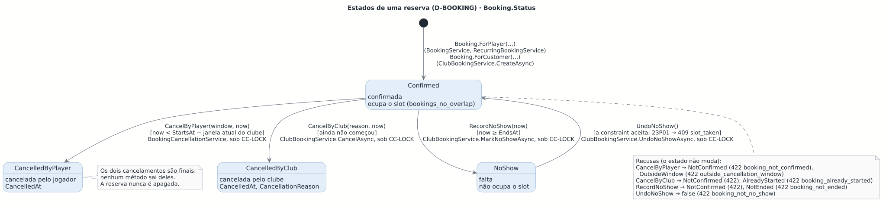

Source: [logical-state-booking.puml](logical-state-booking.puml).

`Confirmed` is the only state with exits. Both ways of cancelling are final. A no-show can go back to `Confirmed` (`UndoNoShow`), but only if no other confirmed booking has taken the slot in the meantime: the no-show does not occupy the slot, so it is the database that decides (23P01 → 409 `slot_taken`). `Booking.MarkNoShow(now)` is the same as `RecordNoShow(now) == Marked` and is only used by `DemoDataSeeder`.

### Outbox message

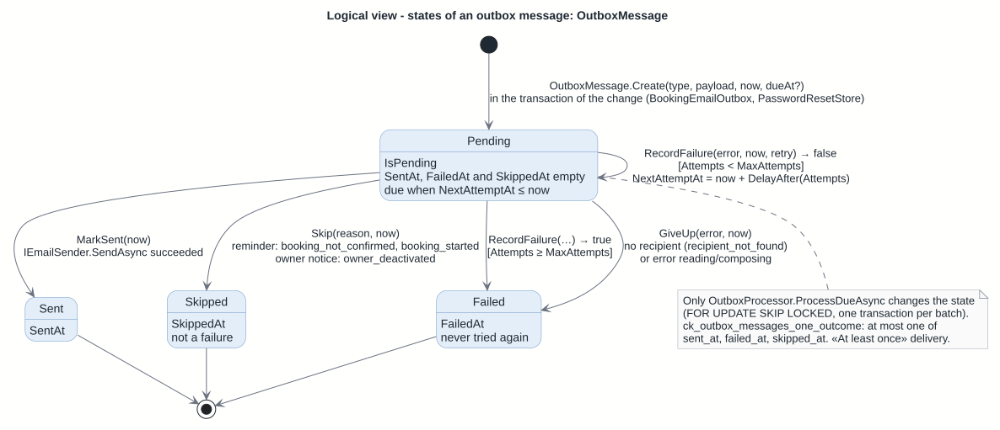

Source: [logical-state-outbox.puml](logical-state-outbox.puml).

There is no state column: the state is which of the three dates (`SentAt`, `SkippedAt`, `FailedAt`) is filled in, and `IsPending` when none is. A send failure counts as an attempt and postpones the next one (`OutboxRetry`, doubling interval up to the maximum); on the last allowed attempt, the message becomes failed.

### Owner

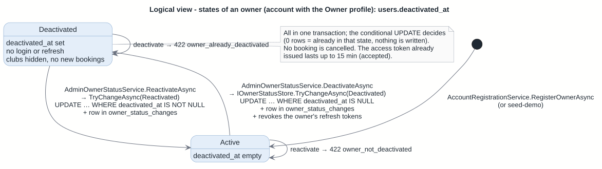

Source: [logical-state-owner.puml](logical-state-owner.puml).

The state is `users.deactivated_at`. The change is made by `IOwnerStatusStore.TryChangeAsync` (`Inf/Admin/OwnerStatusStore`) with a conditional `UPDATE`, not by the `AppUser.Deactivate(now)` method, which only the tests call. The effects of being deactivated come from the checks that already exist: `AccountStore.AuthenticateAsync` (login), `SessionService.RefreshAsync` (refresh), `VisibleClubs` (public pages) and `IAccountStore.IsActiveAsync` (new bookings).

## 6. Code (C4 level 4)

### The Booking aggregate

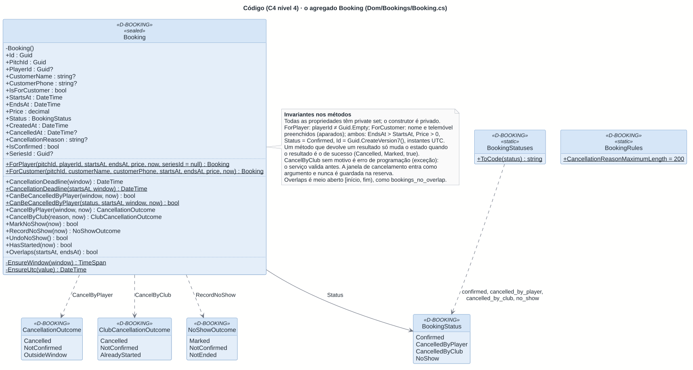

Source: [logical-code-booking.puml](logical-code-booking.puml). File: `Dom/Bookings/Booking.cs`.

The methods that change the state return the result instead of throwing: the services translate each result into a `ServiceError` (for example `CancellationOutcome.OutsideWindow` → 422 `outside_cancellation_window`, with the `cancellationDeadline`). The static methods `CancellationDeadline(startsAt, window)` and `CanBeCancelledByPlayer(status, startsAt, window, now)` exist for the my-bookings list, which does not load entities, and are the same ones the instance methods use.

### Slot generation, «free» and price

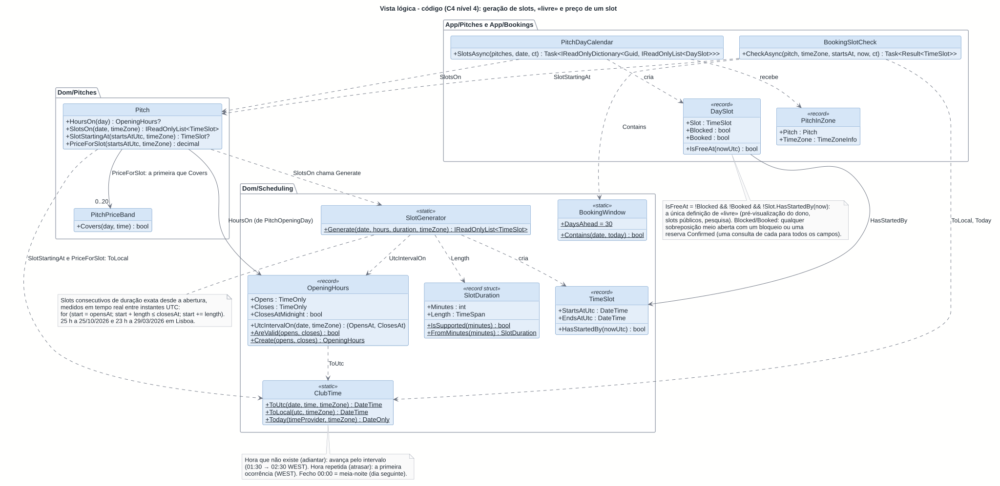

Source: [logical-code-slots.puml](logical-code-slots.puml).

- `ClubTime` is the single local↔UTC conversion. `OpeningHours.UtcIntervalOn` uses it for a day's opening and closing instants; `SlotGenerator.Generate` cuts that interval into slots of exact duration.
- `Pitch.SlotsOn` picks the weekday's hours and calls the generator; `Pitch.SlotStartingAt` (a booking's end always comes from here) and `Pitch.PriceForSlot` (the first band that `Covers` the start's local day and time, otherwise `PricePerSlot`) use the start's local time.
- `PitchDayCalendar.SlotsAsync` adds to the slots the blocks and confirmed bookings of all the pitches asked for and returns `DaySlot`s; `DaySlot.IsFreeAt` is the single definition of «free».
- `BookingSlotCheck.CheckAsync` is what is checked when booking: the window (`BookingWindow.Contains` with `ClubTime.Today`), the grid (`SlotStartingAt`), "started" (`TimeSlot.HasStartedBy`) and the blocks.

## Notes

- **File.** This view brings together what was previously planned in `03-components.md` and `04-domain.md` (which were empty).
- **New ids.** The layers (`L-`) and the parts of the busiest components (`API-BOOK-*`, `API-AUTH-*`, `API-NOTIF-*`) were added to the inventory with this view.
- **Deviations found between documents and code** (all fixed):
  - `docs/stack.md` gave `booking.Cancel(motivo, agora)` (Portuguese for "reason, now") as an example; the real methods are `CancelByPlayer(window, now)` and `CancelByClub(reason, now)`. **Fixed.**
  - AGENTS.md said that a deactivated account is `AppUser.Deactivate(now)`; in production deactivation is `OwnerStatusStore`'s conditional `UPDATE`, and `AppUser.Deactivate` is only used in the tests. **Fixed.**
  - The comment of `PitchPriceBand` referred to `Pitch.AddPriceBand` and `Pitch.ChangePriceBand`; the methods are called `TryAddPriceBand` and `TryChangePriceBand`. **Fixed** (T06 pre-deploy hardening pull request).
