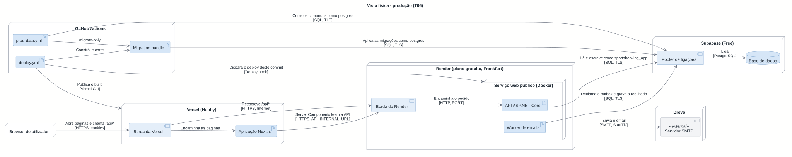

# Physical view

<!-- C4 deployment diagrams · 4+1 view: physical. See README.md. -->

Where each container runs, how it is reached, what is trusted and which configuration changes behaviour. Two levels: the **deployment diagrams** (development, which exists, and production, running since 2026-11-09, T06) and **network and trust** (what is public, TLS, origin, client IP, database, secrets). The ids are in the [inventory](../inventory.md); the `DEP-` nodes and the new `PL-` ones were added with this view.

What is said about development was checked on 2026-10-30, at commit `452be5a`, against `docker-compose.yml`, `.env.example`, `backend/Dockerfile`, `frontend/Dockerfile`, `frontend/next.config.ts`, `frontend/src/proxy.ts`, `Api/Program.cs`, the `appsettings*.json` files and the options classes. **Production has been running since 2026-11-09.** What is said about the providers (Vercel, Render, Supabase, Brevo) comes from their documentation, read that day, and from the first real deploy at the points indicated. The decision is in [ADR 0009](../adr/0009-deployment-target.md).

Sections 1 (development) and 3 (production), with the deployment diagrams, are in [C4 · Deployment](../c4/README.md#deployment); the numbering of these sections is kept.

Source: [physical.puml](physical.puml). UML deployment diagram of production, with the same nodes and names as the [deployment C4](../c4/README.md#3-production-t06): what has existed since 2026-11-09, without what [ADR 0009](../adr/0009-deployment-target.md) did not adopt.

## 2. Continuous integration

CI (X-GHA, `.github/workflows/ci.yml`) deploys nothing: the deploy is `deploy.yml` (PL-DEPLOY). The `ubuntu-latest` runners build and test; the integration tests start their own `postgres:18.6` with Testcontainers, and the `diagrams` job starts the PlantUML image. Details in [Development view](development.md#4-build-and-quality-pipeline). In T06, CI also becomes part of the deploy (section 5).

## 4. Network and trust

### 4.1 What is public and what is not

| What | Today (compose) | Production (T06) |
| --- | --- | --- |
| Pages and `/api/*` | `localhost:3000` (C-WEB) | `https://<project>.vercel.app` (PL-VERCEL) |
| The API directly | `localhost:5080` (Swagger) | **Yes**, at `https://<service>.onrender.com`. Swagger only exists in Development. A `POST` without the site's `Origin` gets 403 |
| PostgreSQL | `localhost:5432` | Supabase endpoint on the Internet, protected by password and TLS |
| SMTP | Mailpit at `localhost:1025`/`8025` | Brevo (external provider) |

### 4.2 TLS

- **Browser → Vercel:** HTTPS. The cookies are already `Secure` (`AuthCookies`). HSTS is turned on with `ENABLE_HSTS=true` in Vercel's variables: the headers are written at build time.
- **Vercel → Render:** HTTPS over the Internet (the build fails on Vercel if `API_INTERNAL_URL` is not `https`).
- **Render edge → C-API:** HTTP. Render's documentation says the load balancer terminates TLS. The API does not do `UseHttpsRedirection`, which is right behind a proxy, and reads the scheme from `X-Forwarded-Proto`.
- **C-API → Supabase:** TLS, with `SSL Mode=Require` (encrypts without verifying the server, as Supabase's documentation describes).
- **C-WORKER → Brevo:** `Email__Security=StartTls` on port 2525 (confirmed on the first deploy; `StartTls` refuses to send if the server does not support TLS).

### 4.3 A single origin: first-party cookies, no CORS, `Origin`

The browser only knows Vercel's origin: the pages and `/api/*` come from that address, and the rewrite sends `/api/*` to the API. Therefore:

- The cookies `access_token` (`Path=/`, `SameSite=Lax`) and `refresh_token` (`Path=/api/auth`, `SameSite=Strict`), both httpOnly and Secure, are **first-party**.
- **There is no CORS** and the API does not configure it.
- The **`Origin` check** (CC-ORIGIN) accepts only `Security__AllowedOrigins__0`, Vercel's address without a trailing slash. Without at least one origin the API does not start. Vercel previews have another address and get 403.
- Whoever calls the API from the server (Server Components) only makes `GET`s, which do not need an `Origin`.

### 4.4 The client IP

**Provisional.** Rate limiting (CC-RATE) counts by client IP. The API only reads `X-Forwarded-For` and `X-Forwarded-Proto` if a proxy is configured. In production it uses `ForwardedHeaders__TrustAnyProxy=true`, because Render's proxies have no addresses that can be listed, with an explicit `ForwardedHeaders__ForwardLimit`.

- **Rewrite:** Vercel's documentation says that, on an external rewrite, it sends the origin `x-forwarded-for` with the visitor's public IP, and that it overwrites what the browser sends.
- **Server Components:** carry the visitor's IP (`visitorIpHeader`, `lib/server/visitor-ip.ts`).
- **The chain on Render is not documented:** how many entries reach the API and in what order. On the first deploy, `ForwardLimit=1` gave the client's right IP, found with the log line `Too many requests from client …` ([procedure](../../deployment/environment-variables.md)).
- **The API is public**, so whoever connects to it directly can forge the header: the per-IP limits are best-effort only, and the real protection against guessing passwords is Identity's account lockout.

### 4.5 The rewrites are fixed at build time

`next.config.ts` reads `API_INTERNAL_URL` when Next.js **builds** the application; Server Components read the same variable **at run time**. On Vercel it is a single variable, available at both moments, and changing the API's address requires a new deploy. The build fails on Vercel if it is missing. Details in [`environment-variables.md`](../../deployment/environment-variables.md).

### 4.6 Database: roles, connection and Supabase

**Two roles (PL-DBUSERS, T06 criterion), created by [`supabase-roles.sql`](../../deployment/supabase-roles.sql):**

| Role | Used by | Can | Cannot |
| --- | --- | --- | --- |
| `postgres` (schema owner) | PL-MIGBUNDLE and C-CLI, from GitHub Actions | DDL: tables, indexes, `bookings_no_overlap`, the DB-AUDITTRG trigger and the `btree_gist` extension (DB-GIST) | — |
| `sportsbooking_app` | C-API and C-WORKER, on Render | `SELECT`, `INSERT`, `UPDATE`, `DELETE` on the tables; use the sequences; `USAGE` on the schema | DDL, `TRUNCATE`, create extensions |

`ALTER DEFAULT PRIVILEGES FOR ROLE postgres` covers the tables and sequences created by future migrations. Tested with compose's `postgres:18.6`: bookings, `bookings_no_overlap` (409 `slot_taken`), the outbox, the Data Protection keys, the refresh tokens, Identity and the trigger work with the application role, which cannot do DDL. The migrations and `seed-demo` also ran on `postgres:17`.

**Connection through Supabase's pooler.** The API's transactions depend on session state: `PitchLock` holds `SELECT … FOR UPDATE` until `COMMIT`, the worker holds `FOR UPDATE SKIP LOCKED` and Npgsql prepares commands. Supabase's documentation (2026-11-09) says that the shared pooler is IPv4, that session mode uses port 5432 and supports prepared statements, that transaction mode uses 6543 and does not support them, and that the direct connection is IPv6, or IPv4 with a paid add-on. The user is `<role>.<project-ref>`. Choice: **session mode on port 5432**. On the free plan the pool has 15 connections, so Render uses `Maximum Pool Size=5`.

**Supabase's data API.** The documentation says that new objects in `public` may receive privileges for `anon`, `authenticated` and `service_role`, depending on the project. The application's tables have no row level security and include `users`. The script removes those privileges, also for future tables.

**Version.** Development and the tests use PostgreSQL 18.6; the pages read do not say which version Supabase gives to new projects.

### 4.7 Secrets and environment variables per service

The complete list, per place, is in [`environment-variables.md`](../../deployment/environment-variables.md). `ValidateOnStart`: a required setting that is missing or invalid prevents the API from starting, and the message never shows the value. The schema owner's connection only exists in GitHub's secrets, never on Render.

### 4.8 Where migrations and commands run

**`deploy.yml` (PL-DEPLOY)** runs after green CI on `main`, at CI's exact commit, and only with the `DEPLOY_ENABLED` variable set to `true`:

1. **migrate:** builds the migration bundle (PL-MIGBUNDLE) and applies it as `postgres`.
2. **deploy-api:** calls Render's deploy hook with that commit (PL-DEPLOYHOOK) and waits up to 6 minutes for a 200 on `/health`.
3. **deploy-web:** `vercel pull`, `vercel build --prod` and `vercel deploy --prebuilt --prod`, from the repository root.
4. **smoke:** reads only, on the site and on `/health`.

The new schema goes live before the new API: **every migration must work with the previous version of the API** (add before removing). `/health` does not say which version is running, and during a build Render keeps serving the previous instance: a 200 confirms the API answers, not that this commit is already active.

**`prod-data.yml` (PL-PRODDATA)**, manual, runs `migrate-only`, `set-admin-password` or `seed-demo`, as `postgres`. The concurrency group is the deploy's.

### 4.9 Data Protection keys and backups

- The keys that protect the recovery tokens (CC-DATAPROT) live in the `data_protection_keys` table (DB-DPKEYS). That is why a restart or a new deploy keeps accepting links already sent, and nothing needs persistent disk on Render.
- The code does not configure encryption of the keys at rest: **whoever has a copy of the database has the keys**.
- **Backups (PL-BACKUP).** There are none: the data is demo data, and Supabase's documentation does not include automatic backups on the free plan.

## 5. Risks and open points for T06

The accepted risks are in [ADR 0009](../adr/0009-deployment-target.md). Results of the first real deploy (2026-11-09), according to the project owner. "Not reported" is still to be confirmed.

| # | Point | Status | What to verify |
| --- | --- | --- | --- |
| 1 | **`ForwardLimit`** | Confirmed: `1` gave the client's right IP | — |
| 2 | **`Origin` and `Set-Cookie` on the Vercel rewrite** | Confirmed: login and a request that changes data worked | — |
| 3 | **Vercel's caching on the rewrites** | Confirmed: nothing was cached | — |
| 4 | **Port 2525 and STARTTLS on Brevo** | Confirmed: port 2525 with StartTls worked | — |
| 5 | **Supabase's pooler with EF Core** | Not reported separately | A booking and the worker against Supabase |
| 6 | **`btree_gist` on Supabase** | Not reported separately | The runbook's query |
| 7 | **A real `vercel deploy --prebuilt`** | Not reported separately | The result of `deploy.yml` |
| 8 | **Build context on Render** | Confirmed: the runbook's values were the ones used | — |
| 9 | **HTTP health check on the free plan** | The runbook's values, including the health check, were the ones used; no differences | — |
| 10 | **Client IP on Server Component calls** | Not reported separately | A request for a club page |
| 11 | **Supabase's PostgreSQL version** | Not reported | The `select version()` query |

## 6. Notes

- **File.** This view replaces the planned `06-deployment.md` (which was empty); the matching entry in the [README](../README.md) was updated.
- **New ids** (in the [inventory](../inventory.md)): `DEP-DEVHOST`, `DEP-COMPOSE-NET`, `DEP-PGVOLUME` (new prefix `DEP-`, deployment nodes and infrastructure that exist today), `PL-DNS`, `PL-RENDER-EDGE`, `PL-RENDER-NET`, `PL-SUPAPOOL`, `PL-DEPENDABOT`, `PL-SECHEADERS`.
- **What this view replaces from the Stack:** see [ADR 0009](../adr/0009-deployment-target.md). The Stack was not changed.
- **Revised target (2026-11-09).** The first version of this view described Next.js and a private API on Render. The target became Vercel and free Render with a public API (ADR 0009): the ids `PL-RENDER-WEB`, `PL-RENDER-NET` and `PL-DNS` stay in the inventory as "not adopted".
- **Deviations found between documents and code** (fixed):
  - The comment of `TrustedProxyOptions` said production trusts only Caddy. **Fixed**: it describes what T06 did (section 4.4).
  - `AGENTS.md` said "Caddy in prod" for the same origin and for the client IP. **Fixed** (planned, no trusted proxy today). `README.md` also said "Production: trust only Caddy"; **fixed** when it was rewritten (pull request #29).
  - `getPublicClub` called an endpoint with a per-IP limit from the server, without the client's IP. **Fixed** in T06 (`visitorIpHeader`).
  - The comment of `MigrateDatabaseAsync` and that of `Program.cs` said production uses a migration bundle, which did not exist. **Fixed**: the bundle is built and applied by the T06 workflows.
  - The diagram [02-containers-dev.svg](../out/02-containers-dev.svg) showed the label of the C-WEB → C-API arrow broken, because `http://` in the technology argument of a `Rel` is read as italics by PlantUML. **Fixed** (the technology is now "HTTP, api:8080"); in the physical view diagrams the scheme was also removed from those labels.
