# Vista de processo

<!-- Diagramas de sequência UML · vista 4+1: de processo. Ver README.md. -->

O que corre, em que processo e fio de execução, o que corre ao mesmo tempo, e como as partes colaboram nos pedidos que mexem em dados partilhados: as transações, os trincos, o outbox e o worker. Tudo foi tirado do código (a ordem do pipeline vem de `Api/Program.cs`, não dos documentos); os ids estão no [inventário](../inventory.md).

**Como ler os diagramas de sequência.** São diagramas de sequência UML simples, com as mensagens numeradas. Cada participante mostra o nome de um elemento do inventário (o id é o alias no PlantUML, ver a [secção 12 do inventário](../inventory.md#12-nomes-e-aliases-nos-diagramas)) e a caixa à volta dele é o contentor ou o processo onde corre. A classe ou o método que representa cada participante está na [secção 5](#5-participantes-de-cada-diagrama). Uma seta cheia é uma chamada (rótulo em pt-PT, tecnologia ou SQL entre parênteses retos, no mesmo texto); uma seta a tracejado é a resposta. `group` marca uma transação, `alt` as saídas possíveis, `loop` uma repetição. Quando o mesmo elemento aparece duas vezes (dois separadores do browser), o segundo alias leva um sufixo (`WEB_API_CLIENT_B`).

## 1. Processos, fios e o que corre ao mesmo tempo

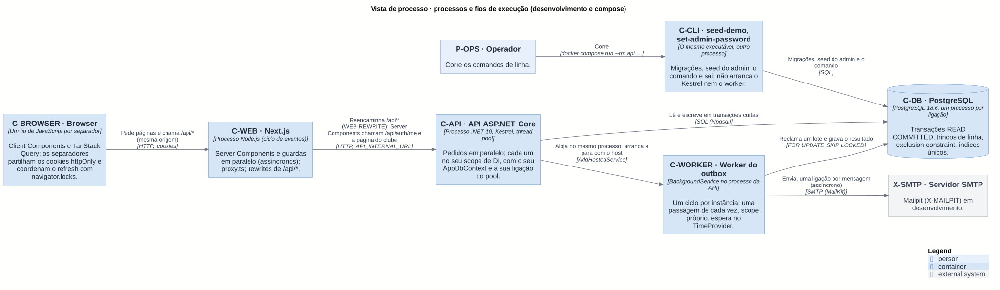

Fonte: [process-runtime.puml](process-runtime.puml).

| Processo | Elemento | Fios e concorrência |
| --- | --- | --- |
| Browser | C-BROWSER | Um fio de JavaScript por separador. Os separadores partilham os cookies httpOnly, por isso coordenam o refresh com a Web Locks API (secção 2.4). Dentro de um separador, os 401 simultâneos partilham um só refresh (`refreshInFlight`). |
| Next.js | C-WEB | Um processo Node.js com um ciclo de eventos: muitos pedidos de página em paralelo (assíncronos). `proxy.ts` (WEB-PROXY) corre antes das páginas das áreas com guarda; os Server Components chamam a API pelo URL interno; os rewrites (WEB-REWRITE) reencaminham `/api/*`. O servidor nunca renova uma sessão. |
| API | C-API | Um processo .NET 10 (Kestrel). Cada pedido corre no thread pool, no seu scope de DI, com o seu `AppDbContext` e a sua ligação do pool do Npgsql: os pedidos correm em paralelo e só se esperam uns pelos outros na base de dados (trincos de linha, constraints). Em desenvolvimento a API também se alcança diretamente na porta 5080 ([Notas de arquitetura](../README.md#limitações-conhecidas), 1). |
| Worker de emails | C-WORKER | Um `BackgroundService` (`OutboxDispatcher`) dentro do processo da API, que arranca e para com o host. Um ciclo por instância: uma passagem de cada vez, cada uma no seu scope. Corre em paralelo com os pedidos; com várias instâncias da API há vários workers, e `SKIP LOCKED` impede que dois peguem na mesma mensagem. `Outbox:Enabled=false` desliga-o (testes). |
| Comandos de linha | C-CLI | O mesmo executável, noutro processo de curta duração, corrido pelo operador (P-OPS): `seed-demo` ou `set-admin-password`. `Program.cs` valida as opções, aplica as migrações (em Development ou com `Database:ApplyMigrationsOnStartup`), corre o seed do admin, corre o comando e sai **antes** de `MapControllers` e `RunAsync`: não arranca o Kestrel nem o worker, por isso não envia emails. Pode correr ao mesmo tempo que uma API a servir pedidos; o `seed-demo` recusa-se se já houver donos ou jogadores e faz tudo numa transação. |
| PostgreSQL | C-DB | Um processo por ligação. Transações `READ COMMITTED` (o valor por omissão): cada instrução vê o que estava confirmado quando começou, e é por isso que os serviços **voltam a ler** os dados depois de obterem um trinco. |

### Pipeline de um pedido na API

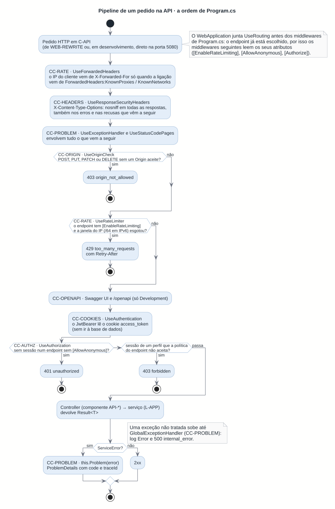

Fonte: [process-pipeline.puml](process-pipeline.puml).

A ordem real, de `Api/Program.cs`:

| # | Middleware | Elemento | O que decide |
| --- | --- | --- | --- |
| 0 | `UseRouting` (implícito) | — | O `WebApplication` põe-no antes dos middlewares de `Program.cs`: o endpoint fica escolhido logo, e os seguintes leem os seus atributos. |
| 1 | `UseForwardedHeaders` | CC-RATE | IP do cliente a partir de `X-Forwarded-For`, só quando a ligação vem de um proxy de confiança (`ForwardedHeaders:KnownProxies`/`KnownNetworks`, vazios por omissão). |
| 2 | `UseResponseSecurityHeaders` | CC-HEADERS | Põe `X-Content-Type-Options: nosniff` em todas as respostas, também nos erros e nas recusas dos middlewares seguintes (o cabeçalho é escrito quando a resposta começa). O Kestrel não envia `Server`. |
| 3 | `UseExceptionHandler` | CC-PROBLEM | Envolve tudo o que vem a seguir: uma exceção não tratada chega ao `GlobalExceptionHandler` (log Error, 500 `internal_error`). |
| 4 | `UseStatusCodePages` | CC-PROBLEM | Uma resposta de erro sem corpo (401, 403, 404 de rota) passa a ProblemDetails com `code` e `traceId`. |
| 5 | `UseOriginCheck` | CC-ORIGIN | POST, PUT, PATCH e DELETE sem um `Origin` de `Security:AllowedOrigins` → 403 `origin_not_allowed`. |
| 6 | `UseRateLimiter` | CC-RATE | Só nos endpoints com `[EnableRateLimiting]`: janela fixa por IP (IPv6 por /64) → 429 `too_many_requests` com `Retry-After`. |
| 7 | Swagger UI e `MapOpenApi` | CC-OPENAPI | Só em Development; antes da autenticação, porque a política de fallback os bloquearia. |
| 8 | `UseAuthentication` | CC-COOKIES | O JwtBearer lê o cookie `access_token` e valida o JWT sem ir à base de dados. |
| 9 | `UseAuthorization` | CC-AUTHZ | Política de fallback (sessão obrigatória salvo `[AllowAnonymous]`) → 401; política do perfil → 403. A verificação por dono (T02) vem depois, nos serviços. |
| 10 | Controllers | API-* | Controller fino → serviço → `Result<T>`; um `ServiceError` vira ProblemDetails com `this.Problem(error)` (CC-PROBLEM). |

Consequências da ordem: um POST de outra origem recebe 403 antes de gastar uma tentativa do limite; o limite é aplicado antes da autenticação, por isso conta também os pedidos sem sessão; e as recusas destes middlewares saem também como ProblemDetails (o 403 e o 429 escrevem-no eles próprios).

## 2. Sequências

Cada sequência mostra um caminho; as recusas aparecem nos ramos `alt`.

### 2.1 Jogador reserva um slot

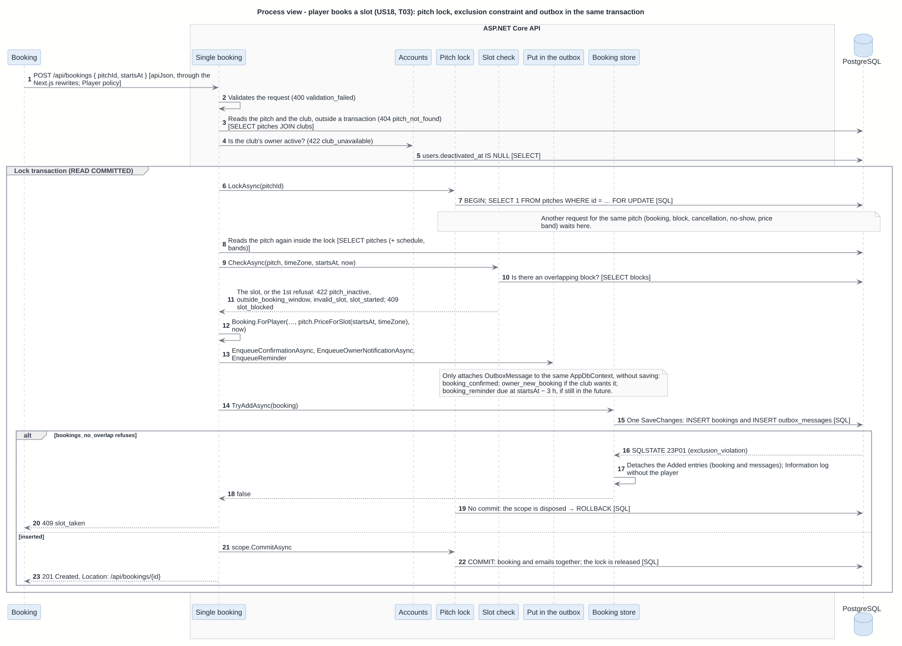

Fonte: [process-book.puml](process-book.puml). Código: `App/Bookings/BookingService.cs`, `BookingSlotCheck.cs`; `Inf/Pitches/PitchLock.cs`; `Inf/Bookings/BookingStore.cs`; `App/Notifications/BookingEmailOutbox.cs`.

- **Antes da transação:** validação (400), o campo e o clube (404 `pitch_not_found`) e o dono ativo (`IsActiveAsync`, 422 `club_unavailable`).
- **Transação:** `PitchLock.LockAsync` abre a transação e tranca a linha do campo com `SELECT 1 FROM pitches WHERE id = … FOR UPDATE`. Dentro dela o campo é lido outra vez (uma desativação, uma mudança de preço ou de horário confirmada antes é vista), `BookingSlotCheck.CheckAsync` verifica campo ativo, janela, grelha, «começado» e bloqueios, e o preço vem de `Pitch.PriceForSlot`. As três mensagens do outbox (`booking_confirmed`, `owner_new_booking` se `clubs.notify_on_new_booking`, `booking_reminder` devido a `startsAt − 3 h` se esse momento ainda for futuro) são só juntas ao mesmo `AppDbContext`; o `SaveChanges` de `BookingStore.TryAddAsync` grava a reserva e as mensagens juntas, e o `COMMIT` liberta o trinco.
- **Falhas:** qualquer recusa da verificação devolve o erro e o scope é descartado sem commit (ROLLBACK). A sobreposição com outra reserva confirmada não é procurada pelo código: é a `bookings_no_overlap` (DB-NOOVERLAP) que recusa, com SQLSTATE 23P01; o store desliga as entradas `Added` (a reserva e os emails), regista o caso em Information sem o jogador, e o serviço responde 409 `slot_taken`. Uma reserva perdida nunca deixa um email no outbox. No browser, um 409 fecha o resumo e recarrega os slots.

### 2.2 Série semanal

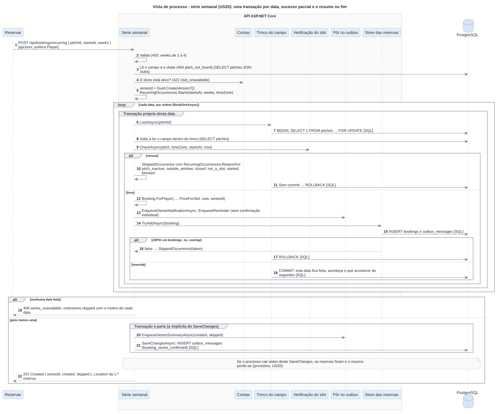

Fonte: [process-series.puml](process-series.puml). Código: `App/Bookings/RecurringBookings.cs` (`RecurringBookingService.CreateAsync`, `BookOneAsync`, `RecurringOccurrences`).

- As datas vêm de `RecurringOccurrences.Starts`: a primeira tal como foi pedida, as outras na mesma data local + 7·n à mesma hora local (`ClubTime.ToUtc`), por isso uma série que atravessa a mudança de hora mantém a hora de Lisboa.
- **Uma transação por data.** `BookOneAsync` faz o mesmo que uma reserva simples, com o seu trinco e o seu commit. Uma data recusada (`pitch_inactive`, `outside_window`, `closed`, `not_a_slot`, `started`, `blocked`, ou `taken` pelo 23P01) é deixada de fora e a seguinte é tentada; as já feitas ficam. Por cada reserva feita entram o aviso ao dono e o lembrete, na transação dela; a confirmação individual não entra.
- **Sucesso parcial:** com pelo menos uma reserva, 201 com `created` e `skipped`; sem nenhuma, 409 `series_unavailable` com `extensions.skipped`.
- **Resumo:** depois das datas, `EnqueueSeriesSummaryAsync` e um `SaveChanges` à parte gravam um só `booking_series_confirmed`. Se o processo cair entre a última data e esse passo, as reservas ficam e o resumo perde-se (decisão provisória da US20).

### 2.3 Cancelamentos

#### Pelo jogador

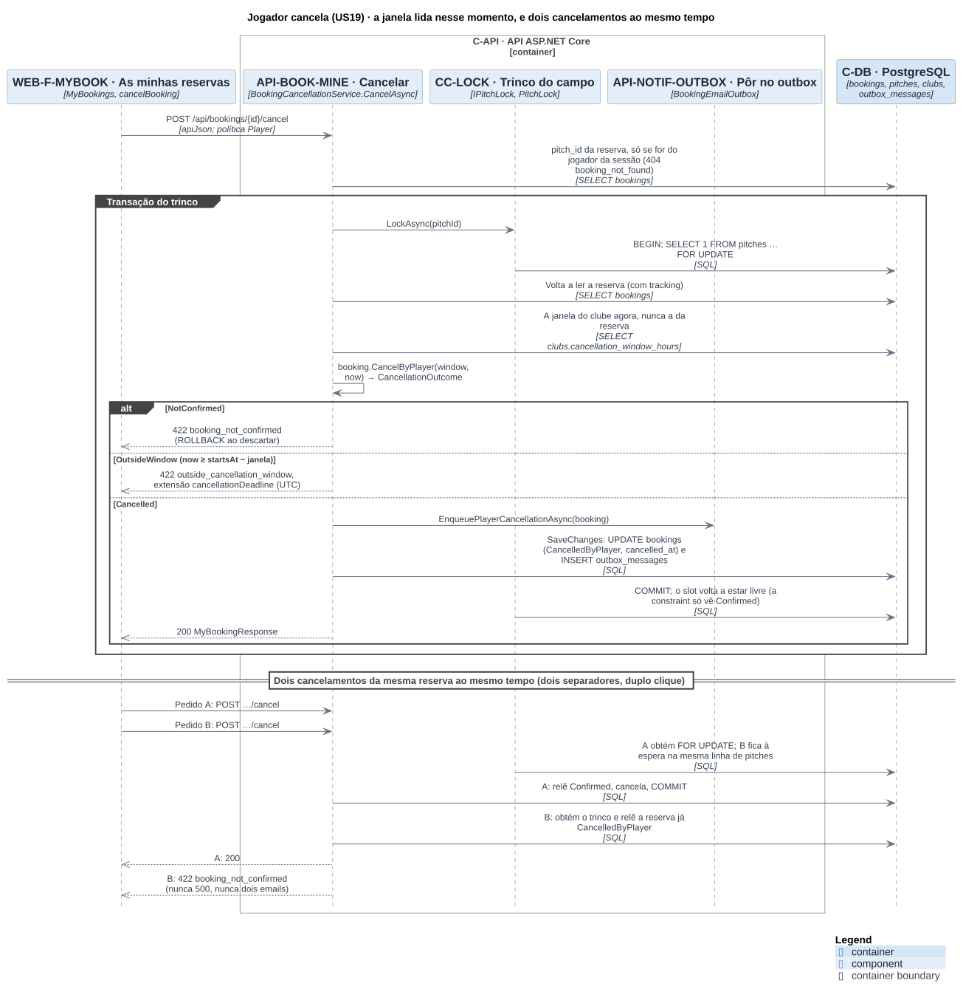

Fonte: [process-cancel-player.puml](process-cancel-player.puml). Código: `App/Bookings/BookingCancellationService.cs`; `Dom/Bookings/Booking.cs` (`CancelByPlayer`).

- A reserva só é encontrada se for do jogador da sessão (404 `booking_not_found` igual para a de outro jogador). Depois, sob o trinco do campo: a reserva é relida e a janela é a `clubs.cancellation_window_hours` **desse momento**, nunca guardada na reserva. `CancelByPlayer(window, now)` decide: `NotConfirmed` → 422 `booking_not_confirmed`; `OutsideWindow` (`now ≥ startsAt − janela`) → 422 `outside_cancellation_window` com `cancellationDeadline`; `Cancelled` → o estado muda, o email entra no outbox e um só `SaveChanges` grava os dois antes do `COMMIT`.
- **Concorrência:** dois cancelamentos da mesma reserva esperam um pelo outro no `FOR UPDATE`; o segundo relê a reserva já cancelada e recebe 422, nunca um 500 nem um segundo email. O slot fica livre de imediato, porque a constraint só cobre `Confirmed`.

#### Pelo dono

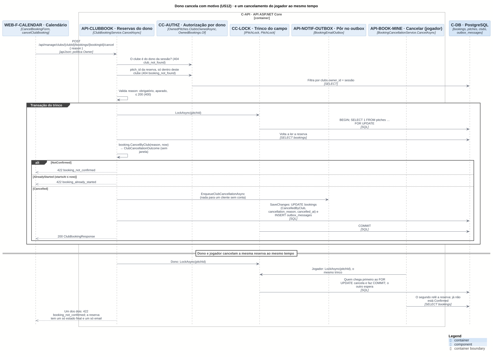

Fonte: [process-cancel-club.puml](process-cancel-club.puml). Código: `App/Bookings/ClubBookings.cs` (`ClubBookingService.CancelAsync`); `App/Pitches/OwnedPitches.cs`.

- Ordem: clube do dono (404 `club_not_found`) → reserva desse clube (404 `booking_not_found`) → motivo (400) → trinco → releitura → `CancelByClub(reason, now)`: 422 `booking_not_confirmed`, depois 422 `booking_already_started` (sem janela; começar agora conta como começado). O motivo e `cancelled_at` são guardados e o email ao jogador entra no outbox na mesma transação (nada para um cliente sem conta).
- **Concorrência:** o cancelamento do dono e o do jogador tomam o mesmo trinco; quem chega primeiro ganha e o outro recebe 422 `booking_not_confirmed`.

### 2.4 Sessões: login, refresh, separadores e logout

#### Login e logout

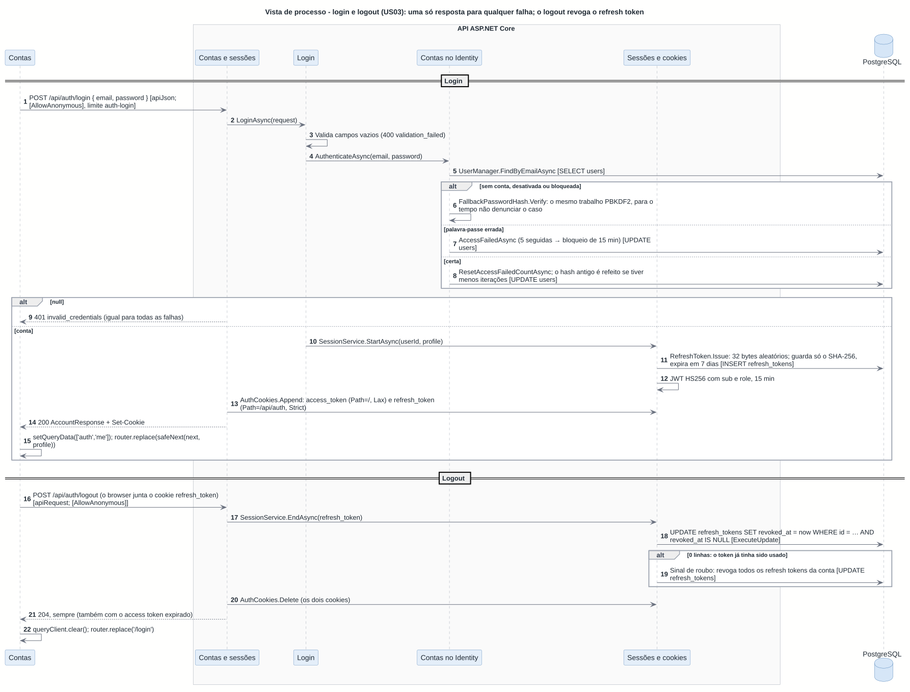

Fonte: [process-login.puml](process-login.puml). Código: `Api/Controllers/AuthController.cs`; `App/Auth/LoginService.cs`; `Inf/Identity/AccountStore.cs`; `Inf/Auth/SessionService.cs`; `Api/Auth/AuthCookies.cs`.

- Qualquer falha de login (email desconhecido, palavra-passe errada, conta bloqueada ou desativada) é o mesmo 401 `invalid_credentials`, depois do mesmo trabalho PBKDF2 (`FallbackPasswordHash`). Cinco palavras-passe erradas seguidas bloqueiam a conta 15 minutos (`LoginLockout`).
- `SessionService.StartAsync` guarda o SHA-256 de um refresh token novo (7 dias) e assina um JWT de 15 minutos com `sub` e `role`; `AuthCookies` escreve `access_token` (`Path=/`, `SameSite=Lax`) e `refresh_token` (`Path=/api/auth`, `SameSite=Strict`), ambos httpOnly e Secure.
- O logout consome o refresh token com uma atualização condicional; se o token já tinha sido usado, é o mesmo sinal de roubo do refresh e todas as sessões da conta são revogadas. Responde sempre 204 e apaga os dois cookies; o browser limpa a cache do TanStack Query.

#### Refresh com rotação e deteção de reutilização

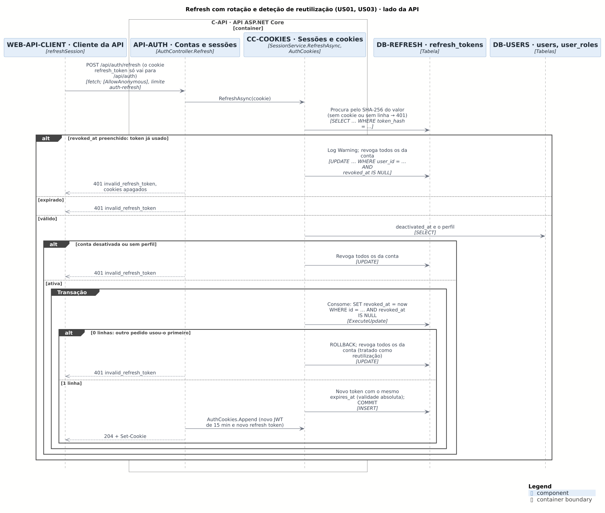

Fonte: [process-refresh.puml](process-refresh.puml). Código: `Inf/Auth/SessionService.cs` (`RefreshAsync`).

- O token apresentado é procurado pelo hash. Já revogado → reutilização: log Warning e revogação de todos os tokens da conta. Expirado → 401. Conta desativada ou sem perfil → revoga todos e 401 (é aqui que a desativação acaba com as sessões).
- **Rotação:** numa transação, `UPDATE refresh_tokens SET revoked_at = now WHERE id = … AND revoked_at IS NULL`. Só um pedido consegue a linha; o que recebe 0 linhas faz ROLLBACK e é tratado como reutilização. O token novo herda o `expires_at` (validade absoluta de 7 dias desde o login). Qualquer falha apaga os cookies e responde 401 `invalid_refresh_token`.

#### No browser: Web Lock entre separadores e refresh silencioso em /login

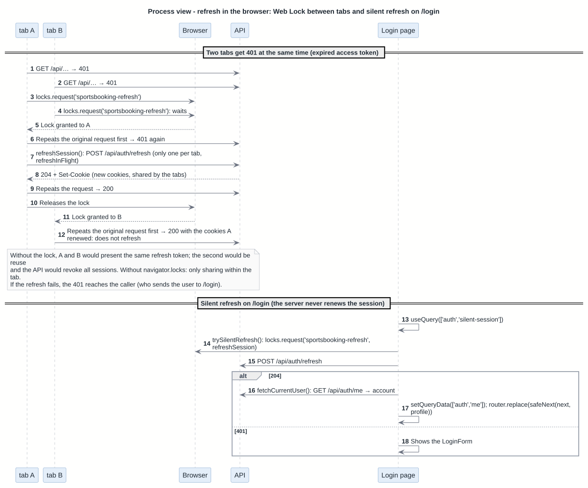

Fonte: [process-refresh-client.puml](process-refresh-client.puml). Código: `Web/lib/api/client.ts` (`apiRequest`, `retryAfterUnauthorized`, `refreshSession`, `trySilentRefresh`, `REFRESH_LOCK`); `Web/features/auth/components/login-screen.tsx`.

- Num 401, o cliente pede o trinco `sportsbooking-refresh`; quem o obtém **repete primeiro o pedido original**, porque outro separador pode já ter renovado os cookies partilhados, e só se voltar a receber 401 faz o refresh e repete outra vez. Sem o trinco, dois separadores apresentariam o mesmo refresh token e o segundo seria tratado como roubo. Sem `navigator.locks`, vale só a partilha dentro do separador.
- O servidor nunca renova a sessão (o cookie do refresh não vai para as páginas). Por isso `/login` (`LoginScreen`) tenta primeiro, no browser, `trySilentRefresh()` com o mesmo trinco; com 204 lê `/api/auth/me` e segue para `safeNext(next, profile)`, senão mostra o formulário.

### 2.5 Recuperação da palavra-passe

#### Pedido

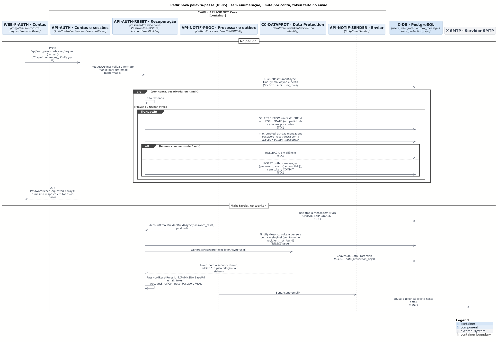

Fonte: [process-reset-request.puml](process-reset-request.puml). Código: `App/Auth/PasswordReset.cs` (`PasswordResetService.RequestAsync`); `Inf/Auth/PasswordReset.cs` (`PasswordResetStore.QueueResetEmailAsync`, `AccountEmailBuilder`); `Inf/Notifications/OutboxProcessor.cs`.

- **Sem enumeração:** a resposta é sempre o mesmo 202 (`PasswordResetRequested.Always`); só um email malformado dá 400. Para uma conta inexistente, desativada ou de admin não se faz nada.
- **Limite por conta:** numa transação, a linha da conta é trancada (`SELECT 1 FROM users WHERE id = … FOR UPDATE`), por isso dois pedidos ao mesmo tempo não passam os dois; se já houver uma mensagem `password_reset` com menos de 5 minutos, ROLLBACK em silêncio. A mensagem leva **só o id da conta**.
- **Token no envio:** o worker chama `AccountEmailBuilder.BuildAsync`, que volta a confirmar a elegibilidade e gera o token com o fornecedor do Identity (`GeneratePasswordResetTokenAsync`, chaves do Data Protection em `data_protection_keys`). O token e a ligação só existem no email; nunca estão no outbox nem nos logs.

#### Confirmação

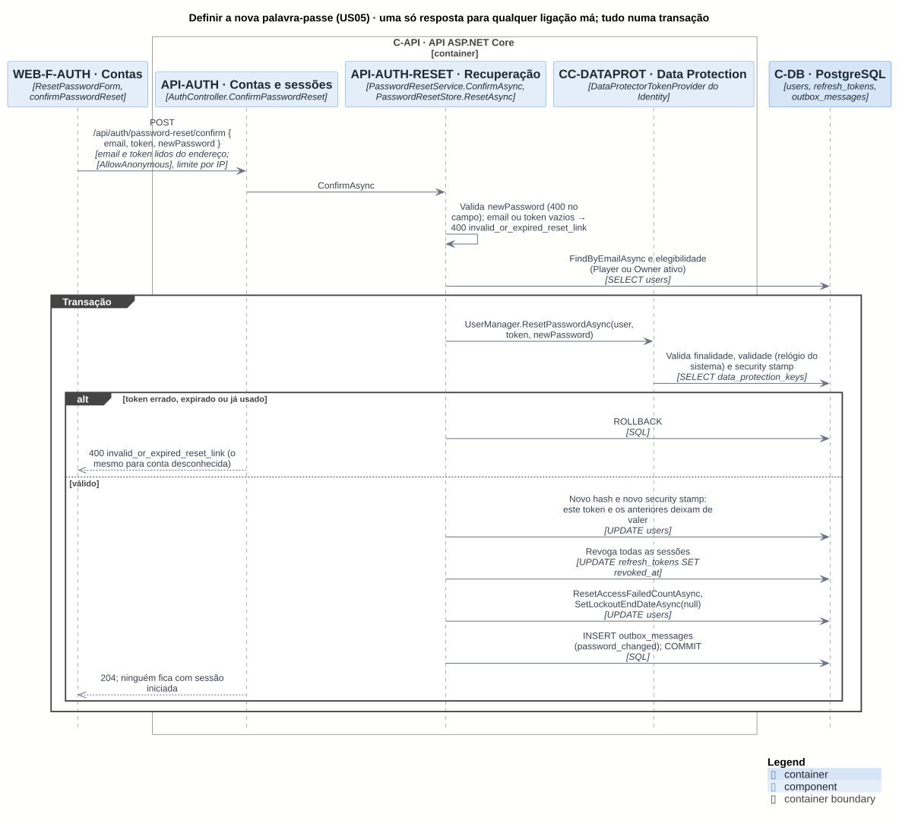

Fonte: [process-reset-confirm.puml](process-reset-confirm.puml). Código: `PasswordResetService.ConfirmAsync`, `PasswordResetStore.ResetAsync`.

- Primeiro a nova palavra-passe (400 no campo); depois, toda a ligação má (email desconhecido, token errado, expirado ou já usado, email ou token vazios) é o mesmo 400 `invalid_or_expired_reset_link`.
- **Uma transação:** `UserManager.ResetPasswordAsync` valida o token e muda o hash e o security stamp (o token deixa de valer, e os anteriores também), os refresh tokens da conta são revogados, o bloqueio é limpo e entra `password_changed` no outbox. 204, sem sessão iniciada.

### 2.6 Worker de emails

#### Reclamar, enviar, adiar, desistir

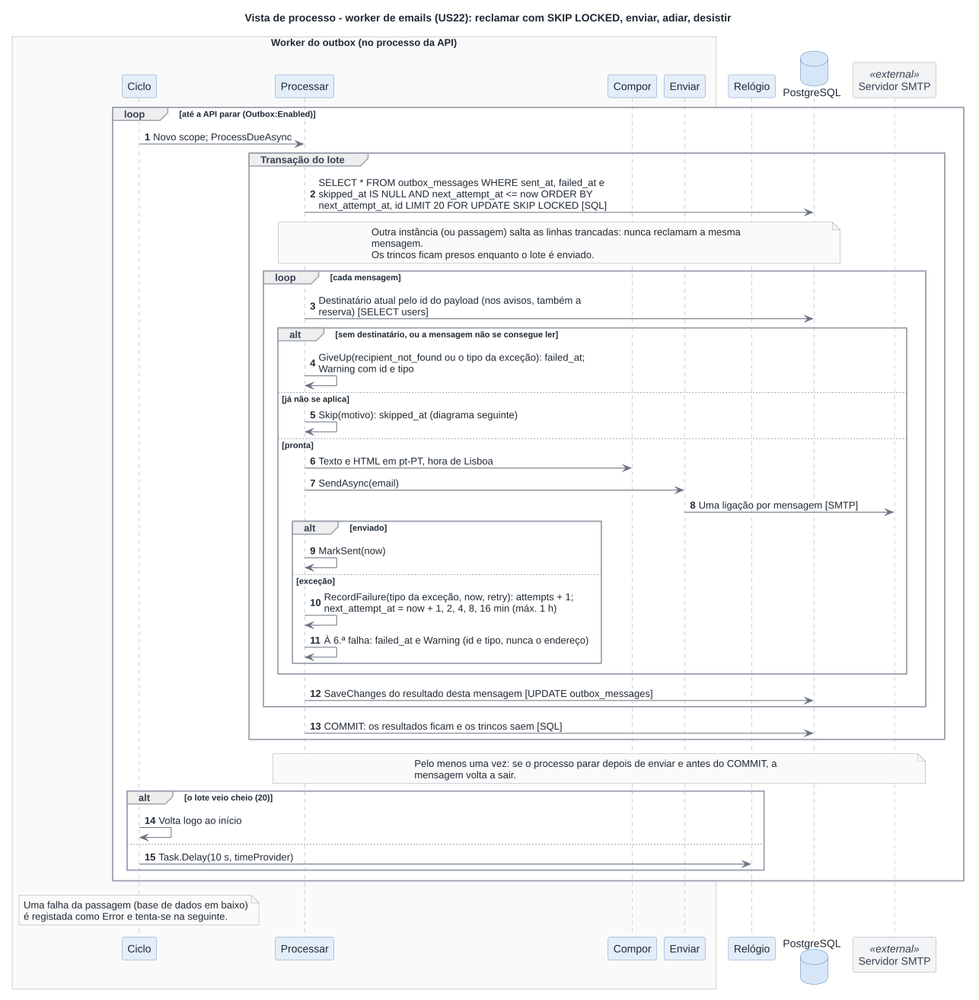

Fonte: [process-outbox.puml](process-outbox.puml). Código: `Inf/Notifications/OutboxDispatcher.cs`, `OutboxProcessor.cs`, `SmtpEmailSender.cs`; `App/Notifications/OutboxMessage.cs` (`OutboxRetry`).

- **Reclamar:** uma transação por lote; `SELECT … FOR UPDATE SKIP LOCKED` das mensagens devidas (nenhuma das três datas preenchida e `next_attempt_at ≤ now`), por ordem, no máximo 20. Outra instância salta as linhas trancadas. Os trincos ficam presos enquanto o lote é enviado.
- **Enviar:** o destinatário é lido **agora** (o endereço atual, nunca guardado no payload); compõe-se em pt-PT na hora de Lisboa e envia-se com uma ligação SMTP por mensagem. O resultado de cada mensagem é gravado logo (`SaveChanges`); o `COMMIT` do lote confirma-os todos.
- **Adiar e desistir:** uma falha de envio conta uma tentativa (`RecordFailure`, só o tipo da exceção em `last_error`) e adia a seguinte 1, 2, 4, 8, 16 minutos (no máximo 1 hora); à 6.ª falha a mensagem fica com `failed_at` e é registado um Warning com o id e o tipo. Sem destinatário, ou com uma mensagem que não se consegue ler, desiste-se logo (`GiveUp`) sem contar tentativa.
- **Ritmo:** se o lote veio cheio, a passagem seguinte começa já; senão espera 10 segundos no `TimeProvider` injetado. Uma falha da passagem inteira (base de dados em baixo) é registada em Error e tentada na seguinte.
- **Pelo menos uma vez:** se o processo parar depois de um envio e antes do `COMMIT`, todas as mensagens desse lote voltam a estar pendentes e as já enviadas saem outra vez.

#### Ignorar o que já não se aplica

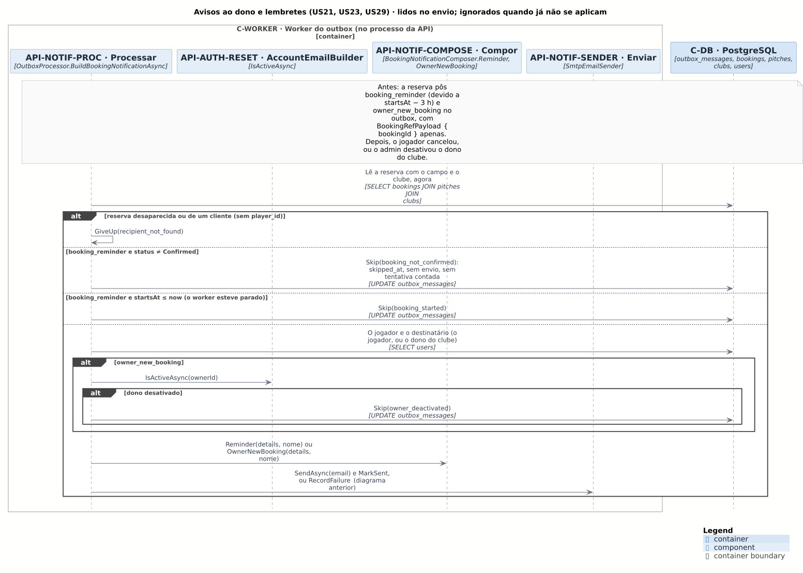

Fonte: [process-outbox-skip.puml](process-outbox-skip.puml). Código: `OutboxProcessor.BuildBookingNotificationAsync`; `AccountEmailBuilder.IsActiveAsync`.

- `owner_new_booking` e `booking_reminder` só guardam o id da reserva; a reserva, o clube e as contas são lidos no envio, por isso o email diz o que é verdade nesse momento.
- Um lembrete de uma reserva que já não está `Confirmed` (cancelada, falta) é fechado com `Skip(booking_not_confirmed)`; um lembrete cuja reserva já começou (o worker esteve parado) com `Skip(booking_started)`; um aviso para um dono desativado entretanto com `Skip(owner_deactivated)`. Ignorar preenche `skipped_at`, não envia e não conta como falha.

### 2.7 Página de uma área com guarda, no servidor

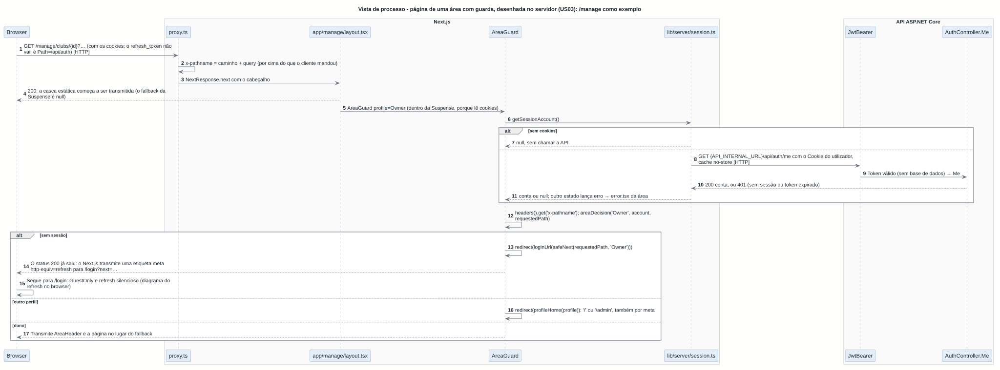

Fonte: [process-guard.puml](process-guard.puml). Código: `Web/proxy.ts`; `Web/app/manage/layout.tsx` (e `admin/layout.tsx`, `(player)/bookings/layout.tsx`); `Web/components/area-guard.tsx`, `player-guard.tsx`; `Web/lib/server/session.ts`; `Web/lib/auth/redirects.ts`.

- `proxy.ts` escreve o caminho pedido em `x-pathname` (por cima do que o cliente enviar) em `/manage/*`, `/admin/*` e `/bookings`; nas mesmas áreas e em `/clubs/{slug}` responde 404 a um id impossível (e, para um clube, a um que a API não tem) antes de a página começar a enviar.
- O layout da área põe o guarda dentro de `<Suspense>`, porque ler cookies é dinâmico com `cacheComponents`. `getSessionAccount` devolve `null` sem chamar a API se não houver cookies; senão chama `GET /api/auth/me` no URL interno com o cabeçalho `Cookie` e `no-store`. Um 401 é `null`; qualquer outro erro lança, e aparece o `error.tsx` da área em vez de um redirecionamento errado.
- `areaDecision` decide: sem sessão → `/login?next=<safeNext(caminho)>`; outro perfil → a página inicial desse perfil; o perfil certo → a área.
- **Redirecionamento dentro da Suspense:** quando o guarda chama `redirect()`, a casca da página já foi enviada com 200 (o fallback da Suspense é vazio). Como a documentação do `redirect()` do Next.js 16 descreve para o streaming, o redirecionamento segue então no HTML transmitido como uma etiqueta `<meta http-equiv="refresh">`, e é o browser que muda de página; não é um 307. Em `/login`, `GuestOnly` manda quem já tem sessão para a sua área e `LoginScreen` tenta o refresh silencioso (2.4).
- O guarda é uma conveniência: quem decide o acesso é a API (401/403), em cada pedido.

### 2.8 Desativar um dono

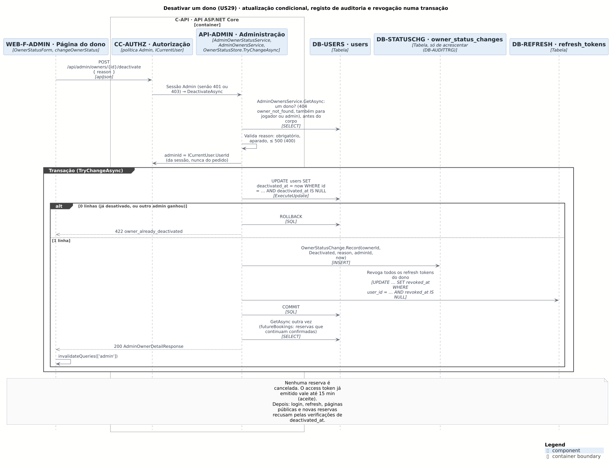

Fonte: [process-owner-deactivation.puml](process-owner-deactivation.puml). Código: `App/Admin/AdminOwnerStatus.cs` (`AdminOwnerStatusService`); `Inf/Admin/OwnerStatusStore.cs` (`TryChangeAsync`).

- Ordem: sessão Admin → o dono existe (404 `owner_not_found`, também para o id de um jogador ou do admin), antes do corpo → motivo (400) → o admin vem de `ICurrentUser`, nunca do pedido.
- **Uma transação:** a atualização condicional `UPDATE users SET deactivated_at = now WHERE id = … AND deactivated_at IS NULL` decide; 0 linhas → ROLLBACK e 422 `owner_already_deactivated` (dois admins ao mesmo tempo: um 200 e um 422). Com 1 linha: a linha de auditoria em `owner_status_changes` (só de acrescentar, protegida pelo trigger DB-AUDITTRG) e a revogação de todos os refresh tokens do dono, e `COMMIT`. A reativação é a mesma sequência com a condição inversa, sem revogar.
- Nenhuma reserva é cancelada; a resposta diz quantas futuras ficam (`futureBookings`). O access token já emitido vale até 15 minutos (compromisso aceite).

## 3. Concorrência: o que está protegido e o que não está

### O que protege o quê

| Mecanismo | Onde | Protege |
| --- | --- | --- |
| Exclusion constraint `bookings_no_overlap` (DB-NOOVERLAP) | `bookings`, só `status = 'Confirmed'` | Duas reservas confirmadas sobrepostas no mesmo campo, venham de onde vierem (jogador, série, cliente do dono, anular uma falta). 23P01 → 409 `slot_taken` ou o motivo `taken`. É a última palavra; o código não procura sobreposições entre reservas antes de inserir. |
| Trinco da linha do campo (CC-LOCK, `SELECT … FOR UPDATE`) | `PitchLock` | Serializa, por campo, tudo o que decide se um período está livre ou o que custa: criar reservas (as três vias), criar bloqueios (e a recusa por reservas confirmadas), cancelar (jogador e dono), marcar e anular faltas, desativar o campo (recusa com reservas futuras) e as faixas de preço. Bloqueios e reservas estão em tabelas diferentes, e é este trinco que impede um bloqueio e uma reserva de passarem os dois. Quem grava a própria linha de `pitches` (editar o campo ou o horário, reativar) também espera, porque um `UPDATE` tranca a linha. |
| Releitura dentro do trinco | Serviços de reservas | Com `READ COMMITTED`, a leitura feita depois de obter o trinco vê o que o anterior confirmou: dois cancelamentos dão um 200 e um 422. |
| Atualizações condicionais | `SessionService` (refresh e logout), `OwnerStatusStore` | Um refresh token usa-se uma vez; uma desativação ou reativação acontece uma vez. Quem recebe 0 linhas perdeu a corrida. |
| Índices únicos | `ix_users_normalized_email`, `ix_pitches_club_id_name_key`, `ix_clubs_slug`, `refresh_tokens.token_hash`, `ux_outbox_messages_booking_notification` (DB-OUTBOXUQ) | Um email por conta (409 `email_taken`), nome do campo único no clube (400 no nome), slug único (nova tentativa), no máximo um lembrete e um aviso ao dono por reserva. |
| Trinco da linha da conta | `PasswordResetStore.QueueResetEmailAsync` | Dois pedidos de recuperação ao mesmo tempo põem no máximo um email na fila. |
| `FOR UPDATE SKIP LOCKED` | `OutboxProcessor` | Duas instâncias (ou passagens) nunca reclamam a mesma mensagem. |
| Outbox na mesma transação | `BookingEmailOutbox`, `PasswordResetStore` | Um email existe se e só se a alteração foi confirmada: uma reserva perdida não deixa email; uma confirmada deixa sempre. |
| Trigger só de acrescentar | DB-AUDITTRG | O histórico dos donos não é alterado nem apagado (23001), nem por SQL à mão. |

**Entrega de emails: pelo menos uma vez.** Uma mensagem confirmada é enviada até ter sucesso ou se desistir dela, mas pode sair duas vezes: o envio acontece antes do `COMMIT` do lote, e se o processo parar entre os dois, as mensagens desse lote voltam a estar pendentes.

### O que não está protegido (dito como é)

- **Resumo de uma série perdido.** O resumo é gravado depois das datas, numa transação à parte: se a API cair entre a última reserva e esse `SaveChanges`, as reservas ficam e o jogador não recebe o resumo (o aviso ao dono e o lembrete de cada reserva ficam, porque estão na transação dela). Decisão provisória da US20.
- **Série não atómica.** Cada data é independente: entre duas datas outra pessoa pode reservar, e o jogador recebe uma série parcial. É o comportamento pedido, não um defeito; a pré-visualização é só indicativa.
- **Dono ativo verificado antes do trinco.** `IsActiveAsync` corre antes de `LockAsync`, e a desativação não toma o trinco do campo: uma reserva que já passou essa verificação pode ser confirmada logo depois de o dono ser desativado. A janela é de milissegundos, e a reserva conta em `futureBookings`.
- **Sessão depois de desativar ou mudar a palavra-passe.** O access token já emitido continua válido até 15 minutos; não há verificação de conta ativa em cada pedido (compromisso aceite).
- **Contagem do bloqueio de login.** Tentativas erradas em paralelo na mesma conta podem não ser todas contadas (controlo de concorrência do Identity); o rate limiting cobre o caso (backlog US03).
- **Rate limiting por instância.** O limitador nativo guarda as janelas na memória do processo: com várias instâncias da API, cada uma conta à parte. E, sem um proxy de confiança à frente, a API vê o IP do contentor do Next.js ([Notas de arquitetura](../README.md#limitações-conhecidas), 2).
- **Emails duplicados.** É o preço do «pelo menos uma vez» (acima).

## 4. Tempo

- **Guardar em UTC.** Todas as datas são `timestamptz` e `DateTime` com `Kind` UTC; o Npgsql recusa outra coisa. Horários de abertura e faixas de preço são `TimeOnly` locais, mais o fuso do clube (`Europe/Lisbon`).
- **Mostrar em Lisboa.** A API devolve instantes UTC; o front end formata só através de `Web/lib/datetime.ts` (WEB-DATETIME), em `pt-PT` e `Europe/Lisbon`, seja qual for o fuso do browser. Os emails são compostos no fuso do clube.
- **Mudança de hora (T04).** A única conversão local→UTC é `ClubTime.ToUtc` (CC-CLUBTIME): uma hora que não existe (último domingo de março, 01:30) avança o tamanho do salto (02:30 WEST); uma hora que se repete (último domingo de outubro) usa a **primeira** ocorrência (WEST). Os slots vêm só de `SlotGenerator`, por tempo real decorrido desde a abertura: nesses dias há menos um ou mais um slot, e cada um dura exatamente a sua duração. Na hora repetida de outubro a UI marca «(verão)» e «(inverno)». `ClubTime.Today` dá a data de Lisboa, que pode não ser a de UTC perto da meia-noite; é ela que define a janela de reservas. O lembrete (`startsAt − 3 h`) é calculado sobre o instante, por isso a mudança de hora não o desloca.
- **Relógio injetado.** Toda a hora atual vem do `TimeProvider` (CC-TIME: `TimeProvider.System` em execução, `FakeTimeProvider` e `SettableTimeProvider` nos testes), incluindo a espera do worker (`Task.Delay(…, timeProvider)`).
- **A exceção documentada.** O gerador de tokens de recuperação do Identity (`DataProtectorTokenProvider`, `AddDefaultTokenProviders`) lê o relógio do sistema, não o `TimeProvider`: a validade de 1 hora conta a partir do envio do email, pelo relógio da máquina, e os testes fabricam tokens antigos no formato do Identity em vez de mudar o relógio. O mesmo acontece com a validade do access token, que o JwtBearer verifica contra o relógio do sistema (por isso os testes com relógio falso fazem as sessões no relógio real).

## 5. Participantes de cada diagrama

O que estava escrito por baixo do nome de cada participante, diagrama a diagrama. As caixas são a do contentor (API ASP.NET Core = C-API, Next.js = C-WEB, Worker do outbox = C-WORKER).

### Processos e fios de execução

Fonte: [process-runtime.puml](process-runtime.puml).

| Nome | Tecnologia | Responsabilidade |
| --- | --- | --- |
| Operador | — | Corre os comandos de linha. |
| Browser | Um fio de JavaScript por separador | Client Components e TanStack Query; os separadores partilham os cookies httpOnly e coordenam o refresh com navigator.locks. |
| Next.js | Processo Node.js (ciclo de eventos) | Server Components e guardas em paralelo (assíncronos); proxy.ts; rewrites de /api/\*. |
| API ASP.NET Core | Processo .NET 10, Kestrel, thread pool | Pedidos em paralelo; cada um no seu scope de DI, com o seu AppDbContext e a sua ligação do pool. |
| Worker do outbox | BackgroundService no processo da API | Um ciclo por instância: uma passagem de cada vez, scope próprio, espera no TimeProvider. |
| seed-demo, set-admin-password | O mesmo executável, outro processo | Migrações, seed do admin, o comando e sai; não arranca o Kestrel nem o worker. |
| PostgreSQL | PostgreSQL 18.6, um processo por ligação | Transações READ COMMITTED, trincos de linha, exclusion constraint, índices únicos. |
| Servidor SMTP | — | Mailpit (X-MAILPIT) em desenvolvimento. |

### Jogador reserva um slot

Fonte: [process-book.puml](process-book.puml).

| Participante | Caixa | Classe, método ou tabelas |
| --- | --- | --- |
| Reservar | — | ClubBooking, createBooking |
| Uma reserva | API ASP.NET Core | BookingService.CreateAsync |
| Contas | API ASP.NET Core | IAccountStore.IsActiveAsync |
| Trinco do campo | API ASP.NET Core | IPitchLock, PitchLock |
| Verificação do slot | API ASP.NET Core | BookingSlotCheck.CheckAsync |
| Pôr no outbox | API ASP.NET Core | BookingEmailOutbox |
| Store das reservas | API ASP.NET Core | BookingStore.TryAddAsync |
| PostgreSQL | — | pitches, blocks, bookings, outbox_messages |

### Série semanal

Fonte: [process-series.puml](process-series.puml).

| Participante | Caixa | Classe, método ou tabelas |
| --- | --- | --- |
| Reservar | — | ClubBooking, createRecurring |
| Série semanal | API ASP.NET Core | RecurringBookingService.CreateAsync |
| Contas | API ASP.NET Core | IAccountStore.IsActiveAsync |
| Trinco do campo | API ASP.NET Core | IPitchLock, PitchLock |
| Verificação do slot | API ASP.NET Core | BookingSlotCheck.CheckAsync |
| Pôr no outbox | API ASP.NET Core | BookingEmailOutbox |
| Store das reservas | API ASP.NET Core | BookingStore.TryAddAsync |
| PostgreSQL | — | pitches, blocks, bookings, outbox_messages |

### Jogador cancela

Fonte: [process-cancel-player.puml](process-cancel-player.puml).

| Participante | Caixa | Classe, método ou tabelas |
| --- | --- | --- |
| As minhas reservas | — | MyBookings, cancelBooking |
| Cancelar | API ASP.NET Core | BookingCancellationService.CancelAsync |
| Trinco do campo | API ASP.NET Core | IPitchLock, PitchLock |
| Pôr no outbox | API ASP.NET Core | BookingEmailOutbox |
| PostgreSQL | — | bookings, pitches, clubs, outbox_messages |

### Dono cancela com motivo

Fonte: [process-cancel-club.puml](process-cancel-club.puml).

| Participante | Caixa | Classe, método ou tabelas |
| --- | --- | --- |
| Calendário | — | CancelBookingForm, cancelClubBooking |
| Reservas do dono | API ASP.NET Core | ClubBookingService.CancelAsync |
| Autorização por dono | API ASP.NET Core | OwnedPitches.ClubIsOwnedAsync, OwnedBookings.Of |
| Trinco do campo | API ASP.NET Core | IPitchLock, PitchLock |
| Pôr no outbox | API ASP.NET Core | BookingEmailOutbox |
| Cancelar (jogador) | API ASP.NET Core | BookingCancellationService.CancelAsync |
| PostgreSQL | — | bookings, pitches, clubs, outbox_messages |

### Login e logout

Fonte: [process-login.puml](process-login.puml).

| Participante | Caixa | Classe, método ou tabelas |
| --- | --- | --- |
| Contas | — | LoginForm, LogoutButton, login, logout |
| Contas e sessões | API ASP.NET Core | AuthController |
| Login | API ASP.NET Core | LoginService.LoginAsync |
| Contas no Identity | API ASP.NET Core | AccountStore.AuthenticateAsync |
| Sessões e cookies | API ASP.NET Core | SessionService, AuthCookies |
| PostgreSQL | — | users, user_roles, refresh_tokens |

### Refresh com rotação

Fonte: [process-refresh.puml](process-refresh.puml).

| Participante | Caixa | Classe, método ou tabelas |
| --- | --- | --- |
| Cliente da API | — | refreshSession |
| Contas e sessões | API ASP.NET Core | AuthController.Refresh |
| Sessões e cookies | API ASP.NET Core | SessionService.RefreshAsync, AuthCookies |
| refresh_tokens | — | Tabela |
| users, user_roles | — | Tabelas |

### Refresh no browser

Fonte: [process-refresh-client.puml](process-refresh-client.puml).

| Participante | Caixa | Classe, método ou tabelas |
| --- | --- | --- |
| separador A | — | apiRequest, retryAfterUnauthorized |
| separador B | — | apiRequest, retryAfterUnauthorized |
| Browser | — | navigator.locks, cookies partilhados |
| API | — | /api/\* |
| Página de login | — | LoginScreen, trySilentRefresh |

### Pedir nova palavra-passe

Fonte: [process-reset-request.puml](process-reset-request.puml).

| Participante | Caixa | Classe, método ou tabelas |
| --- | --- | --- |
| Contas | — | ForgotPasswordForm, requestPasswordReset |
| Contas e sessões | API ASP.NET Core | AuthController.RequestPasswordReset |
| Recuperação | API ASP.NET Core | PasswordResetService, PasswordResetStore, AccountEmailBuilder |
| Processar o outbox | API ASP.NET Core | OutboxProcessor (em C-WORKER) |
| Data Protection | API ASP.NET Core | DataProtectorTokenProvider do Identity |
| Enviar | API ASP.NET Core | SmtpEmailSender |
| PostgreSQL | — | users, user_roles, outbox_messages, data_protection_keys |
| Servidor SMTP | — | — |

### Definir a nova palavra-passe

Fonte: [process-reset-confirm.puml](process-reset-confirm.puml).

| Participante | Caixa | Classe, método ou tabelas |
| --- | --- | --- |
| Contas | — | ResetPasswordForm, confirmPasswordReset |
| Contas e sessões | API ASP.NET Core | AuthController.ConfirmPasswordReset |
| Recuperação | API ASP.NET Core | PasswordResetService.ConfirmAsync, PasswordResetStore.ResetAsync |
| Data Protection | API ASP.NET Core | DataProtectorTokenProvider do Identity |
| PostgreSQL | — | users, refresh_tokens, outbox_messages |

### Worker de emails

Fonte: [process-outbox.puml](process-outbox.puml).

| Participante | Caixa | Classe, método ou tabelas |
| --- | --- | --- |
| Ciclo | Worker do outbox (no processo da API) | OutboxDispatcher.ExecuteAsync |
| Processar | Worker do outbox (no processo da API) | OutboxProcessor.ProcessDueAsync |
| Compor | Worker do outbox (no processo da API) | BookingEmailComposer, BookingSeriesEmailComposer, BookingNotificationComposer, AccountEmailComposer |
| Enviar | Worker do outbox (no processo da API) | IEmailSender, SmtpEmailSender |
| Relógio | — | TimeProvider |
| PostgreSQL | — | outbox_messages, users, bookings |
| Servidor SMTP | — | — |

### Avisos ao dono e lembretes

Fonte: [process-outbox-skip.puml](process-outbox-skip.puml).

| Participante | Caixa | Classe, método ou tabelas |
| --- | --- | --- |
| Processar | Worker do outbox (no processo da API) | OutboxProcessor.BuildBookingNotificationAsync |
| AccountEmailBuilder | Worker do outbox (no processo da API) | IsActiveAsync |
| Compor | Worker do outbox (no processo da API) | BookingNotificationComposer.Reminder, OwnerNewBooking |
| Enviar | Worker do outbox (no processo da API) | SmtpEmailSender |
| PostgreSQL | — | outbox_messages, bookings, pitches, clubs, users |

### Página de uma área com guarda

Fonte: [process-guard.puml](process-guard.puml).

| Participante | Caixa | Classe, método ou tabelas |
| --- | --- | --- |
| Browser | — | cookies access_token (Path=/) |
| proxy.ts | Next.js | matcher /manage/\*, /admin/\*, /bookings e /clubs/{slug} (não nos prefetch) |
| app/manage/layout.tsx | Next.js | Suspense com fallback null |
| AreaGuard | Next.js | areaDecision, safeNext, loginUrl |
| lib/server/session.ts | Next.js | getSessionAccount |
| JwtBearer | API ASP.NET Core | lê o cookie access_token |
| AuthController.Me | API ASP.NET Core | AccountStore.FindAsync |

### Desativar um dono

Fonte: [process-owner-deactivation.puml](process-owner-deactivation.puml).

| Participante | Caixa | Classe, método ou tabelas |
| --- | --- | --- |
| Página do dono | — | OwnerStatusForm, changeOwnerStatus |
| Autorização | API ASP.NET Core | política Admin, ICurrentUser |
| Administração | API ASP.NET Core | AdminOwnerStatusService, AdminOwnersService, OwnerStatusStore.TryChangeAsync |
| users | — | Tabela |
| owner_status_changes | — | Tabela, só de acrescentar (DB-AUDITTRG) |
| refresh_tokens | — | Tabela |

## Notas

- **Ficheiro.** Esta vista substitui o `05-runtime.md` previsto (que estava vazio); a correspondência no [README](../README.md) foi atualizada.
- **Ids.** Nenhum id novo; todos os participantes e passos dos diagramas estão no [inventário](../inventory.md). O segundo separador do browser é o mesmo elemento (WEB-API-CLIENT) com um alias com sufixo.
- **Desvios encontrados entre documentos e código** (todos corrigidos nos documentos):
  - `docs/stack.md` dizia que o `proxy.ts` atua «só para `/manage` e `/admin`» e que os guardas vivem nos layouts dessas duas áreas; o código também cobre `/bookings` (matcher do `proxy.ts` e `PlayerGuard`). **Corrigido.**
  - `docs/stack.md` falava de rate limiting «nas rotas `/api/auth/*`»; o código limita login, os dois registos, refresh e os dois passos da recuperação (não o logout nem o `/me`) e também as leituras públicas (`ClubsController`, `LocalitiesController`). **Corrigido.**
  - Nenhum documento dizia a ordem do pipeline. No código, a verificação do `Origin` vem **antes** do rate limiting (e o tratamento de exceções antes dos dois); está dita na secção 1.
  - O logout com um refresh token já usado revoga todas as sessões da conta (`SessionService.EndAsync`), e o refresh de uma conta desativada também; `docs/stack.md` só descrevia a revogação total na reutilização durante o refresh. **Corrigido.**
