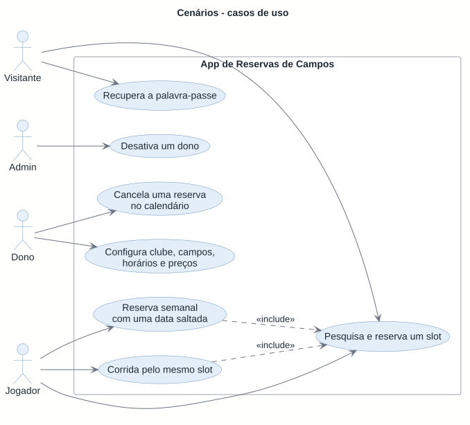

# Scenarios

<!-- 4+1 view: scenarios (+1) · sequence diagrams per use case. See README.md. -->

Seven use cases that cut across several views and validate them: if a scenario cannot be told with the elements and diagrams of the other views (context, containers, logical, process, development and physical), something is missing in those views. Each scenario says who takes part, the steps in the order they happen, the rules that decide the outcome and where to see the same thing drawn. It does not repeat the detail: it points to it. The element ids are in the [inventory](../inventory.md) (section 11 for the scenarios, `SC-`); the complete rules are in the [backlog](../../backlog.md) (US and T) and in [AGENTS.md](../../../AGENTS.md). The interface is in Portuguese (pt-PT), so on-screen texts are quoted in Portuguese, followed by their English meaning in parentheses.

| Id | Scenario | Actors | Stories |
| --- | --- | --- | --- |
| [SC-01](#sc-01--visitor-searches-for-and-books-a-slot) | Visitor searches for and books a slot | P-VIS → P-JOG | US16, US17, US18, US01, US03, US22 |
| [SC-02](#sc-02--owner-sets-up-club-pitches-schedules-and-prices) | Owner sets up club, pitches, schedules and prices | P-DONO | US02, US06, US07, US08, US09, US10 |
| [SC-03](#sc-03--owner-cancels-a-booking-in-the-calendar) | Owner cancels a booking in the calendar | P-DONO, P-JOG | US11, US12, US22 |
| [SC-04](#sc-04--weekly-booking-with-one-date-skipped) | Weekly booking with one date skipped | P-JOG | US20, US18 |
| [SC-05](#sc-05--password-recovery) | Password recovery | P-VIS (with an account) | US05 |
| [SC-06](#sc-06--admin-deactivates-an-owner) | Admin deactivates an owner | P-ADMIN, P-DONO | US29, US04 |
| [SC-07](#sc-07--race-for-the-same-slot) | Race for the same slot | P-JOG, P-JOG | T03, US18 |

## Scenarios, stories, diagrams and tests

Source: [scenarios-use-cases.puml](scenarios-use-cases.puml). The tests column only has test classes that exist in `backend/tests/SportsBooking.IntegrationTests/` (`BE`), in `backend/tests/SportsBooking.UnitTests/` (`UT`) or in `frontend/src/features/` (`FE`); none is an end-to-end test of the whole scenario. The four end-to-end tests in `e2e/` (booking and cancelling, the conflict between two players, the owner's calendar, exporting and deleting the account) are not in the column: they are not test classes of these folders.

| Scenario | Stories | Process diagrams | Tests |
| --- | --- | --- | --- |
| SC-01 | US16, US17, US18, US01, US03, US22 | [pipeline](../out/process-pipeline.svg), [login](../out/process-login.svg), [refresh in the browser](../out/process-refresh-client.svg), [booking](../out/process-book.svg), [worker](../out/process-outbox.svg) | BE `ClubSearchTests`, `PublicClubTests`, `PublicSlotsTests`, `BookingTests`, `LoginTests`, `EmailWorkerTests`; FE `club-search.test.tsx`, `club-booking-flow.test.tsx`, `return-after-login.test.tsx` |
| SC-02 | US02, US06, US07, US08, US09, US10 | [pipeline](../out/process-pipeline.svg), [guarded page](../out/process-guard.svg) | BE `OwnerRegistrationTests`, `ManageClubsTests`, `ManagePitchesTests`, `PitchScheduleTests`, `PriceBandTests`, `BlockTests`; UT `PitchScheduleTests`, `PriceBandTests`, `BlockTests` |
| SC-03 | US11, US12, US22 | [owner cancels](../out/process-cancel-club.svg), [worker](../out/process-outbox.svg) | BE `ClubCalendarTests`, `ClubBookingTests`, `BookingNotificationTests`; UT `ClubCancellationTests`; FE `club-calendar.test.tsx` |
| SC-04 | US20, US18 | [weekly series](../out/process-series.svg), [booking](../out/process-book.svg), [worker](../out/process-outbox.svg) | BE `RecurringBookingTests`; FE `recurring.test.tsx` |
| SC-05 | US05 | [request](../out/process-reset-request.svg), [set](../out/process-reset-confirm.svg), [worker](../out/process-outbox.svg), [login](../out/process-login.svg) | BE `PasswordResetTests`; FE `forgot-password-form.test.tsx`, `reset-password-form.test.tsx` |
| SC-06 | US29, US04 | [deactivating an owner](../out/process-owner-deactivation.svg), [refresh on the API](../out/process-refresh.svg), [login](../out/process-login.svg), [guarded page](../out/process-guard.svg) | BE `OwnerDeactivationTests` |
| SC-07 | T03, US18 | [booking](../out/process-book.svg), [cancelling (player)](../out/process-cancel-player.svg), [cancelling (owner)](../out/process-cancel-club.svg), [weekly series](../out/process-series.svg) | BE `BookingTests` (`Twenty_concurrent_requests_for_the_same_slot_give_exactly_one_201_and_409_for_the_rest`), `BookingCancellationTests` |

## SC-01 · Visitor searches for and books a slot

**Actors.** A visitor without a session (P-VIS) who then signs in as a player (P-JOG); C-WEB, C-API, C-DB; at the end, the worker (C-WORKER) and the email server (X-SMTP).

**Steps**

1. The visitor opens `/` (`ClubSearch`, WEB-F-CATALOG) and filters by sport, locality and date. The filter lives in the address (`?sport=&locality=&date=&page=`). The browser calls `GET /api/clubs` (API-CATALOG), 20 clubs per page.
2. They open a club: `/clubs/{slug}` is a Server Component that reads the API at the internal URL, without cookies (WEB-SERVER, `loadPublicClub`). An unknown or hidden club is the same 404.
3. They choose a pitch and a date; the browser reads the slots (`GET /api/clubs/{slug}/pitches/{pitchId}/slots?date=`). Each slot has a single `available` flag and the API's price; it never says why it is unavailable. Choosing a slot writes `?pitch=&date=&slot=` to the address.
4. Without a session, the summary shows `Entrar para reservar` (Sign in to book): it goes to `/login?next=<this address>` (or to registration, which carries the same `next`). `/login` first tries a silent refresh and then shows the form; login answers with the two cookies and the player returns to the same choice (`safeNext`).
5. The player confirms: `POST /api/bookings` with only `{ pitchId, startsAt }`.
6. The API validates, confirms the owner is active, locks the pitch, reads the pitch again, checks the slot (`BookingSlotCheck`), calculates the price (`Pitch.PriceForSlot`) and inserts the booking; in the same transaction the confirmation, the owner notice (if the club wants it) and the reminder (3 h before, if still in the future) go into the outbox. Response 201 with `Location`.
7. The browser shows the confirmation and invalidates `["catalog"]` and `["my-bookings"]`, so the slot becomes unavailable and the booking appears in `/bookings`.
8. In the background, the worker reads the outbox, composes the email in pt-PT and sends it (SMTP; in development, Mailpit).

**Rules**

- Only what is public is seen: a club needs an active owner and an active pitch; responses carry no data about players or owners; public reads have a per-IP limit (120 per minute, provisional).
- Bookings from today up to 30 days ahead, on Lisbon's date; the slot has to exist in the generated grid and must not have started or be blocked ([ADR 0007](../adr/0007-calculated-slots.md)).
- Only a player books; owner and admin see the slots read-only.
- The booking stores the price at the time; no payments.
- Overlap with another booking is left to the database ([ADR 0003](../adr/0003-booking-exclusion-constraint.md); see SC-07).
- The email never blocks the booking and only exists if the booking was confirmed ([ADR 0004](../adr/0004-outbox-for-emails.md)).
- The session lives in httpOnly cookies ([ADR 0002](../adr/0002-session-in-httponly-cookies.md)).

**Diagrams**

- [Context](../out/01-context.svg) and [containers](../out/02-containers-dev.svg): who talks to whom.
- [Front end: routes, guards and paths](../out/03-components-web.svg) and [areas and features](../out/03-components-web-features.svg).
- [Booking components](../out/03-components-api-bookings.svg), [slots code](../out/logical-code-slots.svg) and [states of a booking](../out/logical-state-booking.svg).
- [Pipeline of a request](../out/process-pipeline.svg), [login](../out/process-login.svg), [refresh in the browser](../out/process-refresh-client.svg), [booking](../out/process-book.svg) and [email worker](../out/process-outbox.svg) ([process view, 2.1](process.md#21-player-books-a-slot)).

## SC-02 · Owner sets up club, pitches, schedules and prices

**Actors.** An owner (P-DONO); C-WEB, C-API, C-DB.

**Steps**

1. The person registers as an owner (`/register/owner`, `POST /api/auth/register/owner`), accepting the Terms and acknowledging the Privacy Policy (the version and date are stored on the account); the account is born with the `Owner` profile and the session starts right away. They go to `/manage`, which, with no clubs, shows `Criar o primeiro clube` (Create the first club).
2. **Club:** `/manage/clubs/new` sends `POST /api/manage/clubs` (name, address, locality, contacts, cancellation window, 24 h by default, and the new-booking notice). The API generates the `slug` from the name, which does not change if the name changes.
3. **Pitch:** in `/manage/clubs/{id}`, `PitchSection` creates the pitch (`POST …/pitches`): sport, name unique in the club, base price (> 0 and ≤ €500). The pitch is born active, with 60-minute slots and **closed every day**.
4. **Schedule:** the `Horário` (Schedule) button opens the `ScheduleEditor`; `PUT …/schedule` replaces the whole week (seven days, opening and closing in 30-minute steps, or closed; closing `00:00` = midnight) and the slot duration (30, 60 or 90). The `SlotPreview` shows the slots of one day, from today to today + 30, generated from the schedule.
5. **Prices:** the `Faixas de preço` (Price bands) button creates bands (`POST …/price-bands`) with days, times and price. Without a band, the slot costs the base price. The preview now shows each slot's price.
6. **Blocks (optional):** the `Bloqueios` (Blocks) button creates periods with no bookings (`POST …/blocks`), in Lisbon time and in 30-minute steps.
7. With the pitch active and the owner active, the club starts to appear in the public search (SC-01).

**Rules**

- Every owner request starts from `OwnedClubs`/`OwnedPitches` (T02): the club is resolved before validating the body, and another owner's club gives the same 404 `club_not_found` as a non-existent one.
- The pitch is never deleted: it is deactivated (and only if there are no confirmed bookings yet to end).
- Changing the schedule, the duration or the bands does not alter bookings already made ([ADR 0007](../adr/0007-calculated-slots.md)). A schedule that goes past midnight is refused (MVP limitation).
- Bands: at most 20 per pitch and no overlap on the same day (touching is allowed): 409 `price_band_overlap`. Bands and blocks change under the pitch lock, like bookings.
- A block is refused if it overlaps another block (409 `block_overlap`) or confirmed bookings (409 `block_overlaps_bookings`); it can only be removed before it starts.
- A slot's price is only decided in `Pitch.PriceForSlot`; the browser shows what the API returns.

**Diagrams**

- [API components, overview](../out/03-components-api-overview.svg) (API-CLUBS, API-PITCHES, API-SCHED, API-BLOCKS, API-PRICE) and [accounts](../out/03-components-api-accounts.svg) (registration).
- [Bookings domain](../out/logical-domain-booking.svg) (club, pitch, opening day, band, block) and [slots code](../out/logical-code-slots.svg).
- [Front end](../out/03-components-web.svg) and [features](../out/03-components-web-features.svg) (WEB-F-CLUBS, WEB-F-PITCHES).
- [Pipeline](../out/process-pipeline.svg) and [guarded page](../out/process-guard.svg) (`/manage` requires the `Owner` profile).

## SC-03 · Owner cancels a booking in the calendar

**Actors.** The owner (P-DONO) and the booking's player (P-JOG, only as a recipient); C-WEB, C-API, C-DB, C-WORKER.

**Steps**

1. The owner opens `/manage/clubs/{id}/calendar` (the view, the date and the open booking are in the address). The browser reads `GET …/calendar?from=&to=` for the day, with the pitches in columns, and `layoutDay` positions everything by real elapsed time (a clock-change day has 23 or 25 rows).
2. They click a booking: the details open (`GET …/bookings/{bookingId}`), with the player's name (never the email or the id), `canCancel` and `playerNoShows`.
3. `Cancelar reserva` (Cancel booking) opens the reason form (required, up to 200 characters); it sends `POST …/bookings/{bookingId}/cancel`.
4. The API resolves the owner's club (404 `club_not_found`) and the booking inside it (404 `booking_not_found`), validates the reason (400), locks the pitch, reads the booking again and calls `Booking.CancelByClub(reason, now)`. If it is confirmed and has not started, it becomes `CancelledByClub`, stores the reason and `cancelled_at`, and the email to the player goes into the outbox, all in the same transaction.
5. The response is 200; the browser invalidates `["calendar", clubId]`, and the booking leaves the day (or appears as cancelled, with `Mostrar reservas canceladas` (Show cancelled bookings)).
6. The slot is free immediately: the exclusion constraint only covers `Confirmed`.
7. The worker sends the player the email saying who cancelled and the reason; in the `As minhas reservas` (My bookings) list the booking appears as `Cancelada pelo clube` (Cancelled by the club).

**Rules**

- No cancellation window: the owner can cancel up to the start; starting now counts as started (422 `booking_already_started`). A booking that is no longer confirmed is 422 `booking_not_confirmed`, checked first.
- The owner's cancellation and the player's take the same lock: whoever arrives first wins and the other gets 422.
- A booking made by the owner for a customer without an account (US13) is cancelled the same way, but generates no email.
- The owner sees only the player's name ([ADR 0005](../adr/0005-single-marketplace.md)).
- The screen never works out whether it can be cancelled: it follows the API's `canCancel`.
- The email only exists if the cancellation was confirmed ([ADR 0004](../adr/0004-outbox-for-emails.md)).

**Diagrams**

- [Owner cancels](../out/process-cancel-club.svg) ([process view, 2.3](process.md#23-cancellations)) and, for comparison, [player cancels](../out/process-cancel-player.svg).
- [States of a booking](../out/logical-state-booking.svg), [booking components](../out/03-components-api-bookings.svg) and [code of the Booking aggregate](../out/logical-code-booking.svg).
- [Email worker](../out/process-outbox.svg) and [states of the outbox message](../out/logical-state-outbox.svg).
- [Front end](../out/03-components-web.svg) (WEB-F-CALENDAR) and [pipeline](../out/process-pipeline.svg).

## SC-04 · Weekly booking with one date skipped

**Actors.** A player with a session (P-JOG); C-WEB, C-API, C-DB, C-WORKER.

**Steps**

1. In a booking's summary (SC-01, step 4), the player chooses `Repetir semanalmente` (Repeat weekly) with 3 weeks. The address gains `?weeks=3`.
2. The browser calls `POST /api/bookings/recurring/preview`. The API calculates the three dates (the first as requested; the others on the same local date + 7 days, at the same Lisbon local time), checks each one with the rules of a single booking and returns, per date, the price and `free` or `unavailable` with the reason. Suppose the 2nd date has a block (`blocked`).
3. The list shows the three dates and the reason for the one that cannot be booked, in words. The button says `Confirmar 2 reservas` (Confirm 2 bookings).
4. The player confirms: `POST /api/bookings/recurring`.
5. The API tries each date **in order, each in its own transaction** (locks the pitch, checks, price, inserts; that booking's owner notice and reminder go in). The 1st and the 3rd are created; the 2nd is skipped with the reason `blocked`. All the bookings created share the `SeriesId`.
6. After the dates, a separate `SaveChanges` saves a single email, `booking_series_confirmed`, with the bookings made.
7. Response 201 with `created` and `skipped`. `RecurringConfirmation` lists the bookings and the dates left out; it invalidates `["catalog"]` and `["my-bookings"]`.
8. In `As minhas reservas` (My bookings), each booking shows `Reserva semanal: 1 de 2` (Weekly booking: 1 of 2) and `2 de 2` (2 of 2) (only the created ones count).

**Rules**

- From 2 to 4 weeks (1 is a single booking). The series is **not atomic**: each date is independent, someone else can book a date in between, and the preview is only indicative.
- Reasons for a refused date: inactive pitch, outside the 30-day window, closed day, a time that is not a slot, already started, blocked, or taken (`taken`, which comes from the exclusion constraint, 23P01).
- If no date can be booked: 409 `series_unavailable` with the dates and the reasons.
- A series that crosses the clock change keeps Lisbon time.
- The summary is saved outside the dates' transaction: if the API crashes between the two steps, the bookings stay and the summary is lost (provisional decision of US20).
- Cancelling is always one booking at a time (`POST /api/bookings/{id}/cancel`); there is no endpoint to cancel the series.

**Diagrams**

- [Weekly series](../out/process-series.svg) ([process view, 2.2](process.md#22-weekly-series)) and, per date, [booking](../out/process-book.svg).
- [Booking components](../out/03-components-api-bookings.svg) (API-BOOK-SERIES) and [slots code](../out/logical-code-slots.svg).
- [Email worker](../out/process-outbox.svg) and [front end](../out/03-components-web-features.svg) (WEB-F-BOOKING, WEB-F-MYBOOK).

## SC-05 · Password recovery

**Actors.** A person with a player or owner account who forgot their password; C-WEB, C-API, C-DB, C-WORKER, X-SMTP.

**Steps**

1. On `/login`, `Esqueci-me da palavra-passe` (I forgot my password) leads to `/forgot-password`; the person types their email.
2. `POST /api/auth/password-reset/request` always answers the same 202, whether the account exists or not (only a badly typed email is 400). The page always shows the same message.
3. For an active player or owner account, `PasswordResetStore` locks the account's row and, if there is not already a request less than 5 minutes old, puts a `password_reset` message in the outbox with **only the account id**. For a non-existent, deactivated or admin account, it does nothing.
4. The worker reads the message, confirms the account is still eligible, generates the token with Identity (Data Protection keys in the database) and composes the link `/reset-password?email=&token=` with `PublicSite:BaseUrl`. The email is sent.
5. The person opens the link. `/reset-password` reads the email and the token from the address and shows the form (new password and confirmation).
6. `POST /api/auth/password-reset/confirm`: first it validates the new password (400 per field); then every bad link (unknown email, wrong, expired or already used token) is the same 400 `invalid_or_expired_reset_link`.
7. If the link is valid, in one transaction: it changes the hash and the security stamp (this link and earlier ones stop working), revokes all the account's refresh tokens, clears the attempt lockout and puts the `password_changed` notice in the outbox. Response 204; nobody ends up with a session.
8. The page shows success and the link to `/login`; the worker sends the notice that the password changed.

**Rules**

- No account enumeration and at most one email per account every 5 minutes; per-IP request limits on both steps.
- The link is valid for 1 hour and only once. The token is never in the outbox, the logs or the browser's storage; `/reset-password` is served with `Referrer-Policy: no-referrer` and `Cache-Control: no-store`.
- The password has at least 8 characters, with no composition rules.
- The keys that protect the token are in the database, so the link survives a restart ([ADR 0008](../adr/0008-data-protection-keys-in-the-database.md)). Identity's token generator reads the system clock: it is the exception to `TimeProvider`.

**Diagrams**

- [Requesting a new password](../out/process-reset-request.svg) and [setting the new password](../out/process-reset-confirm.svg) ([process view, 2.5](process.md#25-password-recovery)).
- [Email worker](../out/process-outbox.svg) and [account components](../out/03-components-api-accounts.svg) (API-AUTH-RESET, CC-DATAPROT).
- [States of an outbox message](../out/logical-state-outbox.svg) and [login](../out/process-login.svg).

## SC-06 · Admin deactivates an owner

**Actors.** The admin (P-ADMIN), the deactivated owner (P-DONO) and, afterwards, players and visitors who stop seeing them; C-WEB, C-API, C-DB.

**Steps**

1. The admin exists because the seed created it at startup (`AdminSeed:*`); they sign in at `/login` and go to `/admin` (the guard and the `Admin` policy send the other profiles away).
2. `/admin` shows the totals and the charts (counts only) and the owners list, the only part with names and emails (of owners, never of players). The admin opens the owner at `/admin/owners/{id}`.
3. The page shows the owner's numbers, the status and the history, and how many future confirmed bookings stay (`futureBookings`). `Desativar dono` (Deactivate owner) opens the reason form (required, up to 500 characters).
4. `POST /api/admin/owners/{id}/deactivate`: the API confirms the id is an owner's (404 `owner_not_found`, before validating the body) and validates the reason.
5. In one transaction: `UPDATE users SET deactivated_at = now WHERE id = … AND deactivated_at IS NULL` decides (0 rows = 422 `owner_already_deactivated`); with 1 row the audit row is saved in `owner_status_changes` (admin from the session, never from the request) and all the owner's refresh tokens are revoked. Response 200.
6. The browser invalidates everything under `["admin"]`; the owner appears as deactivated and the history gains the row.
7. **Effects.** The owner cannot sign in (the same 401 `invalid_credentials`); the refresh of the session they had gives 401; their clubs leave the public pages (404); nobody can book on their pitches (422 `club_unavailable`); the unsent notices to the owner are skipped. Bookings already made stay confirmed.
8. Reactivating is the same sequence with the inverse condition, revoking nothing.

**Rules**

- The admin sees counts only; no name, email, phone or id of players.
- Only the seed gives the Admin profile; the admin's password is changed with the `set-admin-password` command.
- The history is append-only (trigger `owner_status_changes_append_only`, 23001) and the foreign keys are `RESTRICT`.
- **Accepted trade-off:** the access token already issued stays valid for up to 15 minutes, so the owner can still use the management area in that interval ([ADR 0002](../adr/0002-session-in-httponly-cookies.md)).
- No booking is cancelled by the deactivation.

**Diagrams**

- [Deactivating an owner](../out/process-owner-deactivation.svg) ([process view, 2.8](process.md#28-deactivating-an-owner)) and [states of an owner](../out/logical-state-owner.svg).
- [Refresh on the API](../out/process-refresh.svg) (refuses the deactivated account), [login](../out/process-login.svg) and [account components](../out/03-components-api-accounts.svg).
- [Accounts domain](../out/logical-domain-accounts.svg) (`OwnerStatusChange`) and [guarded page](../out/process-guard.svg).

## SC-07 · Race for the same slot

**Actors.** Two players (P-JOG) with a session, A and B, who confirm the same slot at the same time; C-API, C-DB, C-WORKER.

**Steps**

1. A and B see the slot free and press `Confirmar reserva` (Confirm booking) at the same instant. Two identical `POST /api/bookings` reach the API, each in its own request, with its own `AppDbContext` and its own connection.
2. Both pass the validation, the pitch check and the active-owner check, which need no lock.
3. Both ask for the pitch lock: `SELECT … FOR UPDATE` on the pitch's row. A gets it; B waits.
4. A, inside the lock, reads the pitch again, checks the slot (free of blocks and not started), calculates the price, attaches the messages to the outbox and inserts. The `COMMIT` saves the booking and the messages and releases the lock. Response 201.
5. B gets the lock, reads the pitch again and checks the slot; **the check does not look for other bookings**. It tries to insert.
6. The exclusion constraint `bookings_no_overlap` refuses (SQLSTATE 23P01). `BookingStore` detaches the new entries (B's booking and emails), logs the case at Information, without the player, and the API answers 409 `slot_taken`. None of B's emails stays in the outbox.
7. B's browser closes the summary, shows the message and reloads the slots; the slot now appears unavailable, without saying why.

**Variants with the same lock**

- *Booking against a block* (owner and player): both take the lock; the one that comes later sees the other, and answers 409 `block_overlaps_bookings` (the block) or 409 `slot_blocked` (the booking).
- *Two cancellations of the same booking* (player and owner, or two tabs): the second reads the already cancelled booking and gets 422 `booking_not_confirmed`; a single email.
- *Undoing a no-show* after someone else has booked the slot: 409 `slot_taken`, through the same constraint.
- *Two dates of a series* against another player's booking: the date is `taken` and is skipped (SC-04).

**Rules**

- The guarantee is the database's, not the code's: no check in the application looks for overlap between bookings ([ADR 0003](../adr/0003-booking-exclusion-constraint.md)). The lock serializes what the constraint does not cover (blocks, cancellations) and makes the re-read see what the previous request committed.
- The constraint covers only `Confirmed`: a cancelled slot is free.
- Losing the race is expected: 409 and Information, never 500 or Error.
- The email and the booking live and die together ([ADR 0004](../adr/0004-outbox-for-emails.md)).
- The T03 test launches 20 simultaneous requests for the same slot against a real PostgreSQL and expects exactly one 201 and the rest 409.

**Diagrams**

- [Booking](../out/process-book.svg) (with the failures) ([process view, 2.1](process.md#21-player-books-a-slot)) and the [concurrency table](process.md#3-concurrency-what-is-protected-and-what-is-not).
- [Cancelling (player)](../out/process-cancel-player.svg), [cancelling (owner)](../out/process-cancel-club.svg) and [weekly series](../out/process-series.svg).
- [States of a booking](../out/logical-state-booking.svg), [booking components](../out/03-components-api-bookings.svg) and [bookings domain](../out/logical-domain-booking.svg).

## Notes

- **Replaces** the four empty titles this file had: "Player books a slot" is now SC-01, "Player books a weekly series" is SC-04, "Owner cancels a booking with a reason" is SC-03 and "Admin deactivates an owner" is SC-06. The other three (SC-02, SC-05, SC-07) are new.
- **New ids:** `SC-01` to `SC-07`, in the [inventory](../inventory.md), section 11. Only one diagram of its own, the use-case one; each scenario reuses those of the other views.
- **What is not drawn as a sequence:** the club setup (SC-02) and the calendar view (SC-03, steps 1 and 2) are simple read and write requests under the normal pipeline; their rules are in the text and in the component and domain diagrams.
