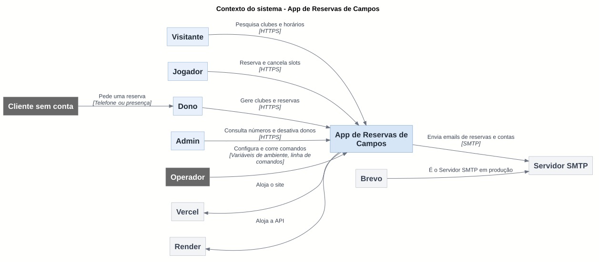
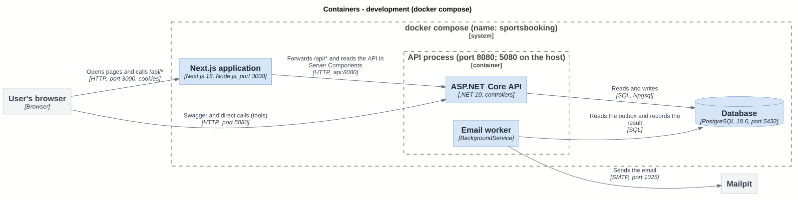
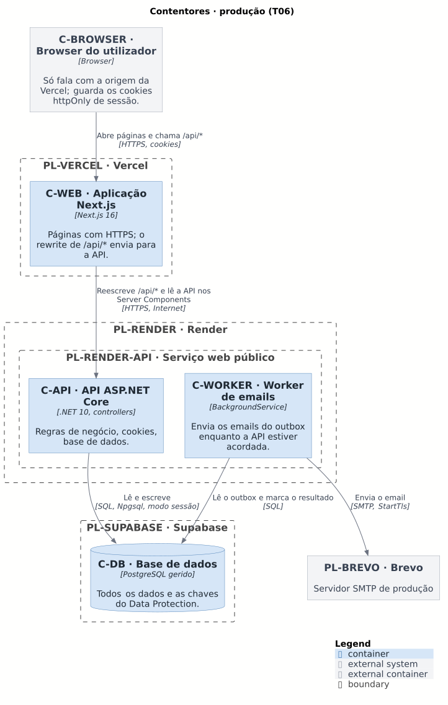
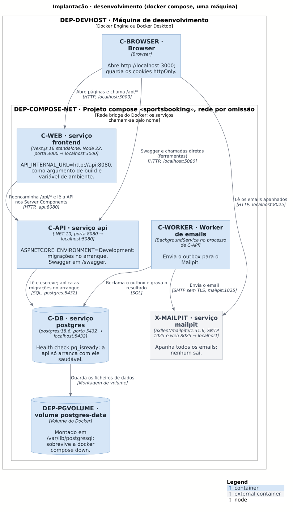
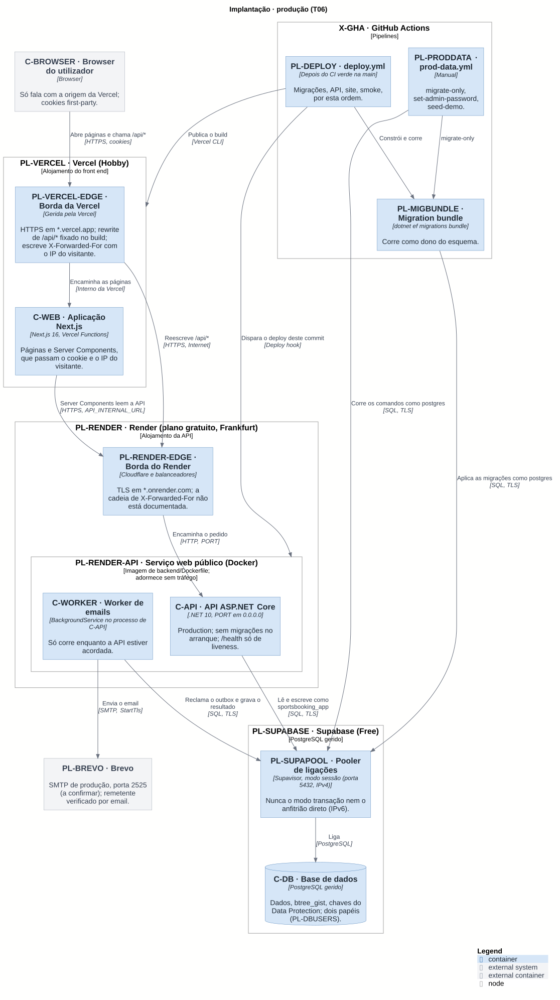

# C4: contexto, contentores e implantação

<!-- Modelo C4 · níveis 1 (contexto) e 2 (contentores) e diagramas de implantação. Ver README.md. -->

Os diagramas C4 mais gerais do sistema: o contexto (nível 1), os contentores (nível 2) e a implantação, em desenvolvimento e em produção. Os componentes (nível 3) e o código (nível 4) estão na [vista lógica](../4plus1/logical.md), e os diagramas de sequência na [vista de processo](../4plus1/process.md). Os ids estão no [inventário](../inventory.md); os `.puml` e os SVG de todos os diagramas estão ao lado, em `c4/` e `4plus1/` (fontes) e em `out/` (desenhos).

Para cada nível, para quem é e que decisão documenta:

- **Contexto** (nível 1). **Para:** quem avalia, produto, recém-chegados. **Decisão documentada:** um só marketplace, com uma conta de jogador que serve em todos os clubes de todos os donos e sem sites por dono ([ADR 0005](../adr/0005-marketplace-unico.md)), e três áreas (jogador, dono, admin) sobre a mesma API ([ADR 0001](../adr/0001-uma-app-tres-areas.md)).
- **Contentores** (nível 2). **Para:** recém-chegados e quem opera. **Decisão documentada:** o browser vê uma só origem, o que mantém os cookies de sessão first-party e dispensa CORS ([ADR 0002](../adr/0002-sessao-em-cookies-httponly.md)); o worker de emails corre no processo da API e lê o outbox ([ADR 0004](../adr/0004-outbox-para-emails.md)).
- **Implantação.** **Para:** quem faz deploy e opera. **Decisão documentada:** a produção na Vercel, no Render e no Supabase, com o Brevo para o email ([ADR 0009](../adr/0009-alvo-de-implantacao.md)); o desenvolvimento é o docker compose.

## Nível 1 · Contexto do sistema

<!-- C4 nível 1 · vista 4+1: cenários (contexto de uso). Ver README.md. -->

### Diagrama do contexto

Fonte: [01-context.puml](01-context.puml). Todos os elementos existem; os de produção (ids `PL-`) estão em funcionamento desde 2026-11-09 (T06).

### Âmbito

A App de Reservas de Campos é um **mercado único**: um só sistema onde jogadores reservam campos (futsal, futebol 7, padel, ténis) em clubes portugueses. Um jogador tem uma conta que serve em todos os clubes de todos os donos; não há sites nem domínios por dono. O mesmo sistema tem três áreas (jogador, dono, admin) sobre a mesma API. Não há pagamentos: a reserva guarda o preço do momento.

Fora do âmbito: pagamentos, aplicações móveis, integração com outros sistemas de reservas, reservas depois da meia-noite (limitação conhecida do MVP) e qualquer forma de o admin ver dados pessoais dos jogadores.

### Pessoas

| Id | Papel | O que faz com o sistema |
| --- | --- | --- |
| P-VIS | Visitante | Pesquisa clubes e vê horários livres; para reservar vai ao login. |
| P-JOG | Jogador | Reserva (um slot ou uma série semanal), vê e cancela as suas reservas, recebe emails. |
| P-DONO | Dono | Gere clubes, campos, horários, bloqueios, preços e o calendário; reserva para clientes; marca faltas. |
| P-ADMIN | Admin | Vê contagens e gráficos e desativa ou reativa donos. Só existe por seed. |
| P-CLI | Cliente sem conta | Não usa o sistema: pede ao clube, e o dono reserva em nome dele. Não recebe email. |
| P-OPS | Operador | Arranca a aplicação, define a configuração e corre `seed-demo` e `set-admin-password`. |

### Sistemas externos

| Id | Sistema | Ligação |
| --- | --- | --- |
| X-SMTP | Servidor SMTP | A aplicação envia por SMTP os emails de reservas e de contas. Em desenvolvimento é o X-MAILPIT (nada sai para fora); em produção é o PL-BREVO. |
| PL-BREVO | Brevo | O servidor SMTP de produção. |
| PL-VERCEL | Vercel | A plataforma onde o site corre. É só uma caixa: o que contém está nos [contentores](#diagrama-dos-contentores). |
| PL-RENDER | Render | A plataforma onde a API corre. É só uma caixa: o que contém está nos [contentores](#diagrama-dos-contentores). |

O CI (X-GHA) e o repositório (X-GH) não fazem parte do uso do sistema e não aparecem aqui; estão na vista de implantação.

### Notas do contexto

- A Vercel e o Render (T06) aparecem como sistemas externos para marcar que o alojamento é uma escolha de implantação e não do sistema. Nenhuma regra de negócio depende deles.
- O envio de email nunca bloqueia uma reserva: a aplicação grava o email num outbox e envia-o depois (ver [4plus1/process.md](../4plus1/process.md)).

## Nível 2 · Contentores

<!-- C4 nível 2 · vista 4+1: de processo. Ver README.md. -->

Dois diagramas: o que corre hoje em desenvolvimento e o que corre em produção. Em ambos o browser vê **uma só origem**, o que mantém os cookies de sessão first-party e dispensa CORS.

### Diagrama dos contentores

#### Desenvolvimento (docker compose)

Fonte: [02-containers-dev.puml](02-containers-dev.puml).

#### Produção (T06)

Fonte: [02-containers-prod.puml](02-containers-prod.puml). **Em produção desde 2026-11-09 (T06).**

### Contentores

| Id | Tecnologia | Responsabilidade | Dono de |
| --- | --- | --- | --- |
| C-BROWSER | Browser | Corre os Client Components e guarda os cookies httpOnly `access_token` e `refresh_token`. Fala só com C-WEB (em desenvolvimento, também com a API na 5080, para o Swagger). | Os cookies de sessão. |
| C-WEB | Next.js 16 (App Router, imagem `standalone`), porta 3000 | Serve as áreas do jogador, do dono e do admin. Os Server Components chamam a API pelo URL interno, a passar o cookie do utilizador; os Client Components chamam `/api/*` na mesma origem. Reencaminha `/api/*` para a API (WEB-REWRITE). | Nenhum dado: não acede à base de dados. |
| C-API | .NET 10, ASP.NET Core, porta 8080 (5080 no anfitrião, só em desenvolvimento) | Única dona das regras de negócio, da autenticação (JWT e refresh em cookies), da autorização por perfil e por dono, dos erros ProblemDetails e do rate limiting. Verifica o `Origin` dos pedidos que alteram dados. | Todas as regras e todo o acesso a C-DB. |
| C-WORKER | `BackgroundService` no processo da API | Lê o outbox, compõe e envia os emails com novas tentativas; usa `SKIP LOCKED`, por isso pode correr em várias instâncias. | O envio dos emails (o outbox em si está em C-DB). |
| C-DB | PostgreSQL 18.6 (desenvolvimento); PostgreSQL gerido (produção, T06) | Guarda os dados, impõe as regras que não podem falhar (sem reservas confirmadas sobrepostas, histórico de donos só de acrescentar) e guarda as chaves do Data Protection. | Os dados e o esquema. |

C-CLI (`seed-demo` e `set-admin-password`) é o mesmo executável da API sem arrancar o servidor, por isso não tem caixa própria nestes diagramas.

### Comunicação entre contentores

**Desenvolvimento**

- C-BROWSER → C-WEB: HTTP na porta 3000, com cookies. É a entrada normal.
- C-WEB → C-API: o Next.js reencaminha `/api/*` para `http://api:8080`, e os Server Components leem a API no mesmo endereço (`API_INTERNAL_URL`). O endereço é argumento de build (os rewrites ficam fixados no build) e variável de ambiente em execução.
- C-BROWSER → C-API: a API também está publicada na porta 5080 (Swagger em `/swagger`), e `http://localhost:5080` é uma das origens aceites em Development. É uma entrada direta para ferramentas, fora do caminho normal.
- C-API e C-WORKER → C-DB: SQL com Npgsql, `Host=postgres;Port=5432`.
- C-WORKER → X-MAILPIT: SMTP na porta 1025, sem TLS; a interface web está na 8025.

**Produção (T06)**

- C-BROWSER → C-WEB: HTTPS, na origem da Vercel (PL-VERCEL). É a única origem que o browser conhece.
- C-WEB → C-API: HTTPS pela Internet, para o URL público do serviço da API no Render (PL-RENDER-API, `API_INTERNAL_URL`), tanto no rewrite de `/api/*` como nos Server Components. A API também se alcança diretamente: o `Origin` e os limites protegem-na, e os limites por IP são só de melhor esforço.
- C-API e C-WORKER → C-DB (PL-SUPABASE): SQL pelo pooler em modo sessão, como `sportsbooking_app`.
- C-WORKER → PL-BREVO: SMTP na porta 2525 com StartTls (a confirmar), porque o plano gratuito do Render bloqueia as portas 25, 465 e 587.
- Cookies: são httpOnly e Secure; o `refresh_token` tem `Path=/api/auth`. Como o browser só conhece a origem da Vercel, são first-party. A API verifica que o `Origin` é o do site (`Security__AllowedOrigins__0`).

### Notas dos contentores

- **O proxy reverso é o Next.js, não o Caddy.** Em desenvolvimento e no compose é C-WEB que reencaminha `/api/*`; em produção é o rewrite do Next.js, servido pela Vercel. O desenho antigo (Caddy numa máquina virtual, em `docs/stack.md`) não foi adotado (ver a [ADR 0009](../adr/0009-alvo-de-implantacao.md)).
- **O IP do cliente.** Sem proxy configurado, a API ignora `X-Forwarded-For` e usa o endereço da ligação; é assim no compose, porque o rewrite passa à frente um `X-Forwarded-For` enviado pelo browser. Em produção a configuração é outra e é provisória (ver a [secção 4.4 da vista física](../4plus1/physical.md#44-o-ip-do-cliente)).
- O worker corre no processo da API: em produção (T06) os emails e lembretes só saem enquanto a API estiver acordada.
- As migrações correm no arranque da API só em desenvolvimento. Em produção aplica-as o GitHub Actions, com um migration bundle, como dono do esquema (ver a [secção 4.8 da vista física](../4plus1/physical.md#48-onde-correm-as-migrações-e-os-comandos)).

## Implantação

<!-- Diagramas de implantação do C4 · vista 4+1: física. Ver README.md. -->

Onde corre cada contentor, em desenvolvimento (que existe) e em produção (em funcionamento desde 2026-11-09, T06). As secções são as da [vista física](../4plus1/physical.md), que tem as restantes: a 2 (integração contínua), a 4 (rede e confiança), a 5 (riscos) e a 6 (notas).

### 1. Desenvolvimento (docker compose)

Fonte: [04-deployment-dev.puml](04-deployment-dev.puml).

Uma máquina (DEP-DEVHOST) com Docker. `docker compose up --build` cria o projeto `sportsbooking` com a rede por omissão do compose (DEP-COMPOSE-NET), onde os serviços se chamam pelo nome (`api`, `postgres`, `mailpit`).

| Serviço | Elemento | Imagem ou build | Portas (anfitrião → contentor) | Volumes | Arranca depois de | Ambiente (do `docker-compose.yml`) |
| --- | --- | --- | --- | --- | --- | --- |
| `postgres` | C-DB | `postgres:18.6` | `5432 → 5432` | `postgres-data` (DEP-PGVOLUME) em `/var/lib/postgresql` | — | `POSTGRES_DB`, `POSTGRES_USER`, `POSTGRES_PASSWORD` (do `.env`, por omissão `sportsbooking`). Health check `pg_isready` a cada 5 s. |
| `mailpit` | X-MAILPIT | `axllent/mailpit:v1.31.6` | `8025 → 8025` (web), `1025 → 1025` (SMTP) | — | — | — |
| `api` | C-API, C-WORKER | build de `./backend` (`backend/Dockerfile`: SDK 10.0 → `aspnet:10.0`, utilizador `$APP_UID`, `EXPOSE 8080`) | `5080 → 8080` | — | `postgres` saudável, `mailpit` arrancado | `ASPNETCORE_ENVIRONMENT=Development`; `ConnectionStrings__Default` (`Host=postgres;Port=5432;…;GSS Encryption Mode=Disable`); `AdminSeed__Email`/`AdminSeed__Password` (de `ADMIN_SEED_*` no `.env`, vazios por omissão); `Email__Host=mailpit`, `Email__Port=1025`, `Email__Security=None`. |
| `frontend` | C-WEB | build de `./frontend` (`frontend/Dockerfile`: `node:22-alpine`, `output: "standalone"`, utilizador `node`) com o argumento de build `API_INTERNAL_URL` | `3000 → 3000` | — | `api` (arrancado, não saudável) | `API_INTERNAL_URL=http://api:8080`, definido uma vez (`x-api-internal-url`) e usado como argumento de build e como variável de ambiente. |

O que vem do `appsettings.Development.json` (porque o ambiente é Development) e não do compose: `Jwt:SigningKey` (chave só de desenvolvimento), `Email:FromAddress`, `PublicSite:BaseUrl=http://localhost:3000` e `Security:AllowedOrigins` (`http://localhost:3000` e `http://localhost:5080`).

**Consequências do ambiente Development:**

- A API aplica as migrações no arranque (`Program.cs`), corre o seed do admin e mostra o Swagger em `/swagger` (só em Development).
- O browser fala com `http://localhost:3000`; os cookies são `Secure` mas os browsers aceitam-nos em `localhost` sem HTTPS (comentário em `Api/Auth/AuthCookies.cs`).
- A API tem uma segunda entrada, `localhost:5080`, para ferramentas ([Notas de arquitetura](../README.md#limitações-conhecidas), 1). O PostgreSQL também está publicado em `localhost:5432`, para correr a API fora do Docker (`dotnet run`, com a ligação do `appsettings.Development.json`) e para clientes SQL.
- Os dados ficam no volume `postgres-data`: sobrevivem a `docker compose down` e só se apagam com `docker compose down -v`.
- Os comandos de linha (C-CLI) correm como `docker compose run --rm api seed-demo` (ou `set-admin-password`, com `ADMIN_NEW_PASSWORD`): um contentor de curta duração na mesma rede.

### 3. Produção (T06)

Fonte: [04-deployment-prod.puml](04-deployment-prod.puml). **Em produção desde 2026-11-09 (T06).** Os passos manuais estão no [runbook](../../deployment/runbook.md).

| Nó ou serviço | Elemento | Corre | Público? | Nota |
| --- | --- | --- | --- | --- |
| Vercel (Hobby) | PL-VERCEL, PL-VERCEL-EDGE | C-WEB | Sim, em `https://<projeto>.vercel.app` | **A origem que o browser conhece.** O rewrite de `/api/*` fica fixado no build. |
| Render (gratuito) | PL-RENDER, PL-RENDER-EDGE, PL-RENDER-API | C-API com C-WORKER, imagem de `backend/Dockerfile` | **Sim**, em `https://<serviço>.onrender.com` | Adormece ao fim de 15 minutos sem tráfego. Deploy automático desligado. |
| Supabase (gratuito) | PL-SUPABASE, PL-SUPAPOOL, C-DB | PostgreSQL gerido e o pooler | Sim (endpoint na Internet, com palavra-passe e TLS) | Sempre pelo pooler em modo sessão (secção 4.6). |
| Brevo | PL-BREVO | SMTP | — (fornecedor) | Porta 2525 com StartTls (confirmado no primeiro deploy); remetente verificado por email. |
| GitHub Actions | X-GHA, PL-DEPLOY, PL-PRODDATA, PL-MIGBUNDLE | `deploy.yml`, `prod-data.yml` | — | Secção 4.8. |

## Elementos de cada diagrama

As caixas dos diagramas mostram só o nome e, entre parênteses retos, a tecnologia. A responsabilidade de cada elemento, tal como era escrita dentro da caixa, está nestas tabelas; a correspondência entre nomes e ids está na [secção 12 do inventário](../inventory.md#12-nomes-e-aliases-nos-diagramas).

### Contexto do sistema

Fonte: [01-context.puml](01-context.puml).

| Nome | Tecnologia | Responsabilidade |
| --- | --- | --- |
| Visitante | — | Pesquisa clubes e vê os horários livres, sem sessão. |
| Jogador | — | Reserva, cancela e vê as suas reservas. |
| Dono | — | Gere clubes, campos, calendário e reservas. |
| Admin | — | Dono da plataforma: contagens e estado dos donos. |
| Cliente sem conta | — | Pede ao clube uma reserva; não usa o sistema. |
| Operador | — | Arranca a aplicação e define a configuração. |
| App de Reservas de Campos | — | Mercado único para reservar campos (futsal, futebol 7, padel, ténis) em clubes portugueses. |
| Servidor SMTP | — | Recebe os emails da aplicação. Em desenvolvimento é o X-MAILPIT. |
| Brevo | — | O servidor SMTP de produção. |
| Vercel | — | Onde o site vai correr. |
| Render | — | Onde a API vai correr. |

### Contentores: desenvolvimento

Fonte: [02-containers-dev.puml](02-containers-dev.puml).

| Nome | Tecnologia | Responsabilidade |
| --- | --- | --- |
| Browser do utilizador | Browser | Corre os Client Components; guarda os cookies httpOnly de sessão. |
| Aplicação Next.js | Next.js 16, Node.js, porta 3000 | Serve as páginas e reencaminha /api/\* para a API (WEB-REWRITE); é o proxy reverso de hoje. |
| API ASP.NET Core | .NET 10, controllers | Regras de negócio, autenticação por cookies, acesso à base de dados. |
| Worker de emails | BackgroundService | Lê o outbox e envia os emails com novas tentativas. |
| Base de dados | PostgreSQL 18.6, porta 5432 | Todos os dados, as regras que não podem falhar e as chaves do Data Protection. |
| Mailpit | — | SMTP 1025, interface web 8025 |

### Contentores: produção

Fonte: [02-containers-prod.puml](02-containers-prod.puml).

| Nome | Tecnologia | Responsabilidade |
| --- | --- | --- |
| Browser do utilizador | Browser | Só fala com a origem da Vercel; guarda os cookies httpOnly de sessão. |
| Aplicação Next.js | Next.js 16 | Páginas com HTTPS; o rewrite de /api/\* envia para a API. |
| API ASP.NET Core | .NET 10, controllers | Regras de negócio, cookies, base de dados. |
| Worker de emails | BackgroundService | Envia os emails do outbox enquanto a API estiver acordada. |
| Base de dados | PostgreSQL gerido | Todos os dados e as chaves do Data Protection. |
| Brevo | — | Servidor SMTP de produção |

### Componentes da API: visão geral

Fonte: [03-components-api-overview.puml](03-components-api-overview.puml).

| Nome | Tecnologia | Responsabilidade |
| --- | --- | --- |
| Aplicação Next.js | Next.js 16 | Reencaminha /api/\* do browser e lê a API nos Server Components. |
| Contas e sessões | AuthController, App/Accounts, App/Auth, Inf/Identity, Inf/Auth | Registo, login, logout, me, refresh, recuperação de palavra-passe. |
| Catálogo público | ClubsController, LocalitiesController, App/Catalog | Pesquisa, localidades, página do clube, slots livres. Só leitura, anónimo. |
| Reservas do jogador | BookingsController, MeBookingsController | Uma reserva, série semanal, as minhas reservas, cancelar. |
| Clubes do dono | ManageClubsController, ClubService | Criar, listar e editar clubes. |
| Campos | ManagePitchesController, PitchService, OwnedPitches | Campos do clube; OwnedPitches é a entrada nos campos do dono. |
| Horários | ManagePitchScheduleController, PitchScheduleService | Horário semanal e pré-visualização dos slots. |
| Bloqueios | ManageBlocksController, BlockService | Bloquear e remover períodos. |
| Faixas de preço | ManagePriceBandsController, PriceBandService | Faixas de preço por dia e hora. |
| Calendário e reservas do dono | ManageCalendarController, ManageBookingsController | Calendário, detalhes, cancelar, reservar para cliente, faltas. |
| Estatísticas do dono | ManageStatisticsController, OccupationService | Ocupação, horas, receita. |
| Administração | AdminController, App/Admin, Inf/Admin | Totais, gráficos, donos, top 10, desativar e reativar. |
| Notificações (outbox) | App/Notifications, Inf/Notifications | Põe emails no outbox; compõe-nos quando são enviados. |
| Slots de um dia e «livre» | PitchDayCalendar, DaySlot | O único cálculo dos slots de um dia com bloqueios e reservas. |
| Persistência | IAppDbContext, AppDbContext | A vista da Application sobre a base de dados; migrações. |
| PostgreSQL | PostgreSQL 18.6 | Dados, exclusion constraint, triggers. |

### Componentes da API: reservas

Fonte: [03-components-api-bookings.puml](03-components-api-bookings.puml).

| Nome | Tecnologia | Responsabilidade |
| --- | --- | --- |
| Uma reserva | BookingService.CreateAsync | Valida, encontra o campo, confirma o dono ativo, tranca o campo, verifica o slot, preço de PriceForSlot, insere. |
| Série semanal | RecurringBookingService, RecurringOccurrences | Pré-visualização e criação: cada data em BookOneAsync, com o seu trinco e a sua transação. |
| As minhas reservas e cancelar | MyBookingsService, BookingCancellationService | Lista e detalhe filtrados pelo jogador da sessão; cancelar com Booking.CancelByPlayer. |
| Store das reservas | IBookingStore, Inf/Bookings/BookingStore | TryAddAsync e TrySaveChangesAsync: 23P01 → false (409 slot_taken). |
| Reservas do dono | ClubBookingService, ClubCalendarService | Reserva para cliente, cancelar com motivo, marcar e anular falta, calendário. |
| Autorização por dono | OwnedClubs, OwnedPitches, OwnedBookings | Só os clubes, campos e reservas do dono da sessão (404 igual para o de outro dono). |
| Verificação do slot | BookingSlotCheck.CheckAsync | Campo ativo → janela → grelha (SlotStartingAt) → começado → bloqueios. Não olha para outras reservas. |
| Trinco do campo | IPitchLock, Inf/Pitches/PitchLock | Transação + SELECT … FOR UPDATE na linha do campo. |
| Clubes visíveis | VisibleClubs | Dono ativo e pelo menos um campo ativo. |
| Contas | IAccountStore.IsActiveAsync | O dono do clube não está desativado. |
| Outbox | BookingEmailOutbox | Junta as mensagens ao mesmo IAppDbContext, antes do SaveChanges de quem chama. |
| pitches | Tabela | A linha trancada pelo CC-LOCK. |
| blocks | Tabela | Bloqueios do campo. |
| bookings | Tabela | Reservas; nunca apagadas. |
| bookings_no_overlap | Exclusion constraint (GiST) | Nenhuma reserva Confirmed se sobrepõe no mesmo campo. |
| outbox_messages | Tabela | Emails por enviar. |

### Componentes da API: contas

Fonte: [03-components-api-accounts.puml](03-components-api-accounts.puml).

| Nome | Tecnologia | Responsabilidade |
| --- | --- | --- |
| Registo | AccountRegistrationService | Jogador e dono; aceitação dos Termos (400 terms_not_accepted); 409 email_taken; começa a sessão. |
| Login | LoginService | Qualquer falha é o mesmo 401 invalid_credentials. |
| Recuperação | PasswordResetService, Inf/Auth/PasswordResetStore, AccountEmailBuilder | Pedido (202 sempre) e confirmação; o token só é feito pelo worker. |
| Contas no Identity | IAccountStore, Inf/Identity/AccountStore, UserManager&lt;AppUser> | Cria, autentica (FallbackPasswordHash, LoginLockout), procura, IsActiveAsync. |
| Sessões e cookies | ISessionService, Inf/Auth/SessionService, Api/Auth/AuthCookies | JWT de 15 min (sub, role) e refresh de 7 dias em cookies httpOnly; rotação atómica. |
| Data Protection | Identity DataProtectorTokenProvider | Faz e verifica os tokens de recuperação; lê o relógio do sistema. |
| Seed do admin | AdminAccountSeeder | No arranque; único código que dá o perfil Admin. |
| set-admin-password | AdminPasswordCommand | Troca o hash e revoga as sessões do admin. |
| Estado dos donos | AdminOwnerStatusService, Inf/Admin/OwnerStatusStore | Desativa e reativa donos numa transação. |
| Outbox | OutboxMessage | password_reset, password_changed. |
| users, roles, user_roles | Tabelas (Identity) | deactivated_at, registered_at, accepted_terms_version, terms_accepted_at, email normalizado único. |
| refresh_tokens | Tabela | Só o SHA-256 do valor. |
| data_protection_keys | Tabela | Chaves dos tokens. |
| owner_status_changes | Tabela, só de acrescentar | Histórico dos donos. |
| outbox_messages | Tabela | Emails por enviar. |

### Componentes da API: notificações

Fonte: [03-components-api-notifications.puml](03-components-api-notifications.puml).

| Nome | Tecnologia | Responsabilidade |
| --- | --- | --- |
| Reservas do jogador | BookingService, RecurringBookingService, BookingCancellationService | Reserva, série, cancelamento. |
| Reservas do dono | ClubBookingService.CancelAsync | Cancelamento pelo clube (a reserva para cliente não gera email). |
| Recuperação | PasswordResetStore, AccountEmailBuilder | Põe na fila; no envio, faz o token e o link. |
| Pôr no outbox | BookingEmailOutbox, OutboxMessage.Create | Junta a mensagem ao IAppDbContext de quem chama; não grava. |
| Ciclo do worker | OutboxDispatcher | Um scope por passagem; espera o intervalo no TimeProvider; Outbox:Enabled. |
| Processar o que está devido | OutboxProcessor.ProcessDueAsync | SKIP LOCKED; envia, ignora, desiste ou volta a tentar (OutboxRetry). |
| Compor os emails | BookingEmailComposer, BookingSeriesEmailComposer, BookingNotificationComposer, AccountEmailComposer | pt-PT, hora de Lisboa, texto e HTML. |
| Enviar | IEmailSender, SmtpEmailSender (MailKit) | Uma ligação por mensagem. |
| Data Protection | Identity | Token de recuperação (relógio do sistema). |
| Relógio injetado | TimeProvider | A hora de agora e a espera entre passagens. |
| outbox_messages | Tabela | ck_outbox_messages_one_outcome: no máximo um resultado. |
| ux_outbox_messages_booking_notification | Índice único parcial | Um lembrete e um aviso ao dono por reserva. |
| users | Tabela | Endereço e nome atuais do destinatário. |
| bookings | Tabela | Estado atual da reserva do lembrete e do aviso. |
| Servidor SMTP | — | Mailpit em desenvolvimento |

### Componentes do front end: rotas e guardas

Fonte: [03-components-web.puml](03-components-web.puml).

| Nome | Tecnologia | Responsabilidade |
| --- | --- | --- |
| Browser | Browser | Corre os Client Components; guarda os cookies httpOnly. |
| proxy.ts | Next.js proxy | Em /manage/\*, /admin/\* e /bookings escreve o caminho pedido em x-pathname. Não renova sessões. |
| Área do jogador | app/(player) | / (pesquisa no endereço), /clubs/[slug] (escolha ?pitch=&date=&slot=&weeks= no endereço), /bookings. |
| Área do dono | app/manage | Clubes, campos, calendário (?date=&view=&pitch=&booking= no endereço), estatísticas. |
| Área do admin | app/admin | Painel e página de um dono; filtros no endereço. |
| Páginas de conta | app/login, register, forgot-password, reset-password | Formulários de conta. |
| Guardas | AreaGuard, PlayerGuard, GuestOnly, lib/auth/redirects | Redirecionam por perfil no servidor; a API decide sempre. |
| Chamadas no servidor | lib/server (server-only) | getSessionAccount (cookie do utilizador), loadPublicClub (sem cookies), loadAdminStats; no-store. |
| Cliente da API | lib/api/client.ts (corre no browser) | apiRequest/apiJson: ProblemDetails → ApiError; um refresh partilhado no 401 (Web Lock). |
| Rewrites | next.config.ts | /api/\* → API_INTERNAL_URL/api/\*; cabeçalhos de /reset-password. |
| API ASP.NET Core | .NET 10 | Regras, sessões e dados. |

### Componentes do front end: funcionalidades

Fonte: [03-components-web-features.puml](03-components-web-features.puml).

| Nome | Tecnologia | Responsabilidade |
| --- | --- | --- |
| Área do jogador | app/(player) | /, /clubs/[slug], /bookings |
| Páginas de conta | app/login, register, … | Login, registo, recuperação. |
| Área do dono | app/manage | /manage/... |
| Área do admin | app/admin | /admin, /admin/owners/[id] |
| Contas | features/auth | Formulários; useCurrentUser (chave [auth, me]). |
| Catálogo | features/catalog | Pesquisa no endereço; slots públicos. |
| Reservar | features/booking | Escolha no endereço (selection.ts); série semanal. |
| As minhas reservas | features/my-bookings | Separador e página no endereço; cancelar. |
| Clubes do dono | features/clubs | Lista e formulário do clube. |
| Campos | features/pitches | Campos, horário, pré-visualização, bloqueios, faixas de preço. |
| Calendário | features/calendar | Vista no endereço (calendar-url.ts); layout por tempo real. |
| Estatísticas | features/statistics | Período e campo no endereço. |
| Admin | features/admin | Vista no endereço (admin-url.ts); gráficos. |

### Implantação: desenvolvimento

Fonte: [04-deployment-dev.puml](04-deployment-dev.puml).

| Nome | Tecnologia | Responsabilidade |
| --- | --- | --- |
| Browser | Browser | Abre http://localhost:3000; guarda os cookies httpOnly. |
| serviço frontend | Next.js 16 standalone, Node 22, porta 3000 → localhost:3000 | API_INTERNAL_URL=http://api:8080, como argumento de build e variável de ambiente. |
| serviço api | .NET 10, porta 8080 → localhost:5080 | ASPNETCORE_ENVIRONMENT=Development: migrações no arranque, Swagger em /swagger. |
| Worker de emails | BackgroundService no processo da API | Envia o outbox para o Mailpit. |
| serviço postgres | postgres:18.6, porta 5432 → localhost:5432 | Health check pg_isready; a api só arranca com ele saudável. |
| serviço mailpit | axllent/mailpit:v1.31.6, SMTP 1025 e web 8025 → localhost | Apanha todos os emails; nenhum sai. |
| volume postgres-data | Volume do Docker | Montado em /var/lib/postgresql; sobrevive a docker compose down. |

### Implantação: produção

Fonte: [04-deployment-prod.puml](04-deployment-prod.puml).

| Nome | Tecnologia | Responsabilidade |
| --- | --- | --- |
| Browser do utilizador | Browser | Só fala com a origem da Vercel; cookies first-party. |
| Borda da Vercel | Gerida pela Vercel | HTTPS em \*.vercel.app; rewrite de /api/\* fixado no build; escreve X-Forwarded-For com o IP do visitante. |
| Aplicação Next.js | Next.js 16, Vercel Functions | Páginas e Server Components, que passam o cookie e o IP do visitante. |
| Borda do Render | Cloudflare e balanceadores | TLS em \*.onrender.com; a cadeia de X-Forwarded-For não está documentada. |
| API ASP.NET Core | .NET 10, PORT em 0.0.0.0 | Production; sem migrações no arranque; /health só de liveness. |
| Worker de emails | BackgroundService no processo da API | Só corre enquanto a API estiver acordada. |
| Pooler de ligações | Supavisor, modo sessão (porta 5432, IPv4) | Nunca o modo transação nem o anfitrião direto (IPv6). |
| Base de dados | PostgreSQL gerido | Dados, btree_gist, chaves do Data Protection; dois papéis (PL-DBUSERS). |
| Brevo | — | SMTP de produção, porta 2525 (a confirmar); remetente verificado por email. |
| deploy.yml | Depois do CI verde na main | Migrações, API, site, smoke, por esta ordem. |
| prod-data.yml | Manual | migrate-only, set-admin-password, seed-demo. |
| Migration bundle | dotnet ef migrations bundle | Corre como dono do esquema. |
